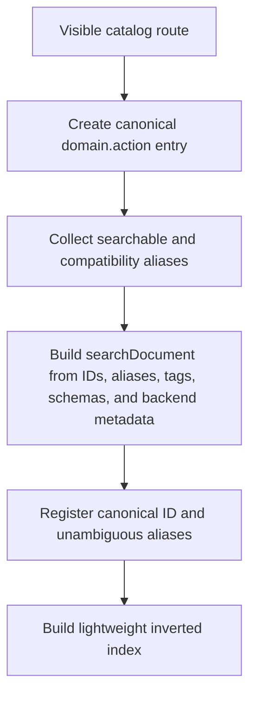
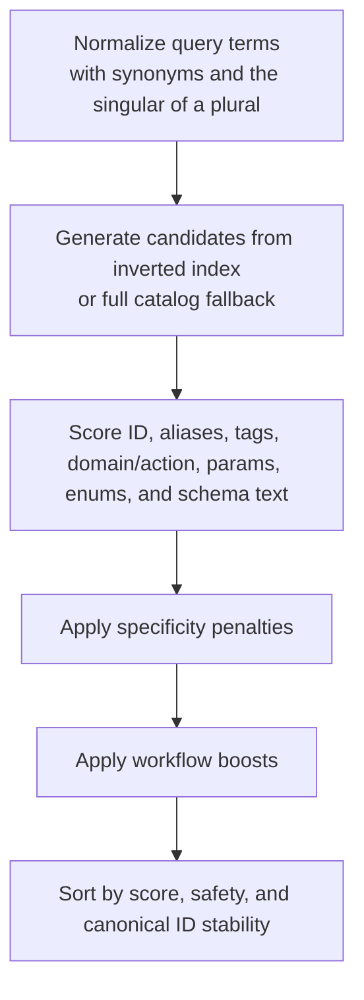
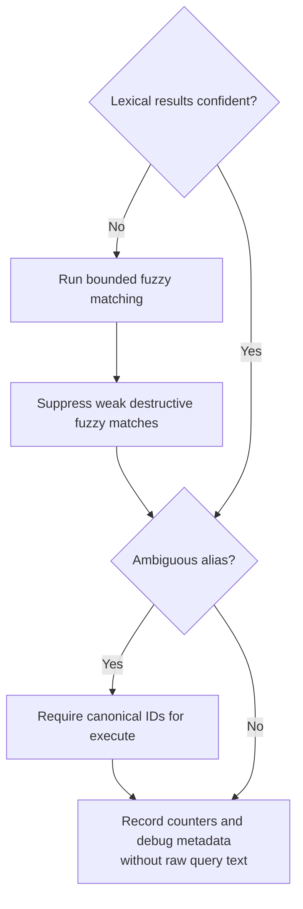

# Dynamic Search Ranker

> **Diátaxis type**: Explanation · **Audience**: 🛠️ Contributors & maintainers

This document describes the current dynamic action search ranker.

## Current Behavior

Dynamic mode builds the executable action registry eagerly when an MCP server instance is created. In stdio mode this happens during server startup. In HTTP mode this happens when the server for a configuration shape is created, on the first request of a credential with that shape (ADR-0020), after the tier is detected for that credential's pool entry and after token-scope filtering, read-only mode, safe mode, and excluded-tool filtering have been applied.

The current registry stores each visible action as an `actionEntry` with:

- Canonical `domain.action` ID.
- Backing meta-tool name.
- Domain and action names.
- Compatibility aliases.
- Curated and schema-derived tags.
- Required and optional params.
- Field-aware `searchDocument` metadata built from ID words, tool name, domain, action, aliases, tags, required params, optional params, schema property names, schema enum values, and compact schema description terms.
- Flat lower-case `SearchText` kept as a compatibility fallback during the ranker migration.
- Tokenized `SearchTokens` for fuzzy fallback.

Search first uses a lightweight inverted index to gather candidates from aliases, domains, actions, and indexed metadata tokens. If no bucket matches, it deliberately falls back to the full visible catalog so ranking remains deterministic instead of returning an accidental empty set. It then scores each normalized query term against typed action metadata, falling back to flat text for compatibility. Exact canonical IDs score highest, followed by aliases, tags, exact domain or action names, partial ID matches, partial domain or action matches, typed field matches, and broader flat text matches. Synonyms and verb alternatives are expanded before scoring, and a plural also matches the action ID as the singular the catalog spells (see [Plurals](#plurals)).

Callers may pass `explain:true` to `gitlab_find_action` to include deterministic scoring explanations. The default remains compact and omits explanations. Explanation mode reuses the same scoring path as non-explanation mode, so enabling explanations does not change ranking.

Search and describe results also include curated `related_actions` for workflows where ordering matters, such as comparing refs before generating release notes or checking tag/release state before deletion. These relationships are intentionally sparse and live with the action UX metadata next to usage hints.

No-match searches return a small `suggestions` list built from nearby indexed tokens plus common domains. This gives recovery guidance without exposing or dumping the full catalog.

Fuzzy matching is conservative. It runs when lexical search returns no matches or only low-confidence matches, ignores query tokens shorter than three characters, and uses bounded Levenshtein distance with a maximum of two edits. Fuzzy recovery is filtered so weak typo matches do not elevate destructive actions.

Long prompts are searched twice: once as the whole normalized query, and again through overlapping three- to six-term windows when the query is long enough. Segmented search runs for every query of five or more meaningful terms; the requested result limit plays no part in that decision. Each segment match receives a large window-size boost so multi-intent prompts can surface each relevant action without forcing the model to split the prompt perfectly.

`describe` and `execute` accept canonical action IDs and unambiguous aliases. Ambiguous aliases are rejected with repair guidance listing the valid canonical action IDs. Dynamic `execute` normalizes schema-safe parameter aliases before dispatch, logs name-only normalization metadata at debug level, and reports unknown or missing parameters with valid schema fields before calling the route handler. It does not silently drop unsupported security-sensitive fields such as `masked` or `protected`; callers receive validation feedback and must retry with fields accepted by the selected action schema. Destructive actions still require explicit `confirm:true` before execution.

## Ranking Weights

| Signal                                      | Weight |
| ------------------------------------------- | -----: |
| Exact canonical action ID                   |    120 |
| Exact alias                                 |    100 |
| Exact tag                                   |     90 |
| Exact domain or action                      |     80 |
| Split domain or action word                 |     65 |
| Partial canonical ID                        |     55 |
| Partial domain or action                    |     45 |
| Required param match                        |     35 |
| Schema enum match                           |     28 |
| Typed field or raw flat-text match          |     25 |
| Optional param match                        |     22 |
| Synonym or verb alternative flat-text match |     18 |
| Schema description match                    |     12 |

The base score is scaled by the matched-term ratio. One- or two-term queries must match all meaningful terms; longer queries may miss one term so incidental words do not suppress a good action. The top result is marked `low_confidence` if its score is below 80 or its margin over the second result is below 15.

Additional scoring adjustments:

| Adjustment                                         | Value |
| -------------------------------------------------- | ----: |
| Verb-intent boost for matching read/write/workflow |    16 |
| Verb-intent penalty for mismatched intent          |   -24 |
| Destructive verb boost for delete/remove/revoke    |    48 |
| Required parameter signal boost                    |    10 |
| Optional parameter signal boost                    |     5 |
| Compound tag match boost                           |    50 |
| Unmatched action-specific word penalty, per word   |   -60 |
| Segmented-search boost, per matched window term    |    90 |

A few intent-specific boosts sit beside these in `ranking.go`, each narrow to one action family whose generic signals ranked wrongly in the regression corpus: comparing refs (90), resolving a git remote URL through `discover_project.resolve` (95), fetching one project by path (220), searching projects (90), service accounts (80, plus 30 for the scope), CI job token scope (80), and code search and the current user (1000 each). The last two are deliberately large: both actions pass the match-ratio filter through an intent bypass while matching only a couple of tokens of a long query, so their scaled base score is tiny next to a competitor that stacks many matches, and the boost has to exceed that deficit outright. One more is general rather than narrow: a read of a plural lifts the actions that list what it names (30), described under [Plurals](#plurals).

## Plurals

A query names its object in the plural far more often than the catalog does: a model writes `list issues` or `branches list`, and the actions are `issue.list` and `branch.list`. Search therefore matches a plural to the singular the catalog spells, as one rule for every noun rather than a synonym per plural (issue 1121):

- **The singular is derived, not added.** `searchIndex.searchTerms` undoes the three regular English plurals of each term, `ies` for `y` (`policies`), a plain `s` (`issues`) and `es` (`branches`), in that order, and keeps the first candidate that is a domain or action word of the catalog's action IDs in `searchTerm.Singular`. The term's alternatives stay what the caller wrote and its synonyms.
- **The vocabulary is the gate.** A word that only ends in `s` has no singular, because the catalog spells none: `access`, `status` and `alias` would become `acces`, `statu` and `alia`. The vocabulary is the words of the action IDs rather than every indexed token, since schema descriptions would give `its` the singular `it` and `is` the singular `i`, short enough to be a substring of most IDs. A plain `s` is tried before `es`, so `notes` reads as `note` even where the catalog also spells `not`, and a misspelled `branchs` still reaches `branch`.
- **The singular matches the action ID only, one step below.** It scores against the action's domain and action name, the domain or action itself at 65 rather than 80 and a word of either at 45 rather than 65, so where the plural as the caller wrote it and the singular match the same part of two IDs, the one that spells the plural scores more: `list ssh keys` is `user.ssh_keys` before the deploy key lists, `download job artifacts` is the archive `job.artifacts` before `job.download_single_artifact`, and `search issues` is `search.issues`. The other signals still apply on top, so a penalty can reverse it: `statuses` alone answers `server.status`, whose action is the singular, because `repository.commit_statuses` spells the plural only as the second word of its action and loses 60 points for the first, which the query does not spell. It counts as spelling a word of the action name, so `deployment_list` is not penalized for `list deployments`.
- **Nothing else sees the singular.** Tags and compound tags, the parameter signals, the intents that read the query's words, the verb and destructive-action gates and the fuzzy pass read the alternatives, and the singular is not one of them. As an alternative it formed the compound tag `ssh key` with the word before it, gave every group and project list the service account intent for `list service accounts`, and doubled the cost of the fuzzy pass.
- **A read of a plural prefers the list.** A plural asks for many of the thing it names, so when the query reads (`list`, `show`, `get` and the other read verbs) or names no verb, a read-only action that lists the resource gains 30 points and counts as spelling the word `list` in its name: a list action whose domain is the singular or whose action name holds it (`issue.list`, `environment.deployment_list`), or an action named by the plural itself (`runner.jobs`). Without it `show issues` was decided by the action ID, `issue.get` and `issue.list` scoring alike. A query that writes, deletes, runs or diagnoses gains nothing, so `delete merged branches` keeps `branch.delete_merged` first, and neither does an action that changes what the plural names, so `artifacts` does not lift `job.delete_artifacts`. A singular that is only one word of a domain of two lifts nothing, so `list access requests` does not lift `merge_request.list`.
- **A verbless query has to describe the list.** With no verb the verb intent knows, the plural counts as asking for the list only when every other word is a word of the action's ID, the scope it lists in (`project merge requests`), or a filter the synonym table reads as a list (`open`, `my`, `merged`). A word that is none of these is a verb the classifier does not know, so `assign issues` and `close issues` lift no list.
- **Merge in merge request is a noun.** Merge is a workflow verb and the first word of `merge_request`, so every query about merge requests read as a request to merge one: `merge request` answered the destructive `merge_request.merge` with high confidence, and once the plural reached the domain `merge requests` did too. A verb that the next word completes into a domain name is that domain's first word (`searchTerm.Noun`): no verb of the query, and scored at most as a word of a domain, never as the action it also spells. Written in the plural, the pair also scores as the domain it names on that domain's actions (`searchTerm.Domain`), 80 for the word written as the catalog does and 65 for the plural, since the derived singular forms none of the compound tags the singular pair matches.

The synonym table keeps an entry keyed by a plural for what it adds beyond the derived singular: other words, such as `list` for `jobs` and `releases` or `refs` for `tags`, or the singular as a full alternative, which `tokens` keeps so that `list deploy tokens` still matches the tags `deploy token` and `token list`. The boost `release.list` used to have to itself was retired: the regression corpus and the pinned list queries rank it first with confidence through the plural rule.

A `ref` parameter no longer tags its action with `branch`, `tag` and `commit`. Those tags scored at the weight of a tag, above an action's own domain, so every action taking a ref claimed the three resources as strongly as their own domains: `list branch` tied `branch.list` with `pipeline.list` and was decided by the action ID, and `list commit` ranked `pipeline.list` over `repository.commit_list`. A required ref keeps a weaker claim, because it is the point the action works from: the commit a branch or a tag is created from, the branch a pipeline runs on, the ref a file is read at. When the query has a verb, a `branch`, `tag` or `commit` it names scores 65 on an action whose `ref` is required, as a word of a domain and a step below the action's own, and 45 when the query writes it in the plural, a step lower again as the singular is on the action ID, so `create branches from commits` is `branch.create` too (`refResourceMatch`). So `create branch from commit` is `branch.create` with high confidence, where with no claim at all `repository.commit_create`, which takes the branch to commit to, answered it, and `create tag from commit` is `tag.create` ahead of `branch.create`. A query with no verb names what it is about rather than where to start, so `pipeline for branch` does not make `pipeline.create` its answer. An optional ref only filters what its action lists or reads, and names nothing.

The cost of the rule is measured by `BenchmarkFind_PathologicalQuery`, which carries a query of catalog plurals beside the nonsense words for that reason: from a handful of words on, each plural reaches the actions its singular names and every pass scores a larger candidate set, so a query of them filling the length bound is now the costliest one the tool accepts. The figures are in the comment on `MaxSearchQueryLength`.

## Operational Limits

These constants are intentionally internal tuning values, not user-facing configuration knobs. They are documented here so maintainers can explain observed ranking behavior and update tests deliberately when changing them.

| Area                       | Current value                                                                                                            |
| -------------------------- | ------------------------------------------------------------------------------------------------------------------------ |
| `gitlab_find_action.limit` | Defaults to 20 results and is capped at 50                                                                               |
| Meaningful terms           | Query text is lower-cased, split on spaces, dots, underscores, and hyphens, then filtered through stopwords              |
| Plurals                    | A term ending in `ies`, `s` or `es` also matches the action ID as the first singular that is a word of the catalog's IDs |
| Stopwords                  | `a`, `an`, `and`, `as`, `at`, `by`, `for`, `from`, `in`, `of`, `on`, `or`, `please`, `the`, `to`, `using`, `via`, `with` |
| Required matched terms     | All terms for one- or two-term queries; all but one term for longer queries                                              |
| Fuzzy edit distance        | Maximum two Levenshtein edits                                                                                            |
| Fuzzy token length         | Query parts shorter than three characters are not fuzzy-matched                                                          |
| Fuzzy distance scores      | Distance 0 = 40, distance 1 = 34, distance 2 = 28, plus 2 when first letters match                                       |
| Fuzzy destructive safety   | Destructive fuzzy results require an exact destructive verb plus a resource/action/tag signal                            |
| Segmented search windows   | Three to six meaningful terms; segmented search runs for queries of five or more terms                                   |
| No-match suggestions       | Up to six nearby indexed tokens, then common fallback domains                                                            |
| Unknown action suggestions | Up to five nearby canonical action IDs                                                                                   |
| Unknown param suggestions  | Levenshtein recovery against valid params with maximum distance three                                                    |
| Markdown param guidance    | At most two parameter-guidance snippets in compact `gitlab_find_action` Markdown                                         |

## Alias Metadata

Dynamic aliases have explicit source metadata:

| Source              | Meaning                                                       |
| ------------------- | ------------------------------------------------------------- |
| `catalog`           | Native alias supplied by the canonical action catalog.        |
| `compatibility`     | Backward-compatible alias maintained by the dynamic registry. |
| `provider_observed` | Alias observed in model output and kept for repair tolerance. |
| `standalone`        | Alias associated with standalone dynamic-only actions.        |
| `deprecated`        | Alias retained only for temporary migration compatibility.    |

Aliases also carry a `Searchable` flag. Searchable aliases influence ranking and appear in the field-aware search document. Non-searchable aliases still canonicalize in `describe` and `execute`, but they do not influence search ranking. This is useful for compatibility aliases such as `repository_tree` that are safe to accept as input but too broad for discovery ranking.

Run the alias audit with:

```bash
go run ./cmd/audit_dynamic_aliases/
```

## Schema Signals And Param Repair

The dynamic search document keeps compact schema-derived terms for discovery:

- Required params score above optional params.
- Enum values can help queries that mention concrete states such as `opened` or `closed`.
- Property descriptions contribute low-weight terms so useful wording can help discovery without overpowering canonical action metadata.

Dynamic execution performs two param-normalization passes before dispatch:

- Common schema-safe aliases from `toolutil.NormalizeParamAliasesForSchemaWithExplanation`, such as `search` to `query` or `mr_iid` to `merge_request_iid`.
- Action-scoped aliases from `NormalizeActionScopedParamsWithExplanation`, such as `branch` to `ref` for `repository.file_get`, `status` to `scope` for `job.list`, and role-name conversion for access-level fields.

The explanation data records parameter names, source, and notes only. It never records parameter values. Normal dynamic output does not include this metadata; it is used for debug logging and tests.

## Search Flow Pseudocode

Registry build:



Candidate generation and scoring:



Fuzzy, ambiguity, and metrics:



## Observability

Dynamic search emits a structured debug log for each search with query length, result count, whether fuzzy recovery contributed results, whether the top result is low confidence, whether the query matched an ambiguous alias, the number of destructive fuzzy matches suppressed, and the top action ID. The raw query text is not logged.

Process-local runtime counters are available through `SearchRuntimeMetricsSnapshot()` for tests and future diagnostics. They count total searches, zero-result searches, fuzzy fallback searches, ambiguous alias queries, low-confidence searches, and destructive fuzzy suppressions.

Static registry metrics are available through `Registry.Metrics()` and are reported by:

```bash
go run ./cmd/audit_metrics/
```

The metrics include dynamic action count, search index token/posting counts, total aliases, searchable aliases, unsearchable aliases, and ambiguous aliases. The visible dynamic MCP tool count remains unchanged at two public tools: `gitlab_find_action` and `gitlab_execute_action`.

## Regression Corpus

The deterministic search corpus lives in `internal/tools/dynamic/testdata/dynamic_search_queries.json`. It covers exact canonical IDs, aliases, provider-invented aliases, natural language, plurals, typo recovery, ambiguous aliases, long multi-intent prompts, destructive prompts, schema-param prompts, and no-match prompts. `TestSearch_CurrentHighConfidenceQueriesRemainStable` beside it pins the list queries a model sends most, in the plural and the singular and in both word orders, the reads of merge requests, a plural an action's own name spells, a plural of a word an intent reads, a plural whose singular a compound tag of a write spells (`protected branches`) and the plural of artifact with and without a verb, and requires each of them but the download of artifacts to be high confidence, so a ranking decided by the tie-break fails there. `TestSearch_RequiredRef_NamesThePointItsActionStartsFrom` pins the branch and the tag created from a commit the same way.

Run it after ranker changes with:

```bash
go test ./internal/tools/dynamic/ -run TestDynamicSearchCorpus -count=1
```

## Backend Metadata

The internal search document includes backend-oriented fields: `Backend`, `Capability`, `Resource`, `Operation`, and `Scope`. Current GitLab entries default `Backend` to `gitlab`, infer a coarse capability from the domain, and derive scope from schema fields such as `project_id` or `group_id`.

This does not expose non-GitLab actions. It prepares the ranker for future DADL-like or cross-backend catalogs by giving each action a stable place for provider, resource, operation, and scope metadata. Backend terms such as `github`, `jira`, `pull request`, `merge request`, `pr`, `mr`, `issue`, and `ticket` normalize to the current GitLab catalog vocabulary so searches remain useful while action IDs stay GitLab-only.

## Regression Checks

The following checks passed before ranker refactoring began:

```bash
go test ./internal/tools/dynamic/ -run 'Test.*Search|Test.*Describe|Test.*Execute|Test.*Fuzzy' -count=1
```

## Benchmark Command

The current benchmark command is:

```bash
go test ./internal/tools/dynamic/ -bench BenchmarkSearch_BaselineMetaCatalog -benchmem -run '^$'
```

Keep benchmark snapshots in ignored local reports or implementation plans when they are needed for a specific optimization decision. This reference document keeps the reproducible command and architecture, not run-specific timing data.

## Known Limitations

- Search explanations are opt-in and intentionally compact; they explain the strongest deterministic matches rather than every internal scoring adjustment.
- Candidate generation uses a lightweight in-memory index with full-scan fallback; it is not persisted and is rebuilt per dynamic registry.
- Param normalization explanations are debug-oriented and are not returned in normal `gitlab_execute_action` responses.
