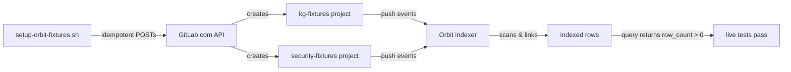
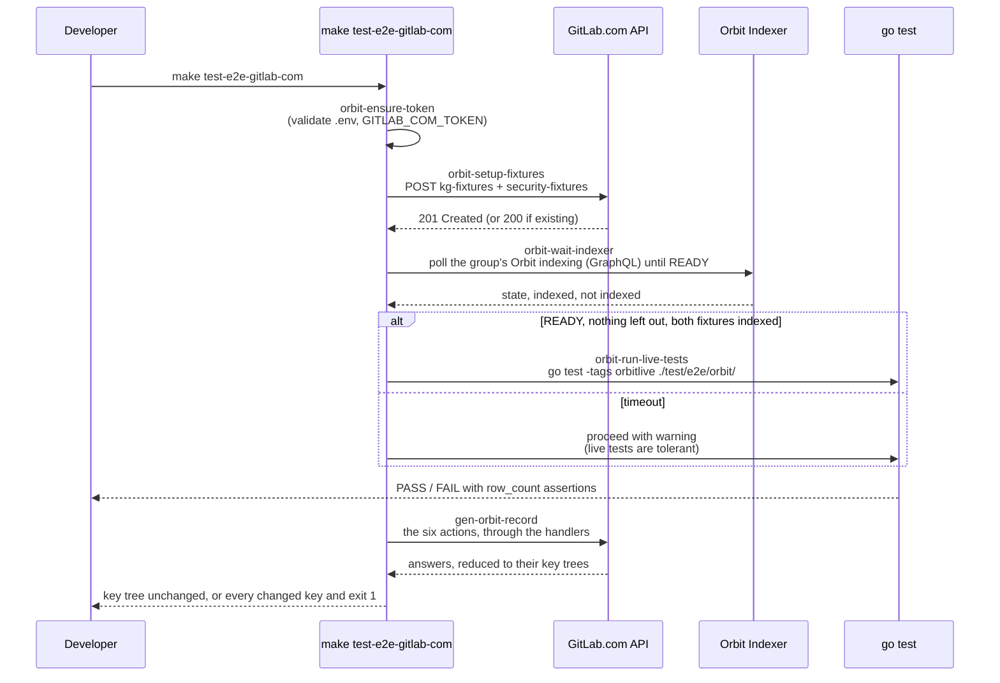

# Orbit live test fixtures

> **Diátaxis type**: How-to · **Audience**: 🛠️ Contributors & maintainers

The Orbit handler live tests in `test/e2e/orbit/live_test.go`
exercise the real `https://gitlab.com/api/v4/orbit/*` endpoints against
the `jmrp-oss/orbit-fixtures` group on gitlab.com, a subgroup of the
top-level group that was named `plens1` and then
`gitlab-mcp-server-orbit-fixtures` before it became `jmrp-oss` (see
[The fixture namespace](#the-fixture-namespace)). Those tests are gated
behind the `orbitlive` build tag and require `GITLAB_COM_TOKEN` in the
environment. This document explains the data they expect and how to
re-provision it.

The file holds 14 tests and 100 subtests, and every query they send but one is written in GQL, the only query language GitLab.com has accepted since 2026-10-15 (issue 1414). One subtest checks that the query language GitLab.com describes is the GQL `orbit.query` teaches, and another sends the one exception, a query written in the JSON DSL GitLab.com removed on 2026-10-27, as text, and checks what the caller is told when GitLab.com refuses it. One test holds the licensing tier the server detects to at least the plan GitLab.com reports for the fixture namespace's top-level group (issue 1224), which Orbit access has no part in since GitLab.com grants it by add-on or trial whatever the plan. One holds the release GitLab.com reports to the fine-grained action table's own release or the prerelease right after it (issue 1023), so GitLab.com moving past the table fails a run, and another holds that rule against a stand-in table with no network. One measures the query route against a token carrying `read_api` alone and runs only with `GITLAB_COM_READ_API_TOKEN`, and another holds that measurement's reading of GitLab's refusal against a stand-in, with no network. The last three hold against a stand-in, with no network, which answers make a subtest skip because GitLab.com does not serve Orbit to the token, that a null a handler reports makes it skip only when GitLab, asked again, answers null too, and that an index the graph status handler does not report skips a test that needs the fixture namespace only when GitLab, asked again, answers that index null too (see [Access since Orbit's general availability](#access-since-orbits-general-availability)).

## The fixture namespace

The fixtures are the two projects of `jmrp-oss/orbit-fixtures`, a public
subgroup of the top-level group `jmrp-oss` ("jmrp open source", id
134059988). That group has been in the GitLab for Open Source program
since 2026-10-26 (`GET /namespaces/134059988` reads `plan: opensource`),
which gives the whole top-level namespace Ultimate, and it is meant for
any of the maintainer's open
source work on gitlab.com, not for the fixtures alone. Orbit keys its
enrollment and its index by the group's id, so both survived each
rename. The program's Ultimate does not by itself entitle the group to
Orbit after Orbit's general availability, which grants Orbit only to a
group holding Orbit's own add-on or running an Orbit trial, whatever its
plan. The suite and the recorder need one of the two, and issue 1516
tracks which the group has.

The default namespace is the subgroup rather than `jmrp-oss` because of
what the suite and the recorder count: they bound their projects with
`STARTS WITH '<namespace>/'`, read the ids of the projects that match,
and ask `graph_status` how many projects of the namespace are indexed.
Under `jmrp-oss` itself each of those would also take in every other
project the group comes to hold.

The program's terms bind everything in the top-level namespace,
subgroups included, so every project added to `jmrp-oss` follows them:

- **Every project carries an OSI-approved license.** Both fixture
  projects carry this repository's MIT `LICENSE`, and
  `test/fixtures/orbit/{kg,security}-fixtures/LICENSE` is the same file,
  so a project the setup script provisions again carries it too. The
  script leaves a project that already exists as it is, so one
  provisioned before the file was added takes it only by a push of its
  own, which is how both fixtures took theirs on 2026-10-26. GitLab
  reports the license it detects as `license.key` of
  `GET /projects/:id?license=true`; check it before moving a project in,
  a fork above all, since a repository that mixes licenses may not be
  detected as one.
- **Every project and every group is public.** The setup script creates
  its projects public unless `ORBIT_FIXTURES_VISIBILITY` says otherwise,
  and every subgroup has to be created with `visibility: public`, which
  is not necessarily the create call's default.
- **The namespace may hold one private project**, which the program
  allows for a project that holds sensitive data. Neither fixture is that
  project: `security-fixtures` holds only fake secrets, every file in it
  is already public in this repository, and its vulnerability report
  stays visible to members alone, so the allowance stays free for a real
  need. Other private work stays in the maintainer's personal namespace.

The subscription is not renewed on its own: the program asks for its
form to be submitted again every year. The project that sat in the group
scheduled for deletion since 2026-10-19
(`orbit-review-2026-10-deletion_scheduled-87502032`) was removed for good
on 2026-10-26, before anything else in the group changed, because the
program counts every project in the namespace and that one was private
and carried no license.

## What the tests need

Every query the tests send but one is written in GQL, the read-only
language based on openCypher 9 that GitLab.com compiles every query in
since 2026-10-15, and each of those was answered `200` against the
fixture namespace, then `plens1`, on 2026-10-17. On 2026-10-26, against
`jmrp-oss/orbit-fixtures`, every one of them was answered `200` again
but two, which GitLab.com has refused since: `PAGE` (issue 1527) and a
shortest path that names no relationship type (issue 1528); both are
written the way GitLab.com takes them now, `SKIP` and `LIMIT`, and a
shortest path over a named relationship type. The one query not written
in GQL is the JSON query DSL the suite used before, sent as text, which
GitLab.com refuses now, and the subtest that sends it holds what a caller
is told about it.

`TestOrbitLiveGitLabCom` and `TestOrbitLiveGitLabCom_ShapeDiscovery`
are self-contained: they bound their projects by path
(`WHERE p.full_path STARTS WITH 'jmrp-oss/orbit-fixtures/'`) and
use no hardcoded project ids; the ids a statement carries are read from
the graph first. They will return rows against any namespace that has at
least:

- a `Project` matching `{full_path: '<namespace>/kg-fixtures'}`
- a `Project` matching `{full_path: '<namespace>/security-fixtures'}`
- at least one `Milestone` with `{state: 'active'}`
- at least one `MergeRequest` with `{source_branch: 'feature/restock-helper'}`
- at least one detected `Vulnerability`

`TestOrbitLiveGitLabCom_Fixtures` matches by content
(`f.path ENDS WITH '.py'`, `{state: 'detected'}`, etc.) so it works
against any namespace once the indexer has had time to scan the fixture
content.

`TestOrbitLiveGitLabCom_FeatureCoverage` exercises every documented
GQL pattern at least once against the namespace: comparison, list and
string predicates joined by `AND`, multi-node patterns with a
relationship type, aggregations grouped by a property and by a node
with `count`, `sum`, `max` and `avg`, `ORDER BY`, the virtual `diff` and
`content` properties, `SKIP` and `LIMIT`, an id range, incoming neighbors of one
relationship type, `properties(n)` and the procedure GQL calls for the
ontology of one entity. Each of its subtests is informational: it passes as long as
the API accepts the statement and returns a valid envelope, even with
`row_count=0`.

## Reproducing the fixtures

```bash
# 1. Create a personal access token with api + write_repository scopes
# 2. Run the setup script with the namespace and token

GITLAB_COM_TOKEN=glpat-... \
ORBIT_FIXTURES_NAMESPACE=mynamespace \
./scripts/setup-orbit-fixtures.sh
```

The script is **idempotent**: it checks for existing resources via the
API and skips them. Re-running it on an already-provisioned namespace
is a no-op. The namespace may be a subgroup, as the default
`jmrp-oss/orbit-fixtures` is: the script looks each project up by its
full path with every slash encoded. It creates the projects public, as
`jmrp-oss` requires; set `ORBIT_FIXTURES_VISIBILITY=private` for a
private group of your own, since GitLab refuses a public project in a
private group. `make orbit-setup-fixtures` and `make test-e2e-gitlab-com`
hand the setting on from their command line, else the environment, else
`.env`.

### What the script creates

| Project                  | Content                                                                                                                                                                                                             | Why                                                                                                                                                                                      |
| ------------------------ | ------------------------------------------------------------------------------------------------------------------------------------------------------------------------------------------------------------------- | ---------------------------------------------------------------------------------------------------------------------------------------------------------------------------------------- |
| `<ns>/kg-fixtures`       | MIT `LICENSE` + Python package `acme.orders` (7 source files, 2 test files) + `.gitlab-ci.yml` (4 stages, 5 jobs, SAST, Secret-Detection) + 7 labels + 1 milestone + 5 issues + 2 environments + 1 squash-merged MR | Populates File, Definition, Directory, ImportedSymbol, Branch, MergeRequest, MergeRequestDiff, MergeRequestDiffFile, Note, Label, Milestone, WorkItem, Pipeline, Job, Stage, Environment |
| `<ns>/security-fixtures` | MIT `LICENSE` + intentionally vulnerable code (hard-coded AWS keys, SQL injection, weak MD5 hashing, `eval()`) + 4 GitLab-managed security scanning templates                                                       | Populates Vulnerability, Finding, SecurityScan, VulnerabilityIdentifier, VulnerabilityOccurrence, VulnerabilityScanner                                                                   |

The script provisions everything from `test/fixtures/orbit/{kg,security}-fixtures/`
in this repo. The fixture content is committed and reproducible, so
no external state is needed.

### Fixture reproduction flow

The end-to-end fixture lifecycle has four phases: validate the environment, provision the namespace, push the projects, then let the indexer catch up. A `flowchart LR` is the right tool here because the phases are sequential and side-effecting (each one mutates state in the next), and readers need to see at a glance that nothing happens between setup and the live tests until the indexer has indexed the rows.



## Optional: mirror a public GitLab repo

The setup script accepts `--mirror-cli` to additionally push
`gitlab-org/cli` (the glab CLI, ~10k files, 1k stars, 1000+ branches)
into `<ns>/glab-mirror`. The mirror takes several minutes and adds
real-world data: hundreds of MergeRequests, real CI runs on main,
real cross-file `ImportedSymbol` references.

```bash
GITLAB_COM_TOKEN=glpat-... \
ORBIT_FIXTURES_NAMESPACE=mynamespace \
./scripts/setup-orbit-fixtures.sh --mirror-cli
```

Re-runs are safe: the mirror step checks for project existence and
skips if already present.

## Indexer behavior

The Orbit indexer is eventually consistent. After a fresh push:

1. The indexer picks up the new content within 1 to 5 minutes.
2. `indexing.state` may transiently report `"error"` even while
   `last_completed_at` advances and row counts keep growing. This is
   a GitLab-side artifact, not a fixture issue.
3. The live test assertions are **informational** (`row_count > 0`)
   rather than strict equality, so a transient re-indexing blip
   surfaces as `PASS` with a low `row_count`, not a hard failure.

If `row_count` is consistently 0 long after the script completes, the
indexer has not yet linked the resource. Re-run the test after a
few minutes, or ask GraphQL what the indexer knows,
`group(fullPath: "<ns>") { orbit { indexing { state projects { indexed notIndexed } } } }`
(`GET /api/v4/orbit/graph_status`, which answered this until 2026-10-28,
was removed by gitlab-org/gitlab!264745).

### Access since Orbit's general availability

Since 29 October 2026 GitLab.com serves a namespace's index and queries
only for a top-level group with the `orbit_promo` add-on or a running
Orbit trial; the plan no longer counts. `jmrp-oss` lost access between
09:21:35 and 09:22:17 UTC that day (the `state` of its Orbit `access` turned from
`LICENSED`/`BETA` to `TRIAL_NOT_ELIGIBLE`), after which the index of
`jmrp-oss/orbit-fixtures` answers `indexing: null` and every query
`403 No Orbit enabled namespaces available`. The service status, the
schema, and the MCP tool list and command catalog still answered the
token until about 09:32 UTC, and by 09:51 UTC `serviceStatus` answered
`null` and the MCP endpoint `403` too. Starting a trial is the
maintainer's decision and has not been taken; the Orbit team was asked in
gitlab-org/orbit/knowledge-graph#1425.

The live suite skips a subtest when GitLab.com does not serve it Orbit,
naming GitLab's answer, and fails it on any other error, since that says
something about the handler. A subtest that needs the fixture namespace
runs under `requireOrbitServed` in `test/e2e/orbit/live_test.go`, which
asks the namespace's index first and skips only when the handler reports
no index and GitLab, asked for that index again with a document of the
test's own, answers it `null` too. GitLab's GraphQL API answers a
namespace Orbit is not served for with `null` rather than a refusal, so a
`403` or any other refusal of that request fails the test, and
`TestFixtureNamespaceServed_AnIndexTheHandlerDoesNotReport_IsAskedOfGitLabAgain`
holds that against a stand-in. One that needs only the account (the
service status, the schema in every format, the tool list and the query
language, in `TestOrbitLiveGitLabCom`, `TestOrbitLiveGitLabCom_DSL` and
`TestOrbitLiveGitLabCom_SchemaFormats`) runs under `skipUnlessServed`,
which skips on the two answers GitLab.com gave the account that morning:
`null` where the handler reads (`orbit.ErrOrbitUnavailable`) and the
Orbit MCP endpoint's permission refusal, a `403` that carries no RFC 6750
code and does not refuse the account itself. A `null` is skipped on only
when GitLab, asked for the same field again with a document of the
test's own, answers it `null` too, so a handler that reads `null` where
GitLab sent a value fails its subtest. A `401`, a scope refusal, a
blocked account or a `404` still fails, and
`TestNotServed_ThroughTheAccountLevelHandlers_ReadsGitLabsAnswer` and
`TestSkipUnlessServed_ANullTheHandlerReports_IsAskedOfGitLabAgain` hold
that reading against a stand-in. A recording made while GitLab.com does
not serve Orbit needs `ORBIT_RECORD_FLAGS=-allow-unanswered` (below).

What says which is the top-level group's own Orbit `access` and `trial`,
which `graph_status` publishes. GitLab answers them for a top-level group
alone, to a token with the Owner role there (`read_orbit_setting` and
`read_orbit_trial`), and `null` for a subgroup or a project, the fixture
namespace among them, so `graph_status` of `jmrp-oss` reports them and that
of `jmrp-oss/orbit-fixtures` does not. GitLab.com serves the index under
`LICENSED` or `TRIAL_ACTIVE` access; at 16:58 UTC on 2026-10-29 `jmrp-oss`
read `TRIAL_NOT_ELIGIBLE` with the `turn_on_denial_reason`
`PURCHASE_REQUIRED`, a trial `NOT_ELIGIBLE` with no credit left, and Orbit
turned off (`enabled: false`). The state does not decide the index on its
own: GitLab reads the state from the `orbit_promo` add-on and from
CustomersDot, and serves the index from the add-on and the trial it
recorded, which an hourly job ends after CustomersDot does, so an index can
still come under `TRIAL_STATUS_UNAVAILABLE` or a trial that has just ended.
The live suite asks it in `GraphStatus_top_level_access`, which runs with
or without access and reports the state, the trial and whether an index
came.

Renaming or moving the group does not reach the projects' nodes. When
`plens1` became `gitlab-mcp-server-orbit-fixtures` on 2026-10-26, the
`Group` node carried the new path and `graph_status` answered for the
new path when they were first checked, but every `Project` node kept
`plens1/...` as its `full_path` four hours later, so each query that
bounds a project by path found nothing under the new name. A rename
changes the group's row and the routes, not the projects' rows, and a
node moved only once its project's own row changed: editing each fixture
project's description, and then restoring it, moved both nodes to the
new path within two minutes, while the project scheduled for deletion,
whose row nobody changed, was still the node
`plens1/orbit-review-2026-10-deletion_scheduled-87502032` that
afternoon.

The move into `jmrp-oss/orbit-fixtures` on 2026-10-26 was ordered
around that: the top-level group was renamed before both projects were
transferred into the new subgroup, because a transfer changes each
project's own row and its traversal path, which a rename of the group
above them does not. Transferring first would have left the nodes on the
old prefix again. No description edit was needed this time. A minute or
so after the transfers, `graph_status` of the subgroup still counted 0
of its 2 projects indexed; within three minutes of them it counted 2,
and the query below listed both. By then each project had also taken its
`LICENSE` push and been made public. More than an hour after the change
to public both nodes still read `visibility_level: private`, so that
change had not reached them and did not move them; the transfer or the
`LICENSE` push did, and which of the two is not known.

After a rename or a transfer, check two things before running the suite
or recording, since they follow different columns and did not move
together after the first rename:

- GraphQL `group(fullPath: "<ns>") { orbit { indexing { projects { indexed } } } }`
  reports `indexed` equal to the number of fixture projects. It counts
  by traversal path, and a recording refuses a namespace it counts no
  indexed project in.
- `MATCH (p:Project) WHERE p.full_path STARTS WITH '<ns>/' RETURN p.full_path`
  lists both fixture projects, which is what every subtest that bounds a
  project by path relies on.

## Project layout

```text
test/fixtures/orbit/
├── kg-fixtures/
│   ├── LICENSE
│   ├── README.md
│   ├── pyproject.toml
│   ├── .gitlab-ci.yml
│   ├── src/acme/__init__.py
│   ├── src/acme/orders/__init__.py
│   ├── src/acme/orders/__main__.py
│   ├── src/acme/orders/cli.py
│   ├── src/acme/orders/fulfillment.py
│   ├── src/acme/orders/models.py
│   ├── src/acme/orders/pricing.py
│   └── tests/
│       ├── test_fulfillment.py
│       └── test_pricing.py
└── security-fixtures/
    ├── LICENSE
    ├── README.md
    ├── pyproject.toml
    ├── .gitlab-ci.yml
    ├── src/acme/__init__.py
    ├── src/acme/orders/__init__.py
    ├── src/acme/orders/auth.py
    ├── src/acme/orders/legacy_db.py
    └── tests/
        └── test_smoke.py
```

Both fixture sets are intentionally small (a few hundred lines each)
so the Orbit indexer can process them within a couple of minutes.

## Running the live tests

```bash
# Unit + integration tests (does not run the live tests, which need the orbitlive tag)
go test ./internal/tools/orbit/

# Live integration test (gated by build tag and token)
GITLAB_COM_TOKEN=glpat-... \
  go test -tags orbitlive -count=1 -v ./test/e2e/orbit/
```

Override the fixture namespace with `ORBIT_FIXTURES_NAMESPACE`:

```bash
GITLAB_COM_TOKEN=glpat-... \
ORBIT_FIXTURES_NAMESPACE=acme-research \
  go test -tags orbitlive -count=1 -v -run 'TestOrbitLiveGitLabCom_Fixtures' ./test/e2e/orbit/
```

## Orchestrator: `make test-e2e-gitlab-com`

The `make test-e2e-gitlab-com` target chains its sub-targets in order. The first three must succeed (in order) before the live tests run; `orbit-wait-indexer` proceeds with a warning if the indexer does not catch up in time, so the live tests are the source of truth for end-to-end readiness. A `sequenceDiagram` is the right tool here because the five Orbit sub-targets share a single `.env`-driven state, the make process is the actor that runs them, and the diagram clarifies that `orbit-ensure-token` is a prerequisite of every other Orbit step (it is listed as a dependency of the four that follow it, even though it only appears once in the visible top-level chain).



After the live tests the target re-records the answers with `make gen-orbit-record`, described below, and ends with `check-graphql-documents-live`, which is not about Orbit.

## Recording the answers: `make gen-orbit-record`

What GitLab.com answers the six Orbit actions is recorded here, since no self-managed GitLab serves Orbit and the query route and the MCP endpoint have no response schema anywhere GitLab publishes one, and committed as `docs/development/orbit-responses.json`. Since GitLab.com removed five of the six REST routes on 2026-10-27 and -28, the actions read three sources: GitLab's GraphQL API (`orbit.status`, the structured `orbit.schema`, `orbit.graph_status`), the Orbit MCP endpoint `POST /api/v4/orbit/mcp` (`orbit.tools`, `orbit.dsl`, the llm `orbit.schema`) and `POST /api/v4/orbit/query`. `cmd/gen_orbit_record` calls each Orbit handler through a proxy on the loopback interface that forwards to GitLab.com with `GITLAB_COM_TOKEN`, so the requests recorded are the ones the server builds. Every call is a read. It asks about the fixture namespace (`ORBIT_FIXTURES_NAMESPACE`, `jmrp-oss/orbit-fixtures` by default): the indexing status of the namespace and a traversal of `<namespace>/kg-fixtures`, which is why the fixtures above have to be indexed before a recording means anything.

The record holds, per call, the action and variant, the output type the handler returned, the parameter names the request carried, and the key tree of the answer with the JSON kinds seen at each path. Since schema version 4 a call to GraphQL or to the MCP endpoint also names its operation (`query OrbitServiceStatus`, `tools/call list_commands`) and the names of its variables or tool arguments, and its key tree is taken from the part the handler reads (`root`): the field below `data` for GraphQL, a connection recorded as the list it pages and its `pageInfo` left out, the JSON-RPC `result` of `tools/list`, and the text of a tool result, decoded when it is JSON. The status and the index are one call each (`default`, `full_path`), since GraphQL renders no llm text. Its source names the Orbit version and the query grammar GitLab.com published beside the answers, a SHA-256 of the description and input schema of the `query_graph` command `orbit.dsl` returns (schema version 3 of the record, since GitLab.com reads GQL; version 2 named the JSON query DSL by its `$id` and `version`, and the check refuses a version 2 record by its version and a version 3 record still naming it as one not in the form the generator writes), and a re-recording that finds a different grammar fails until the record is committed, which is the prompt to read `orbit.query`'s guidance against the new language. The query calls send a GQL statement, the fixture project by its path. It holds no value: a subtree whose keys are data (the query command's input schema, a tool's input schema, the rows a query returns) is kept as its root and marked verbatim, and a key outside one that is not an identifier fails the recording. That second rule stops data that cannot be a name, not data shaped like one: a map keyed by identifier-shaped data would be recorded as keys, which is why such a subtree has to be named verbatim in `cmd/gen_orbit_record/calls.go`. `make audit-1to1-paths` holds the Orbit output types to it (see the Orbit paragraph of the audit_1to1 section in [cmd utilities](cmd-utilities.md#audit_1to1)).

A recording refuses to write anything when the fixture namespace is not indexed: a traversal of the fixture project that finds no row, or an indexing status that counts no indexed project, would record a tree without the paths the rows and counts carry. `orbit-wait-indexer` proceeds with a warning when it times out, so on a slow indexer the chain fails here, and the fix is to wait and run `make gen-orbit-record` again.

A recording also stops on a call GitLab refuses the account (`401`, `403`, GraphQL `null` where the handler reads, or, for a fixture namespace that is itself a top-level group, its Orbit access with no index beside it), unless it is told GitLab may: `make gen-orbit-record ORBIT_RECORD_FLAGS=-allow-unanswered` then carries the call from the record at HEAD when that record sent the same request, dated with the day it was answered (`retrieved_at`, and that day is held to the same window), and otherwise lists it under `unrecorded` with GitLab's answer and the time. The record of 2026-10-29 was made that way at 09:28 UTC, after the fixture namespace lost access: the status, the schema in its three variants, the tool list and the query language were answered through their new sources, the three query calls were carried from the recording of 2026-10-26 (`POST /orbit/query`, the same request), and `orbit.graph_status (full_path)` is unrecorded, its GraphQL document having never been answered for this account. A call listed as unrecorded leaves its output type unjudged by R-PATH until a recording made with access answers it.

A re-recording prints every key GitLab.com added, dropped or changed against the record committed at HEAD, which it reads through git rather than from the file it has just rewritten. When the key tree differs it writes the new record and exits 1, and every later run does the same until the record is committed, so `make test-e2e-gitlab-com` stays red until somebody has read the change, run the audit and committed the record. `make check-orbit-record` is the offline gate CI runs on the committed file, and it fails every branch once the record is older than the shared staleness window in `cmd/internal/provenance`. Only somebody holding a GitLab.com token entitled to Orbit and this fixture namespace can refresh it, unlike the Docker-regenerated records, so plan the refresh before the window closes. The same gate is step 24 of `make analyze` and a step of CI's generated-artifacts job.

The recording is what found that `orbit.schema` sent its format as `format`, which Grape reserves and GitLab.com answers 406 to, that every Orbit route taking a response format refuses `json` (`/orbit/tools` takes none), and that the llm DSL grammar arrived as a JSON string, which `orbit.dsl` published as its text until GitLab.com moved to GQL. Since then (issue 1414) `orbit.query` sends GQL text as the body's query string, takes `gql` as a response format beside `raw` and `llm`, forwarded a JSON object as written until gitlab-org/gitlab!261947 removed the JSON DSL on 2026-10-27 (GitLab.com has refused an object since with `400 query is invalid`, and the `query` parameter is a string since), answers GitLab.com's refusal of a JSON query written as text with a hint that it reads GQL, and `orbit.dsl` read `GET /orbit/agent/commands?command_names=query_graph`, since `GET /orbit/schema/dsl` answers 404, until that route was removed too and `orbit.dsl` moved to `list_commands` of the MCP endpoint.

```bash
make gen-orbit-record                                   # record, GITLAB_COM_TOKEN from .env
make gen-orbit-record ORBIT_FIXTURES_NAMESPACE=acme     # against another fixture namespace
make gen-orbit-record ORBIT_RECORD_FLAGS=-allow-unanswered  # record past what GitLab refuses the account
make check-orbit-record                                 # the offline gate
```
