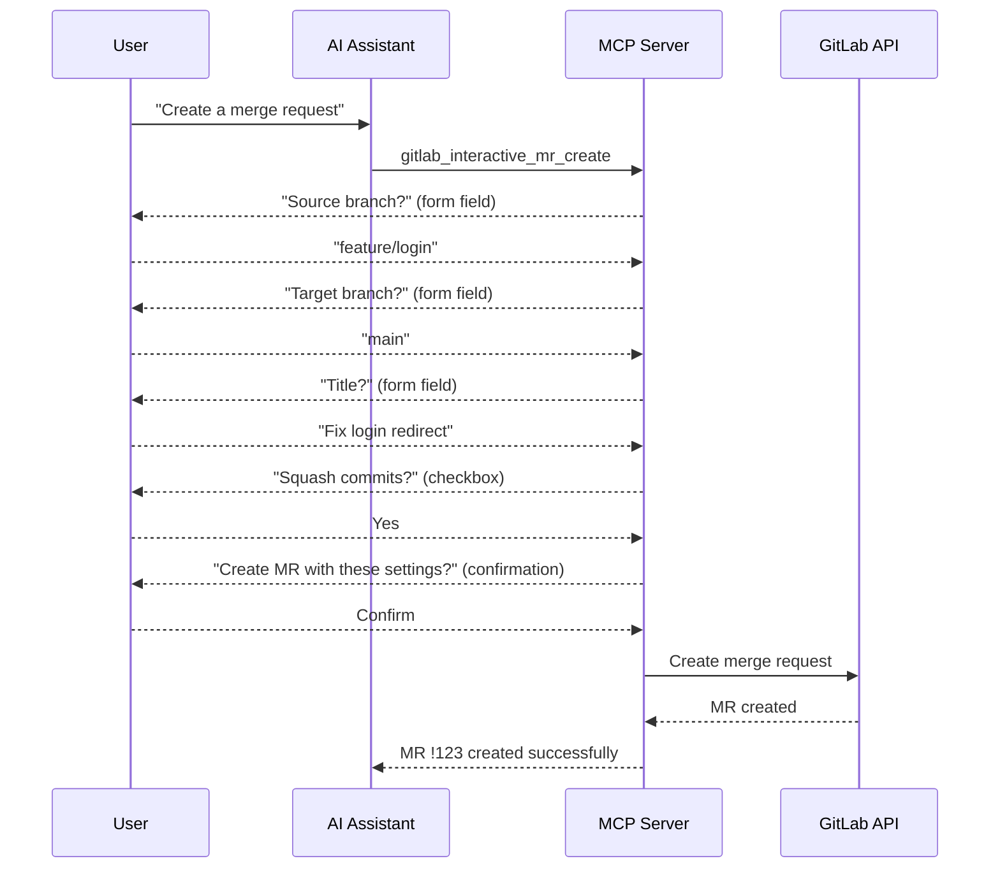

import FAQ from "../../../components/FAQ.astro";

Elicitation lets GitLab MCP Server **ask the user for input through structured forms**, enabling wizard-style creation flows for complex resources such as issues, merge requests, releases, and projects. Instead of requiring the AI to supply every parameter upfront, the server collects fields one step at a time, validates each answer, and confirms before creating the resource.

This capability is server-to-client and **client-dependent**: the MCP client must declare support: in `initialize` on protocol `2025-11-25` and earlier, and on each request from `2026-07-28`. When a client does not support elicitation, GitLab MCP Server falls back to standard parameterized tools, so resource creation still works without the interactive flow.

## What problem does elicitation solve?

Standard MCP tools require the AI to provide **all parameters upfront** in a single tool call. For complex resources — where fields depend on earlier choices and missing data leads to errors — the AI must either guess values or ask multiple chat questions before calling the tool. Elicitation removes that guesswork by letting the server gather and validate each field interactively.

## How does elicitation work?

With elicitation, the server pauses execution and **asks the user directly** for input through the MCP client's UI. Each answer is checked against the question before the next one is asked, and the flow ends with an explicit confirmation before any GitLab API call.



Each step is its own request to the client: one `elicitation/create` per question, carrying the question and a JSON Schema for the answer (a text field, a choice from a list, or a yes/no), so the client can draw the right control. The user answers each one with accept, decline or cancel.

### What are the four phases of a flow?

1. **Capability check**: before asking anything, the wizard checks that the client declared elicitation. If it did not, the wizard stops and names the action that does the same work (see [What happens without elicitation support?](#what-happens-without-elicitation-support)).
2. **Gathering**: the questions follow one another. An optional one can be declined or left empty, and the flow carries on without that field.
3. **Confirmation**: the wizard shows a summary of everything it collected and asks for a final yes or no.
4. **Execution**: only after that yes does it call GitLab, and it returns the object GitLab created.

Cancelling at any step, or answering no at the confirmation, ends the flow with nothing sent to GitLab.

### Which wire form does a client get?

The flow is the same for every client; how the questions travel depends on the MCP protocol version the client speaks:

| Client protocol          | Mechanism                                  | On the wire                                                                                                                                                                                                            |
| ------------------------ | ------------------------------------------ | ---------------------------------------------------------------------------------------------------------------------------------------------------------------------------------------------------------------------- |
| `2025-11-25` and earlier | Synchronous server-initiated requests      | While the tool call runs, the server sends one `elicitation/create` request per question and waits for the answer: an `action` (`accept`, `decline` or `cancel`) and, on accept, the `content`                         |
| `2026-07-28`             | Multi-round-trip requests (MRTR, SEP-2322) | The tool result carries an `inputRequests` map keyed by question and an opaque `requestState`; the client asks the user, then repeats the same call with the answers in `inputResponses` and the `requestState` echoed |

On the multi-round-trip path one round carries one question. An abridged first round of the issue wizard looks like this:

```json
{
  "resultType": "input_required",
  "inputRequests": {
    "title": {
      "method": "elicitation/create",
      "params": {
        "message": "Enter the issue title",
        "requestedSchema": {
          "type": "object",
          "properties": {
            "title": { "type": "string", "title": "title", "description": "Enter the issue title" }
          },
          "required": ["title"]
        }
      }
    }
  },
  "requestState": "<opaque, signed by the server>"
}
```

The wizard runs again from the start on every round, replaying the answers carried in `requestState` instead of asking them again, so the user sees the same questions in the same order on both paths.

### Which protocol version decides?

The version that decides is the one the client **declared**, not the one its session negotiated, and on the legacy handshake those two can differ. `initialize` is deprecated in `2026-07-28`, so the Go SDK this server is built on (v1.8.0) answers an `initialize` asking for `2026-07-28` with `2025-11-25`, while keeping the version the client asked for. The server reads the version the request states, which a `2026-07-28` client sends with every request and an older client stated once in `initialize`. A client that asks for `2026-07-28` in `initialize` is therefore served multi-round-trip input requests although its session negotiated `2025-11-25`.

The SDK decides the same way, and its own client answers `inputRequests` whatever version it negotiated, so a client built on it is unaffected. A client that claimed `2026-07-28` in `initialize` and cannot handle `inputRequests` would receive a result it cannot act on. The negotiated version should drive both sides, which is the SDK's to change; the defect is [recorded upstream](https://github.com/jmrplens/gitlab-mcp-server/blob/main/docs/development/upstream-bugs.md#the-declared-protocol-version-not-the-negotiated-one-selects-mrtr).

### What is `resultType`?

On a `2026-07-28` session every tool result carries `resultType`: `input_required` on a result that asks for input, `complete` on any other. It follows the declared version too, so a client that asked for `2026-07-28` in `initialize` gets `resultType: "complete"` on ordinary calls that elicit nothing. Results on a legacy session carry no `resultType`.

### Which transports carry it?

HTTP mode is [stateless by default](/gitlab-mcp-server/operations/http-server/#stateless-mode), and that decides which of the two forms is available:

| Transport                          | Client protocol          | Elicitation                                                                                                                                      |
| ---------------------------------- | ------------------------ | ------------------------------------------------------------------------------------------------------------------------------------------------ |
| stdio, or HTTP `--stateless=false` | `2025-11-25` and earlier | Available: synchronous `elicitation/create` requests                                                                                             |
| stdio                              | `2026-07-28`             | Available: multi-round-trip input requests                                                                                                       |
| HTTP stateless (default)           | `2026-07-28`             | Available: the input requests travel inside the tool result, so no session or server-initiated channel is needed                                 |
| HTTP stateless (default)           | `2025-11-25` and earlier | Unavailable: no channel outlives the request, so the wizards answer with their alternative action and a destructive action needs `confirm: true` |
| HTTP `--stateless=false`           | `2026-07-28`             | Unavailable: the deployment does not serve this revision and answers `400`                                                                       |

A `--stateless=false` deployment does not offer `2026-07-28` at all, because the SDK's streamable transport serves that revision only without sessions. A request naming it is answered `400` with a JSON-RPC `-32022` error whose `data.supported` lists the revisions the deployment does negotiate, so the client can retry on one of them and use the synchronous form ([Protocol revisions this server negotiates](/gitlab-mcp-server/operations/http-server/#protocol-revisions-this-server-negotiates)).

## Which interactive wizards are available?

GitLab MCP Server provides four wizard-style creation tools. Each guides the user through the fields a resource needs and confirms before performing the final API call.

| Tool                                | Description                                                                                                         |
| ----------------------------------- | ------------------------------------------------------------------------------------------------------------------- |
| `gitlab_interactive_issue_create`   | Step-by-step issue creation: title, description, labels, confidentiality, confirmation                              |
| `gitlab_interactive_mr_create`      | Guided merge request creation: branches, title, description, labels, remove-source and squash options, confirmation |
| `gitlab_interactive_release_create` | Release creation wizard: tag name, release name, description, confirmation                                          |
| `gitlab_interactive_project_create` | Project creation: name, description, visibility, README initialization, default branch with a README, confirmation  |

The issue, merge request and release wizards take the target `project_id` as a tool parameter; the prompts collect the remaining fields. These four tools are registered by name on the meta and individual surfaces; on the default dynamic surface they are reached through `gitlab_execute_action` with the catalog IDs `interactive.issue_create`, `interactive.mr_create`, `interactive.release_create` and `interactive.project_create`, which `gitlab_find_action` returns.

### What does each wizard ask?

The questions come in the order below. Declining an optional question continues without that field; declining a required one, or cancelling at any question, ends the flow. Every yes/no question starts on no. In the final summary a long description shows its first 100 characters.

#### Issue

| Step | Question                    | Answer | Required |
| ---: | --------------------------- | ------ | :------: |
|    1 | Title                       | Text   |   Yes    |
|    2 | Description (Markdown)      | Text   |    No    |
|    3 | Labels, comma-separated     | Text   |    No    |
|    4 | Should it be confidential?  | Yes/no |    No    |
|    5 | Create the issue? (summary) | Yes/no |   Yes    |

#### Merge request

| Step | Question                              | Answer | Required |
| ---: | ------------------------------------- | ------ | :------: |
|    1 | Source branch                         | Text   |   Yes    |
|    2 | Target branch                         | Text   |   Yes    |
|    3 | Title                                 | Text   |   Yes    |
|    4 | Description (Markdown)                | Text   |    No    |
|    5 | Labels, comma-separated               | Text   |    No    |
|    6 | Remove the source branch after merge? | Yes/no |    No    |
|    7 | Squash commits on merge?              | Yes/no |    No    |
|    8 | Create the merge request? (summary)   | Yes/no |   Yes    |

#### Release

| Step | Question                                          | Answer | Required |
| ---: | ------------------------------------------------- | ------ | :------: |
|    1 | Tag name (the tag must already exist)             | Text   |   Yes    |
|    2 | Release name (empty lets GitLab use the tag name) | Text   |   Yes    |
|    3 | Description, the release notes                    | Text   |    No    |
|    4 | Create the release? (summary)                     | Yes/no |   Yes    |

#### Project

| Step | Question                                                                     | Answer | Required |
| ---: | ---------------------------------------------------------------------------- | ------ | :------: |
|    1 | Project name                                                                 | Text   |   Yes    |
|    2 | Description                                                                  | Text   |    No    |
|    3 | Visibility: private, internal or public                                      | Choice |   Yes    |
|    4 | Initialize the repository with a README?                                     | Yes/no |    No    |
|    5 | Default branch, asked only after a README (empty for the instance's default) | Text   |    No    |
|    6 | Create the project? (summary)                                                | Yes/no |   Yes    |

The release name has to be answered, though the answer may be empty. A declined README question means no README, and then no default branch question either: GitLab applies a default branch on creation only together with a README, and a project created empty takes the instance's default branch name, so the wizard skips step 5 and goes straight to the summary.

### Why use a wizard instead of a single tool call?

Wizards add safeguards that a single upfront call cannot, which is what makes them valuable for complex resources:

- **One field at a time**: each form asks for a single value, so nothing has to be supplied all at once.
- **Validation at each step**: an answer that does not fit its question is caught before the final API call.
- **Direct input**: the user types each value into a form instead of the AI relaying it from chat.
- **User confirmation**: the resource is created only after the user approves a summary.

Both kinds of action exist side by side:

| Aspect                | Standard action                         | Wizard                                           |
| --------------------- | --------------------------------------- | ------------------------------------------------ |
| **Input**             | The AI provides every parameter at once | The server asks the user, one question at a time |
| **User interaction**  | Indirect, through the AI chat           | Direct, through structured forms                 |
| **Validation**        | When the call runs                      | At each answer, before going on                  |
| **Cancellation**      | Not possible once called                | At any question                                  |
| **Best for**          | Automation, scripting, batch operations | Interactive creation, first-time users           |
| **AI context needed** | Every parameter, upfront                | Only which wizard to call                        |

## What happens when you cancel?

Cancelling at any question, declining a required one, or answering no at the final review ends the flow before anything is sent to GitLab. The tool answers with a short message, such as `Issue creation cancelled by user.`, and marks the result as an error (`isError: true`): the call produced none of the output its schema describes, and the message tells the model the user decided rather than that something failed.

An answer that does not fit the question asked (a missing field, a choice that was not offered) is a client fault rather than a decision: it is reported as an error, never as a cancellation, and the value is never used.

## How does elicitation guard destructive actions?

Elicitation is also used for **confirmation prompts** before destructive operations on the meta and individual surfaces. There a destructive call proceeds on the first of these that holds:

1. `GITLAB_MCP_YOLO_MODE` is truthy, or, when it is unset, `AUTOPILOT` is.
2. The call carries `"confirm": true`.
3. The client supports elicitation, and the user approves the question.

A client that cannot elicit is refused with a message asking it to send the call again with `confirm: true` only after the user approves, and nothing reaches GitLab. On a `2026-07-28` session the question travels as one multi-round-trip input request.

The default dynamic surface never asks: `gitlab_execute_action` refuses an action classified destructive unless the call carries `confirm: true` or `GITLAB_MCP_YOLO_MODE` (or `AUTOPILOT`) skips the confirmation, as step 1 does on the other two surfaces. Only the two guards that depend on the arguments elicit there too. [Destructive actions](/gitlab-mcp-server/operations/security/#destructive-actions) lists which actions count as destructive and describes both guards.

## How is the input kept safe?

- **Every answer is checked against its question** before the wizard uses it: a choice must be one of the options offered, a number must be a real number within its bounds, and a structured answer is validated against the JSON Schema it was asked with. An answer that fails is refused and never handed on.
- **The summary cannot be impersonated.** Each value shown in the confirmation is escaped: line breaks collapse, link schemes are defanged (`https[:]//`), and Markdown inside the value is shown rather than rendered, so text that came from the model cannot pass itself off as the server's own question.
- **Yes/no questions default to no**, so a client that pre-fills defaults opens them on no.
- **The answers are bound to the call and to the caller.** On the multi-round-trip path the answers travel in `requestState`, which the server signs, ties to the tool and the exact arguments of the call and to the credential the call was made with, and accepts for 10 minutes. State that has expired, was issued for another call, or was issued to another credential of the same HTTP deployment is ignored and the questions are asked again; state the server did not sign is refused. Nothing about the credential travels in the state: it is bound by the signature, not carried. On the HTTP server a flow still open when the pool entry of its credential is rebuilt, after the entry was evicted or once its credential has gone an hour without a check, asks its questions again as well. The signing key is created fresh in each process, so state issued before a restart, or by another replica behind a balancer, is refused rather than continued.
- **The user always has the last word.** Every wizard confirms before it writes anything to GitLab, and the user can cancel at any point without side effects.

## In which language are the questions asked?

In English, unless whoever runs the server sets `GITLAB_MCP_LANGUAGE=es` (or passes `--language es`), which asks them in Spanish. The setting is read by both transports and holds for the whole process, so every credential of an HTTP deployment is asked in the same language; [Configuration](/gitlab-mcp-server/configuration/#language) lists the values it takes. A deployment that does not set it is served exactly the English it was served before the setting existed.

### What changes, and what stays English?

| Text                                                                                                                                       | With `es`                                                |
| ------------------------------------------------------------------------------------------------------------------------------------------ | -------------------------------------------------------- |
| The question of each step (`message`), and the `description` of its field, which repeats it                                                | Spanish                                                  |
| The `title` of each form field (`Título`, `Rama origen`, the `Confirmar` of a yes/no question)                                             | Spanish                                                  |
| The labels of the confirmation summary (`**Título**`, `**Visibilidad**`, `Sí`)                                                             | Spanish; the values in it are shown as they were written |
| The confirmation of a destructive action on the meta and individual surfaces, and the questions of the two guards that depend on arguments | Spanish                                                  |
| Progress messages: the wizards' steps, and the waits, uploads, downloads, transfers and package publishing that report progress            | Spanish                                                  |
| The property keys (`title`, `source_branch`, `confirmed`, `selection`) and the options of a choice (`private`, `internal`, `public`)       | Never change                                             |
| Everything the model reads: descriptions, results, hints, the cancellation message, the refusal a client that cannot elicit receives       | English                                                  |
| The four listings (`tools/list`, `prompts/list`, `resources/list`, `resources/templates/list`), titles included                            | English, byte for byte the same as under `en`            |
| Logs, startup errors, `--help` and the messages of JSON-RPC errors                                                                         | English                                                  |

Only what a person reads without the model reading it first is translated. The model answers in the person's own language whatever language it read, so translating its input would change how it behaves and gain nothing. The listings stay as they are because they are what strict [MCP gateway validators](/gitlab-mcp-server/compatibility/#mcp-gateway-validators) check, pure ASCII with no semicolon, and what the model chooses tools from; the server's tests compare them under `en` and `es` and find them identical. What an operator reads stays English because it is what gets searched for in this documentation and in issues.

The first round of the issue wizard shown [above](#which-wire-form-does-a-client-get), under `es`:

```json
{
  "resultType": "input_required",
  "inputRequests": {
    "title": {
      "method": "elicitation/create",
      "params": {
        "message": "Escribe el título del issue",
        "requestedSchema": {
          "type": "object",
          "properties": {
            "title": { "type": "string", "title": "Título", "description": "Escribe el título del issue" }
          },
          "required": ["title"]
        }
      }
    }
  },
  "requestState": "<opaque, signed by the server>"
}
```

The question key and the property key are `title` in both languages, and the answer comes back under that key.

### What should a hook or a script match on?

A Claude Code `Elicitation` hook, an auto-answer rule or a script that recognizes a question by its `message` stops matching once the language changes. Match on what never changes instead: the property keys of `requestedSchema`, which are the field's own name for a text question (`title`, `description`, `labels`, `source_branch`, `target_branch`, `tag_name`, `name`, `default_branch`), `selection` for a choice and `confirmed` for a yes/no question; the keys of `inputRequests` on a `2026-07-28` session, which name every question: a text field's own name, `visibility` for the choice, `confidential`, `remove_source_branch`, `squash` and `initialize_with_readme` for the wizards' yes/no questions, `confirm` for a wizard's final confirmation and a destructive action's, `project_pull_mirror_overwrite` for the guard of `project.pull_mirror_configure` and `work_item_clear_lists` for the guard of `issue.work_item_update`; and the option values of a choice.

On a `2025-11-25` session or an earlier one, each question is a synchronous `elicitation/create` request that carries only its `message` and its `requestedSchema`, so every yes/no question has the same `confirmed` property, and only its `message`, or its place in the wizard, tells one from another. A hook that answers them differently there has to recognize each one's message in every language the deployment may be set to.

### Which clients show the translated questions?

What a person sees is what the client renders. Every client below whose behavior is documented shows the server's text as it arrives, none translates it, and none sends its user's language to the server, as their documentation and sources read on 2026-10-27:

| Client                                      | Renders the forms                                           | What the person sees                                                                                                                                                                           |
| ------------------------------------------- | ----------------------------------------------------------- | ---------------------------------------------------------------------------------------------------------------------------------------------------------------------------------------------- |
| VS Code + GitHub Copilot (1.102 and later)  | Yes                                                         | The question as Markdown in the chat; each field headed by its `title`, with its `description` beneath it or as its placeholder. VS Code's own buttons follow VS Code's language               |
| Claude Code                                 | Yes, in an interactive terminal session; a `-p` run cancels | A dialog with the server's fields. `Elicitation` hooks receive `message` and `requested_schema` as sent. Its `language` setting is the language of Claude's replies and is not sent to servers |
| Cursor                                      | Listed as supported                                         | Not documented                                                                                                                                                                                 |
| OpenAI Codex                                | Yes                                                         | A form in its terminal interface, with each field's `title` and `description`. It can route the request to an automatic review by a model, which reads Spanish as well as English              |
| Goose                                       | Yes                                                         | A form in the desktop chat; in the CLI, the question and each field's name and description                                                                                                     |
| Claude Desktop                              | No                                                          | No question: the wizards answer with their alternative action, and a destructive action asks the model for `confirm: true`. Progress messages are in Spanish wherever it shows them            |
| Zed, Cline, Continue, LibreChat, Gemini CLI | No                                                          | No question, for the same reason. Progress messages are in Spanish in any of them that shows them                                                                                              |

Windsurf, JetBrains IDEs and Kiro were not verified. A client that renders no form shows none of the translated questions, whatever the setting says. Progress messages do not depend on forms: they travel in `notifications/progress` on any tool call that carries a progress token, so they are in Spanish in every client that [shows progress](/gitlab-mcp-server/capabilities/progress/#how-do-clients-display-progress).

### Will the client's own language be used?

Not yet, because no client sends one and MCP has no field for it. The proposal [SEP-2792](https://github.com/modelcontextprotocol/modelcontextprotocol/pull/2792) adds one: a request names its user's languages in `_meta`, the server answers in the best match it has and says which one it used. The core maintainers accepted it on 2026-10-17, but it is not part of a published revision of the specification yet, and the Go SDK this server is built on does not carry it. When it lands ([issue 1013](https://github.com/jmrplens/gitlab-mcp-server/issues/1013) tracks it), the plan is that a request's own language decides for that request, `GITLAB_MCP_LANGUAGE` is what a request that names none, or none the server has, is served, and nothing is kept on the session.

## What does elicitation require?

The MCP client must declare the `elicitation` capability as it connects, with form mode or with no mode named (which the protocol reads as form). The server reads that declaration on every call, so nothing needs configuring on this side, and the same server serves clients with and without it.

Which clients declare it changes from release to release. Today the documentation of [VS Code](https://code.visualstudio.com/updates/v1_102) (from release 1.102), [Cursor](https://cursor.com/docs/context/mcp) and [Claude Code](https://code.claude.com/docs/en/mcp) lists elicitation as supported. For any other client, check its own documentation.

### What happens without elicitation support?

The wizard does not run. Its answer is an error result saying that the client does not support elicitation and naming the one action that does the same work with every field passed in the call. Each wizard names its own, by its catalog ID, and its description promises the same one:

| Wizard                              | Alternative it names   |
| ----------------------------------- | ---------------------- |
| `gitlab_interactive_issue_create`   | `issue.create`         |
| `gitlab_interactive_mr_create`      | `merge_request.create` |
| `gitlab_interactive_project_create` | `project.create`       |
| `gitlab_interactive_release_create` | `release.create`       |

The tool that runs the alternative depends on the surface: on the default dynamic surface it is `gitlab_execute_action` with the ID as `action` (`{"action": "issue.create", "params": {...}}`), on the meta surface the domain tool with `action` set to `create` (`gitlab_issue`, `gitlab_merge_request`, `gitlab_project`, `gitlab_release`), and on the individual surface a tool of its own (`gitlab_issue_create`, `gitlab_mr_create`, `gitlab_project_create`, `gitlab_release_create`). Functionality is preserved; only the interactive experience is lost.

:::tip
Even without elicitation support, you can use the standard creation actions (`issue.create` through `gitlab_execute_action` on the default surface, or `gitlab_issue` with `action: create` when `GITLAB_MCP_TOOL_SURFACE=meta`) by providing all parameters in a single call.
:::

<FAQ />
