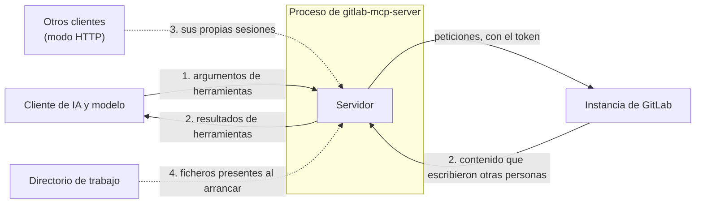

Un caso de aseguramiento (assurance case) es un argumento, respaldado por evidencia, de que un sistema cumple sus requisitos de seguridad. Esta página hace ese argumento para GitLab MCP Server: qué afirma, frente a qué adversarios y a través de qué fronteras de confianza, cómo aplica su diseño los principios de diseño seguro y cómo contrarresta las debilidades comunes de implementación. Cada paso nombra su evidencia: la decisión registrada que lo respalda, el código que lo aplica y el test o la puerta que falla cuando deja de cumplirse. Donde una afirmación no se cumple todavía, la página lo dice.

Los requisitos son los de la [política de seguridad](https://github.com/jmrplens/gitlab-mcp-server/blob/main/SECURITY.md#threat-model). Cómo se comporta cada mecanismo para quien opera el servidor está en la página de [Seguridad](/gitlab-mcp-server/es/operations/security/), y la [revisión de seguridad de octubre de 2026](https://github.com/jmrplens/gitlab-mcp-server/blob/main/docs/development/security-review-2026-10.md) lleva cada enunciado de la política hasta el código y los tests que lo sostienen, y registra los que no pudo trazar.

## Afirmaciones

El servidor hace nueve afirmaciones, y el resto de esta página las argumenta.

| #   | Afirmación                                       | Qué significa                                                                                                                                                                                                                                                                                                                                                                                                                                                     |
| --- | ------------------------------------------------ | ----------------------------------------------------------------------------------------------------------------------------------------------------------------------------------------------------------------------------------------------------------------------------------------------------------------------------------------------------------------------------------------------------------------------------------------------------------------- |
| 1   | Las credenciales siguen siendo confidenciales    | Un token no llega a ninguna línea de log, error, resultado de herramienta, recurso ni salida de un fallo, y ninguna redirección lo saca de la instancia a la que se envió                                                                                                                                                                                                                                                                                         |
| 2   | El contenido de GitLab sigue siendo dato         | El texto que escribieron otras personas no puede cambiar la estructura de un resultado de herramienta ni hablar con la voz del propio servidor                                                                                                                                                                                                                                                                                                                    |
| 3   | Los clientes de un despliegue están aislados     | En modo HTTP ningún cliente puede observar el cliente de GitLab, la identidad, el tier, las suscripciones ni los resultados de otro                                                                                                                                                                                                                                                                                                                               |
| 4   | El servidor actúa dentro del token               | Cada petición se ejecuta como el dueño del token; el modo solo lectura y el modo seguro se cumplen en todas las superficies; una acción cuyo efecto no se puede deshacer pide confirmación salvo que la llamada lleve `confirm: true` o que el operador lo haya desactivado                                                                                                                                                                                       |
| 5   | Los ficheros locales están confinados            | Una ruta que aporta un cliente se resuelve dentro de las raíces que permite el operador, y por HTTP no se puede nombrar ninguna ruta local                                                                                                                                                                                                                                                                                                                        |
| 6   | El servidor se conecta solo adonde debe          | Ningún valor del cliente lleva una petición a otro host, ni a otro endpoint de la instancia que el que construye su acción ([guarda de la ruta de petición](#recorrido-de-rutas-en-la-ruta-de-una-petición-cwe-23)); nunca se alcanza una dirección de metadatos de la nube, salvo detrás de un proxy de salida, donde rechazar un destino nombrado por un nombre de host le toca al proxy; una dirección privada, solo donde el operador la nombró o la permitió |
| 7   | Un repositorio no puede configurar el servidor   | Ningún fichero del directorio en el que el cliente arrancó el servidor cambia su configuración                                                                                                                                                                                                                                                                                                                                                                    |
| 8   | El consumo está acotado                          | Lo que un cliente puede hacer que el proceso retenga o gaste tiene un límite, decidido en un único registro                                                                                                                                                                                                                                                                                                                                                       |
| 9   | Lo que se instala es lo que construyó el release | Los checksums del release van firmados, los artefactos llevan procedencia de compilación, cada release desde 3.0.0 es inmutable y cada etiqueta de release desde v2.7.0 va firmada                                                                                                                                                                                                                                                                                |

## Modelo de amenazas

GitLab MCP Server se sitúa entre un cliente de IA y una instancia de GitLab. Guarda una credencial que suele llevar el scope `api` completo, recibe sus instrucciones de un modelo y le transmite a ese modelo texto escrito por cualquiera que pueda abrir un issue o subir una rama, que en un proyecto público es cualquier persona. Esos tres hechos deciden a qué tiene que resistir:

| Adversario                              | Controla                                                                                | Quiere                                                                                                               |
| --------------------------------------- | --------------------------------------------------------------------------------------- | -------------------------------------------------------------------------------------------------------------------- |
| Quien escribe contenido en GitLab       | El texto de issues y merge requests, notas, mensajes de commit, ficheros y logs de jobs | Dirigir al modelo, o que su texto se lea como palabras del propio servidor                                           |
| Un modelo dirigido                      | Los argumentos de las llamadas a herramientas que hace                                  | Actuar más allá de lo que quería el operador: escribir donde debería leer, llegar a otro host, leer un fichero local |
| Otro cliente de un despliegue HTTP      | Su propia credencial y sus propias peticiones                                           | Ver o usar la sesión de otro cliente, o agotar lo que comparten                                                      |
| Un cliente sin credencial válida        | Peticiones a un listener HTTP, y páginas en un navegador que puede alcanzarlo           | Adivinar o rociar tokens, usar el servidor como proxy hacia otros hosts o aprovechar el acceso de un navegador       |
| Un repositorio que alguien abrió        | Los ficheros del directorio en el que arranca un servidor stdio                         | Configurar el servidor, y con él el token                                                                            |
| Alguien entre un release y quien lo usa | Una descarga, un mirror o una entrada de un registro                                    | Que un binario modificado se ejecute en lugar del release                                                            |

Las afirmaciones descansan en tres supuestos, y en nada más hasta donde encontró la revisión de seguridad: el operador es de confianza y elige el token y su scope; GitLab aplica su propia autorización, y el servidor nunca intenta ampliar lo que el token permite; y la máquina que ejecuta el servidor no está ya comprometida. Lo que la política deja fuera de alcance, como las vulnerabilidades del propio GitLab o una máquina que un atacante ya controla, está [allí](https://github.com/jmrplens/gitlab-mcp-server/blob/main/SECURITY.md#out-of-scope).

## Fronteras de confianza

| Frontera                                 | Qué la cruza                                                                | Qué no debe permitir el servidor                                                                                         | Afirmación |
| ---------------------------------------- | --------------------------------------------------------------------------- | ------------------------------------------------------------------------------------------------------------------------ | ---------- |
| 1. Del modelo al servidor                | Argumentos de herramientas, de un modelo que puede haber leído texto hostil | Que un argumento actúe como autoridad más allá del token, o que envíe una petición o una lectura de fichero a otro sitio | 4, 5, 6    |
| 2. De GitLab al servidor y al modelo     | Contenido que escribieron otras personas, camino de un resultado            | Que ese texto cambie la estructura del resultado o falsifique la guía que el servidor escribe para el modelo             | 2          |
| 3. Entre clientes (modo HTTP)            | Peticiones de clientes distintos a un mismo proceso                         | Que un cliente alcance la sesión de otro, o agote lo que comparten                                                       | 1, 3, 8    |
| 4. Del directorio de trabajo al servidor | Ficheros del directorio en el que un cliente arrancó el servidor            | Que alguno de ellos configure el servidor                                                                                | 7          |

Dos caminos llevan lo que protegen las afirmaciones sin ser una frontera dentro del proceso: la red, que lleva el token del servidor a GitLab y, en modo HTTP, de un cliente al listener ([transmisión en claro](#transmisión-en-claro-cwe-319) y [validación de certificados](#validación-incorrecta-de-certificados-cwe-295) más abajo), y el camino de un release a la máquina que lo ejecuta (afirmación 9).

## Principios de diseño seguro

Los ocho principios de Saltzer y Schroeder, y cómo aplica cada uno el servidor.

### Mínimo privilegio

El servidor no tiene credencial de GitLab propia. Cada petición se ejecuta como el dueño del token que lleva, así que lo que puede hacer el servidor es como mucho lo que puede el token, y GitLab autoriza cada petición. Dentro de eso, el servidor no sirve más de lo que el token puede usar. Un token se admite con `read_api`, lo mínimo que necesita cualquier acción; a un token sin `api` se le sirven las acciones que GitLab acepta con `read_api`, juzgadas acción por acción a partir de las peticiones que envía cada una; los cinco grupos de administración necesitan `admin_mode`; un token de grano fino se acota acción por acción según sus permisos; y `GITLAB_MCP_READ_ONLY` retiene toda escritura lleve el token lo que lleve. La imagen de contenedor se ejecuta con un usuario sin privilegios.

**Evidencia:** [ADR-0018](https://github.com/jmrplens/gitlab-mcp-server/blob/main/docs/development/adr/adr-0018-authorization-admits-per-action-gating.md), [ADR-0024](https://github.com/jmrplens/gitlab-mcp-server/blob/main/docs/development/adr/adr-0024-fine-grained-token-authority-per-action.md) y [ADR-0026](https://github.com/jmrplens/gitlab-mcp-server/blob/main/docs/development/adr/adr-0026-read-api-token-served-what-gitlab-accepts.md); el scope clásico y los permisos de grano fino que necesita cada acción, derivados de las peticiones que envían sus handlers hacia `internal/tools/actiongrants` y sostenidos allí por `make check-action-grants-derivation` en cada pull request y por `make check-action-grants` en cada push a `main` y en cada pull request contra `main` o en la cima de una pila; `test/e2e/stdio/token_scope_test.go` y `test/e2e/http/fine_grained_test.go`, que manejan el binario real.

### Valores por defecto seguros ante fallos

El valor por defecto de cada ajuste es el que rechaza. Los certificados se verifican salvo que se active `GITLAB_MCP_SKIP_TLS_VERIFY`. El modo HTTP no arranca sin `--gitlab-url`, y `--allow-any-gitlab-url` se rechaza salvo que el listener sea loopback o un socket unix. Una ruta local nombrada por HTTP se rechaza. Una llamada destructiva sin confirmar falla cerrada, y nada llega a GitLab. Una dirección de metadatos de la nube se rechaza en cada conexión, y ningún ajuste la permite, salvo detrás de un proxy de salida, donde rechazar un destino nombrado por un nombre de host le toca al proxy ([ADR-0022](https://github.com/jmrplens/gitlab-mcp-server/blob/main/docs/development/adr/adr-0022-operator-named-destinations-are-exempt.md), NEG-004). Un `.env` en el directorio de trabajo nunca se carga.

Dos valores por defecto se inclinan hacia el otro lado. Cuando no se pueden leer los scopes de un token, no se filtra nada y el token cuenta como capaz de escribir, por diseño: un "no" equivocado quitaría herramientas sin avisar, mientras que un "sí" equivocado lo responde el propio `403` de GitLab. Y un listener TCP sirve HTTP en claro salvo que se configure TLS, también por diseño, porque un proxy que termina TLS delante de él es como funciona la mayoría de los despliegues; `--allow-plaintext-http=false` es el modo endurecido que lo rechaza en su lugar, y figura en [riesgos residuales](#riesgos-residuales).

**Evidencia:** [ADR-0022](https://github.com/jmrplens/gitlab-mcp-server/blob/main/docs/development/adr/adr-0022-operator-named-destinations-are-exempt.md); `test/e2e/http/gate_test.go`, `test/e2e/http/local_path_test.go` y `test/e2e/stdio/env_file_test.go`, que manejan el binario real; los casos `TestConfirmDestructiveAction_*` de `internal/toolutil`; `internal/gitlab/destination_test.go`.

### Mediación completa

Cada petición que puede actuar sobre una sesión lleva una credencial, y se liga a la entrada del pool de esa credencial antes de que se ejecute nada ([ADR-0020](https://github.com/jmrplens/gitlab-mcp-server/blob/main/docs/development/adr/adr-0020-one-server-per-configuration-shape.md)). GitLab autentica el token en cada llamada que el servidor hace con él, y el modo OAuth lo verifica contra la instancia elegida antes de servir la petición, guardando una identidad verificada como mucho durante `--oauth-cache-ttl` (15 minutos por defecto) o hasta que caduque el propio token. Cada acción se comprueba cuando se llama, no solo cuando se construye la lista de herramientas: la superficie dinámica responde a la llamada a una acción retenida que está retenida. Cada conexión saliente pasa la comprobación de destino en el dialer, tras la resolución DNS y una vez por cada dirección resuelta, así que la primera petición y cada salto de una redirección se juzgan por adónde van de verdad. Detrás de un proxy de salida la conexión es al proxy, y un destino solo se juzga cuando su URL escribe una dirección, porque un nombre de host lo resuelve el proxy.

**Evidencia:** `test/e2e/http/shared_server_test.go` y `test/e2e/http/oauth_test.go`; `internal/gitlab/destination_test.go` y `test/e2e/http/redirect_test.go`.

### Economía del mecanismo

Cada asunto tiene un mecanismo, aplicado en un solo sitio. Cada acción se declara una vez, en el `ActionSpec` de su dominio, y las tres superficies de herramientas se proyectan de ese único catálogo ([ADR-0014](https://github.com/jmrplens/gitlab-mcp-server/blob/main/docs/development/adr/adr-0014-catalog-first-runtime-architecture.md)), así que el modo solo lectura, el modo seguro, el acotamiento por scope y por permisos y el tier se aplican una vez, al catálogo, y no una vez por superficie. Cada límite que un cliente puede alcanzar se decide en un único registro, `internal/tenancy` ([ADR-0023](https://github.com/jmrplens/gitlab-mcp-server/blob/main/docs/development/adr/adr-0023-tenant-policy-is-declared-once.md)). El texto escrito en GitLab llega al modelo a través de un único conjunto de helpers de escapado, y cada petición llega a GitLab a través de una única cadena de transporte, donde viven la comprobación de destino y la retirada de credenciales en las redirecciones.

**Evidencia:** `make audit-catalog-first` y `TestRegisterAllDoesNotUseDomainRegisterTools` (`internal/tools`); `make check-tenancy`; `make check-md-escaping`.

### Diseño abierto

Nada depende de que el diseño sea secreto. El código, las decisiones registradas, el modelo de amenazas y este argumento son públicos. Lo que tiene que seguir siendo secreto son claves: el token, la clave que cada proceso genera al arrancar para nombrar una credencial en sus logs mediante un digest, y la clave con la que el mantenedor firma las etiquetas. Los checksums de los releases se firman con la identidad keyless del workflow de release, que cualquiera puede comprobar contra el registro público de transparencia de Sigstore.

### Separación de privilegios

Una acción cuyo efecto no se puede deshacer necesita algo más que la autoridad del token: que el usuario apruebe una pregunta, un `confirm: true` en la llamada, o el `GITLAB_MCP_YOLO_MODE` del operador. El `confirm: true` es un argumento, y en todas las superficies los argumentos los escribe el modelo, así que una llamada que lo lleva pasa sin pregunta en las tres. Donde el cliente no puede preguntar, y siempre en la superficie dinámica, que nunca pregunta, el rechazo le dice al modelo que lo envíe solo después de que el usuario lo apruebe. La confirmación es por tanto una petición al modelo y no una garantía, y lo que sostiene son el modo solo lectura y un token acotado. Un release necesita una etiqueta `v*`, que solo puede crear el rol de administración del repositorio; el mantenedor ha firmado todas desde v2.7.0, y todavía nada rechaza una sin firmar. Publica en npm, PyPI y NuGet solo desde el entorno `release`, que solo despliega desde una etiqueta `v*`. Hoy una sola persona tiene todos los roles ([GOVERNANCE.md](https://github.com/jmrplens/gitlab-mcp-server/blob/main/GOVERNANCE.md#access-and-two-factor-authentication)), así que ningún paso necesita todavía a una segunda persona.

**Evidencia:** [Acciones destructivas](/gitlab-mcp-server/es/operations/security/#acciones-destructivas); `test/e2e/stdio/yolo_mode_test.go`.

### Mínimo mecanismo común

Lo que comparten los clientes se limita a lo que no depende de la credencial. En modo HTTP un servidor MCP y su catálogo sirven a todas las credenciales de una misma configuración, y cada credencial tiene una entrada del pool propia: su cliente de GitLab, su bucket de límite de frecuencia, sus watchers de recursos y sus sesiones ([ADR-0020](https://github.com/jmrplens/gitlab-mcp-server/blob/main/docs/development/adr/adr-0020-one-server-per-configuration-shape.md)). Las notificaciones se filtran por su dueño al salir. Las cachés se indexan por digests de la instancia y el token, y nada que acuñe un cliente, como los permisos de un token de grano fino o la versión que dice tener una instancia, es nunca una clave de caché.

**Evidencia:** `test/e2e/http/shared_server_test.go`; `make check-tenancy`.

### Aceptabilidad psicológica

El ajuste seguro es el que no necesita configuración, así que es el que acaban usando los despliegues. Una dirección que nombró el operador nunca la comprueba la guarda de salida, así que un GitLab en `localhost`, en una red privada o detrás de una VPN funciona sin ningún flag ([ADR-0022](https://github.com/jmrplens/gitlab-mcp-server/blob/main/docs/development/adr/adr-0022-operator-named-destinations-are-exempt.md)). Un rechazo nombra su remedio: el flag, el parámetro o el scope que cambiaría la respuesta. Solo se pide confirmación para las acciones cuyo efecto no se puede deshacer, no para cada edición, porque una pregunta que aparece para todo es una pregunta que la gente aprende a aceptar sin leer.

**Evidencia:** [Conexiones salientes](/gitlab-mcp-server/es/operations/security/#conexiones-salientes) y [Gestión de errores](/gitlab-mcp-server/es/operations/error-handling/).

## Debilidades comunes

Cada entrada del CWE Top 25 Most Dangerous Software Weaknesses (2024) se argumenta más abajo o figura entre las [debilidades que no aplican](#debilidades-que-no-aplican), y lo mismo cuatro debilidades que la lista deja fuera y que un servidor con una credencial en la red tiene que responder: la transmisión en claro (CWE-319), la validación de certificados (CWE-295), las credenciales en los logs (CWE-532) y el recorrido de rutas en la ruta de una petición que envía (CWE-23). Cada una nombra la categoría del OWASP Top 10 (2021), y del OWASP Top 10 for LLM Applications (2025), en la que cae, dónde podría surgir aquí, qué la contrarresta y qué falla cuando la contramedida deja de cumplirse.

### Falsificación de peticiones del lado del servidor (CWE-918)

- **Dónde:** un valor que aporta un cliente y elige el host al que va una petición, o una redirección con la que responde GitLab. OWASP A10:2021.
- **Contrarrestada por:** las peticiones se construyen sobre la URL base de la instancia configurada. En modo HTTP la cabecera `GITLAB-URL` solo elige entre las instancias que publica `--gitlab-url`, y `--allow-any-gitlab-url`, que le deja nombrar cualquiera, se rechaza salvo que el listener sea loopback o un socket unix. Un destino que el operador no nombró se comprueba en el dialer, que rechaza las direcciones de metadatos de la nube en cada conexión y las direcciones privadas para una instancia que nombró el cliente o para un salto fuera del host de la instancia. Detrás de un proxy de salida la guarda ve un destino solo como lo escribe su URL, así que rechazar un nombre de host le toca al proxy ([ADR-0022](https://github.com/jmrplens/gitlab-mcp-server/blob/main/docs/development/adr/adr-0022-operator-named-destinations-are-exempt.md), NEG-004).
- **Sostenida por:** `test/e2e/http/gate_test.go` y `test/e2e/http/redirect_test.go`; `internal/gitlab/destination_test.go`; la consulta `go/request-forgery` de CodeQL en cada pull request y cada push a `main`, cuyas alertas sobre `internal/gitlab/client.go` están hoy todas descartadas como falsos positivos, dos de ellas sobre el flujo que arregló GHSA-fcj2-hj27-hj26, lo que la revisión de seguridad registra como el [hallazgo 2](https://github.com/jmrplens/gitlab-mcp-server/blob/main/docs/development/security-review-2026-10.md#findings).

### Recorrido de rutas (CWE-22)

- **Dónde:** las once acciones que leen o escriben una ruta de la máquina que ejecuta el servidor. OWASP A01:2021.
- **Contrarrestado por:** cada ruta resuelve sus enlaces simbólicos y tiene que caer dentro del directorio de trabajo, del directorio temporal o de un directorio que nombró el operador, y el directorio de trabajo se quita de esas raíces cuando es la raíz del sistema de ficheros o el directorio personal. Una descarga se escribe en un fichero temporal nuevo y se renombra sobre su destino, así que nunca escribe a través de un enlace plantado ahí. Por HTTP no se puede nombrar ninguna ruta local.
- **Sostenido por:** los casos de confinamiento de `internal/toolutil` (`file_utils_test.go`, `download_output_test.go`); `test/e2e/http/local_path_test.go` y `test/e2e/stdio/local_path_test.go`.

### Recorrido de rutas en la ruta de una petición (CWE-23)

- **Dónde:** un argumento de herramienta que el servidor coloca en la ruta de una petición a GitLab, como la ruta de un artefacto, la clave de una variable de URL de un webhook o el nombre de una plantilla. Un valor con un separador o con un segmento `.` o `..` podría hacer que la ruta nombre otro endpoint de GitLab distinto del que construye la acción, una vez que una capa delante de GitLab que normaliza la ruta resuelve los segmentos de punto antes de reenviar la petición (el propio GitLab no los resuelve, y responde a una ruta así con `400` o `404`): la petición se sigue ejecutando como el dueño del token y dentro de su autoridad, pero en un endpoint que la acción no nombra, saltándose las exclusiones del operador, el tier, la superficie elegida y la confirmación de las acciones destructivas. OWASP A01:2021.
- **Contrarrestado por:** cada petición que un handler construye a partir de los argumentos de una herramienta llega a GitLab a través de una única cadena de transporte, y en ella `pathTraversalGuardTransport` (`internal/gitlab/path_guard.go`) se niega a enviar, en cualquier salto, una petición cuya ruta tenga un segmento `.` o `..`, tal como está o una vez deshecha su codificación porcentual. Lee la ruta después de que la cadena reescriba `%2E` como `.`, lo que hace para las instancias que rechazan esa codificación detrás de algunos proxies inversos o WAF, así que también rechaza un argumento escapado que sea `.` o `..` entero; y rechaza en lugar de reescribir, así que la petición que se envía es la que construyó la acción. La regla se enuncia una sola vez, en `gitlab.HasDotSegment`, y el rechazo, `gitlab.ErrRequestPathRefused`, se le comunica al modelo como un argumento de ruta rechazado que nunca salió del servidor, no como un fallo de red ni de TLS. Antes de construir la petición, `toolutil.RejectTraversalArg` aplica la misma regla a cada argumento que una ruta de client-go coloca en la ruta sin escaparlo, y nombra el parámetro que hay que corregir. Después los handlers de esas rutas escapan el argumento: `toolutil.EscapePathSegment` escapa como un solo segmento uno que la ruta toma como un único nombre (una clave, un trigger, un tipo o un nombre de plantilla), así que un separador se queda dentro de ese nombre, y `toolutil.EscapePathSegments` escapa la ruta de un artefacto o la ref de la ruta del archivo de artefactos segmento a segmento, conservando su `/`. La descarga del registro de modelos, cuya ruta escapa sus argumentos pero deja sus puntos, somete a `RejectTraversalArg` a `model_version_id` y `filename`, y a cada componente de su `path` que la normalización de `path.Clean` conserva como nombre, uno delimitado por una barra invertida o escrito con codificación porcentual; un `.` o `..` entre barras en `path` se resuelve dentro del paquete en lugar de rechazarse. Un punto dentro de un segmento, como en `v1.2`, se acepta.
- **Sostenido por:** `internal/gitlab/path_guard_test.go`, donde `TestAPITransport_UnescapedDotSegmentArgument_IsRefusedBeforeSending` lleva rutas de client-go que colocan un argumento en la ruta sin escaparlo a través de toda la cadena de transporte contra un servidor que registra las peticiones y sostiene que no le llega ninguna, y `TestPathTraversalGuardTransport_RoundTrip_RefusesDotSegmentsAndSendsCleanPaths` sostiene el rechazo en sus dos formas; `internal/toolutil/path_args_test.go`, cuyo `TestRejectTraversalArg_AgreesWithTheTransportRule` sostiene que la comprobación de los handlers sigue la regla del transporte; los casos de ruta rechazada de `internal/toolutil/errors_test.go`; y en cada paquete cuyos handlers colocan un argumento así (`jobs`, `systemhooks`, `groups`, `pipelineschedules`, `licensetemplates`, `projecttemplates` y `modelregistry`), un test que rechaza un argumento con un segmento de punto sin que llegue ninguna petición al mock y un test de la ruta escapada exacta. La [fila de rutas de la frontera 1](https://github.com/jmrplens/gitlab-mcp-server/blob/main/docs/development/security-review-2026-10.md#1-model-to-server) de la revisión de seguridad de octubre de 2026 nombra cada uno.
- **No se cumplía hasta 3.4.0:** ningún argumento colocado en la ruta de una petición se comprobaba en busca de separadores o segmentos de punto, y la reescritura de `%2E` devolvía a punto los puntos escapados de todos los demás argumentos, así que en cualquier acción cuya ruta escapa un argumento de ruta un valor que fuera `.` o `..` entero llegaba a la red como un segmento de punto, y la afirmación 6 no se cumplía para el endpoint que nombra una petición. [GHSA-rxjw-584q-hxjr](https://github.com/jmrplens/gitlab-mcp-server/security/advisories/GHSA-rxjw-584q-hxjr), publicado con 3.4.0 el 31 de octubre de 2026, enumera las acciones y los releases afectados, y la revisión de seguridad lo registra como el [hallazgo 8](https://github.com/jmrplens/gitlab-mcp-server/blob/main/docs/development/security-review-2026-10.md#findings).

### Inyección en lo que lee el modelo (CWE-74, CWE-79)

- **Dónde:** texto escrito en GitLab colocado en una celda de tabla, un encabezado, un enlace, un valor de lista o un bloque de código Markdown de un resultado de herramienta, donde podría cerrar la construcción y escribir estructura propia, o falsificar la guía que el servidor escribe para el modelo. OWASP A03:2021; LLM01 (inyección de prompts).
- **Contrarrestada por:** `EscapeMdTableCell`, `EscapeMdHeading` y `MdTitleLink` en cada uno de esos valores, un prefijo de cita en cada línea de un cuerpo de varias líneas, vallas de código más largas que cualquier secuencia de comillas invertidas de lo que envuelven, y el encabezado de guía del propio servidor desactivado allí donde el texto ya trae uno ([Contenido escrito por otras personas](/gitlab-mcp-server/es/operations/security/#contenido-escrito-por-otras-personas)). El listener de MCP responde con JSON, o con un stream de eventos de mensajes JSON-RPC, enviados con `X-Content-Type-Options: nosniff` y `Content-Security-Policy: default-src 'none'`, y no sirve ninguna página HTML; el listener de profiling, que es opcional y solo en loopback, sirve el índice de pprof de Go.
- **Sostenida por:** `make check-md-escaping` en cada pull request, que comprueba los tipos de cada formateador y falla cuando un valor escrito en GitLab llega a una de esas construcciones sin su helper; `TestWriteHints_DefusesAForgedBlockAlreadyInTheBuilder` (`internal/toolutil`).

### Inyección en un documento GraphQL (CWE-74)

- **Dónde:** un valor del cliente colocado en el texto de una consulta o mutación GraphQL. OWASP A03:2021.
- **Contrarrestada por:** los documentos GraphQL que escribe el servidor son constantes, y los valores del cliente viajan en sus variables. client-go monta algunos documentos propios; su búsqueda de un estado de Terraform pone la ruta del proyecto y el nombre del estado en el texto con el `%q` de Go, que escapa la comilla y la barra invertida, así que un valor no puede cerrar la cadena en la que está. La acción de consulta de Orbit envía al Knowledge Graph de GitLab una consulta que escribió el cliente, que es el propósito de esa acción, y GitLab la ejecuta como el dueño del token.
- **Sostenida por:** `make check-graphql-documents` en cada pull request, que lee cada documento literal del código de este repositorio contra el esquema fijado de GitLab; la dimensión R-PATH de `make audit-1to1-paths`, también en cada pull request, que somete al mismo esquema los documentos que monta client-go e informa de un rechazo sin fallar por él, porque su arreglo está upstream; el transporte de test, que valida cada petición GraphQL que envía un test unitario.

### Exposición de credenciales (CWE-200, CWE-532)

- **Dónde:** logs, resultados de herramientas, salida de un fallo, telemetría y las redirecciones con las que responde GitLab. OWASP A01:2021 y A09:2021; LLM02 (divulgación de información sensible).
- **Contrarrestada por:** una línea de log nombra una credencial mediante un digest con clave propio de cada proceso, nunca por sus caracteres. Un panic en un handler de petición se responde con un error interno genérico, y su traza va solo al log. Las cabeceras de credencial se retiran cuando una redirección sale de la instancia o pasa de `https` a `http`, y siguen retiradas el resto de la cadena. La copia de los logs que se exporta a un colector de OpenTelemetry no lleva ningún identificador de credencial.
- **Sostenida por:** la consulta `go/clear-text-logging` de CodeQL en cada pull request y cada push a `main`; `test/e2e/http/collector_privacy_test.go` y `test/e2e/http/redirect_test.go`; `TestRecoverPanics_KeepsTheProcessAndHidesTheStack` (`cmd/server`).
- **Todavía sin trazar:** que un error que envuelve la respuesta de GitLab no lleve ninguna de las cabeceras de la petición, para lo que la revisión de seguridad no encontró ningún test.

### Transmisión en claro (CWE-319)

- **Dónde:** el token camino de GitLab, y en modo HTTP de un cliente al listener. OWASP A02:2021.
- **Contrarrestada por:** la instancia por defecto es `https://gitlab.com`, y una instancia `http` es decisión del propio operador. El modo OAuth rechaza una instancia que no sea `https`, salvo loopback. No se envía ninguna cabecera de credencial en un salto de redirección que pasa de `https` a `http`. El listener termina TLS él mismo con `--tls-cert` y `--tls-key`, con TLS 1.2 o superior, o se liga a un socket unix que ningún par remoto puede alcanzar. Un listener TCP que sirve HTTP en claro en una dirección que otras máquinas alcanzan lo dice al arrancar, en `WARN`, salvo que `--allow-plaintext-http` declare que algo delante de él cifra el tramo, y `--allow-plaintext-http=false` se niega a arrancarlo.
- **Sostenida por:** `test/e2e/http/listener_test.go`, que sostiene el aviso contra el binario real en un bind comodín, su ausencia en loopback, en un socket unix y con TLS, y el rechazo de un bind comodín en el modo endurecido, y `test/e2e/http/redirect_test.go`.
- **Todavía no se cumple:** un listener TCP sirve HTTP en claro cuando no se configura ni TLS ni un socket, con un aviso, y solo se rechaza en el modo endurecido que elige el operador, que es como funciona un despliegue detrás de un proxy que termina TLS y también como arranca la imagen de contenedor ([riesgos residuales](#riesgos-residuales)).

### Validación incorrecta de certificados (CWE-295)

- **Dónde:** cada conexión TLS que abre el servidor, hacia GitLab o para su propia sonda de salud. OWASP A07:2021.
- **Contrarrestada por:** el cliente de GitLab verifica los certificados salvo que se active `GITLAB_MCP_SKIP_TLS_VERIFY`, y el modo OAuth rechaza ese ajuste para una instancia fuera de loopback, porque el bearer token de cada cliente iría detrás. El cliente de GitLab, el listener y la sonda de salud fijan TLS 1.2 como mínimo.
- **Sostenida por:** `TestTLSConfigFor_StatesTheFloorAndReloads`, `TestProbeTLSConfig_HoldsTheServersFloor` y `TestValidateHTTPAuthConfig_OAuthRefusesSkipTLSVerify` (`cmd/server`); `TestListener_TLS_RefusesObsoleteVersions` y `TestOAuth_SkipTLSVerifyScope` (`test/e2e/http`).

### Autorización ausente o incorrecta, y gestión de privilegios (CWE-862, CWE-863, CWE-269)

- **Dónde:** una acción que el despliegue o el token no deberían ejecutar, alcanzada por cualquiera de las tres superficies, incluida una lectura que puede llegar a una mutación GraphQL, o un privilegio que el servidor pudiera tener más allá del del token. OWASP A01:2021 (CWE-862, CWE-863) y A04:2021 (CWE-269); LLM06 (agencia excesiva).
- **Contrarrestada por:** GitLab autoriza cada petición como el dueño del token, y el servidor no tiene credencial propia, así que ningún camino le da un privilegio que el token no tenga ([mínimo privilegio](#mínimo-privilegio)). El modo solo lectura, el modo seguro, el acotamiento por scope y por permisos y el tier se aplican al único catálogo del que se construye cada superficie, y la superficie dinámica responde a la llamada a una acción retenida que está retenida antes de que nada llegue a GitLab. Una acción cuyo efecto no se puede deshacer necesita confirmación, que un modelo puede darse a sí mismo con `confirm: true` ([separación de privilegios](#separación-de-privilegios)).
- **Sostenida por:** los casos `TestCreateServer_ReadOnly_*` y `TestCreateServer_SafeMode_*` (`cmd/server`) en las tres superficies; `make check-readonly-graphql`, que falla cuando una acción de solo lectura puede llegar a una mutación GraphQL; `make check-action-grants-derivation`, que falla cuando la clasificación de lectura o escritura de una acción se aparta de lo que alcanza `read_api` sin una declaración que diga por qué.

### Autenticación (CWE-287, CWE-306)

- **Dónde:** el listener HTTP, al que puede llamar cualquiera que lo alcance. OWASP A07:2021.
- **Contrarrestada por:** cada petición que puede actuar sobre una sesión lleva una credencial, y un token que GitLab rechaza se responde con `401`. El modo OAuth verifica cada token contra la instancia antes de que la petición llegue al handler de MCP. Las autenticaciones fallidas tienen presupuesto por dirección, tanto en fallos como en credenciales distintas rechazadas, y por `/48` de IPv6, y un cliente bloqueado no cuesta nada. Las rutas que se sirven sin credencial son la comprobación de salud y los documentos públicos de descubrimiento, y el listener de profiling se rechaza salvo que esté en loopback.
- **Sostenida por:** `test/e2e/http/gate_test.go` y `test/e2e/http/oauth_test.go`; [Presupuestos de autenticación](/gitlab-mcp-server/es/operations/security/#presupuestos-de-autenticación).

### Falsificación de peticiones entre sitios y DNS rebinding (CWE-352)

- **Dónde:** una página en un navegador que puede alcanzar un despliegue HTTP. OWASP A01:2021.
- **Contrarrestada por:** la protección cross-origin de la biblioteca estándar de Go en cada ruta, que rechaza un `POST` o un `DELETE` cross-origin de un navegador; una guarda de `Origin` en el endpoint MCP, que rechaza un origen no confiable en cada método salvo un preflight; y una guarda de `Host`, que rechaza un host que el despliegue no declaró, contra el DNS rebinding.
- **Sostenida por:** `test/e2e/http/cross_origin_test.go` y `test/e2e/http/proxy_test.go`.

### Consumo de recursos sin control (CWE-400, CWE-770)

- **Dónde:** lo que un cliente puede hacer que el proceso retenga o gaste: llamadas abiertas, sesiones, streams de escucha, cuerpos de petición, búsquedas, subidas, credenciales en el pool y peticiones a GitLab. LLM10 (consumo sin límites).
- **Contrarrestado por:** cada límite se decide una vez en el registro de política de inquilinos, `internal/tenancy` ([ADR-0023](https://github.com/jmrplens/gitlab-mcp-server/blob/main/docs/development/adr/adr-0023-tenant-policy-is-declared-once.md)), y se aplica donde se cuenta el recurso: llamadas abiertas y sesiones acotadas por el límite de descriptores, un cuerpo de petición de 4 MiB y 100 niveles de anidamiento por defecto, un límite de frecuencia por credencial activo por defecto en modo HTTP, una consulta de búsqueda de 256 caracteres como mucho, el límite de credenciales en el pool y presupuestos de autenticación que rechazan antes de leer una credencial. Una consulta legítima pero cara que un cliente pide a GitLab queda fuera de alcance, y limitarla es responsabilidad del operador, como dice la [política](https://github.com/jmrplens/gitlab-mcp-server/blob/main/SECURITY.md#out-of-scope).
- **Sostenido por:** `make check-tenancy` en cada pull request, que falla ante un límite escrito fuera de un sitio que declara el registro; `test/e2e/http/held_test.go`, `test/e2e/http/sessions_test.go` y `test/e2e/http/limits_test.go`.

### Validación de entrada incorrecta (CWE-20)

- **Dónde:** los argumentos de las herramientas, en cada una de las tres superficies. OWASP A03:2021; LLM05 (manejo inadecuado de la salida), porque los argumentos son lo que escribió el modelo.
- **Contrarrestada por:** en las superficies dinámica y meta, `params` se decodifica de forma estricta en la entrada tipada de la acción, rechazando un campo desconocido o un valor del tipo equivocado, y la ejecución dinámica rechaza parámetros desconocidos o ausentes antes de despachar. El esquema de entrada de cada herramienta individual fija `additionalProperties: false`. Los argumentos anidados más allá de 64 niveles se rechazan antes de decodificarlos.
- **Sostenida por:** `TestUnmarshalParams_RejectsUnknownField` y `TestAttachArgumentLimits_RefusesOverNestedArguments` (`internal/toolutil`); `TestExecute_ReportsUnknownAndMissingParamsBeforeDispatch` (`internal/tools/dynamic`); los objetivos de fuzzing, cada uno durante diez minutos cada semana.
- **Todavía sin trazar:** en la superficie individual el SDK de MCP valida cada llamada contra el esquema de entrada de la herramienta, y ningún test de este repositorio lo sostiene.

### Deserialización de datos no confiables (CWE-502)

- **Dónde:** todo lo que el servidor decodifica de un cliente o de GitLab. OWASP A08:2021.
- **Contrarrestada por:** la entrada no confiable se decodifica en tipos fijos de Go: las peticiones y las respuestas de GitLab como JSON en structs tipados, y el cursor de lista que un cliente devuelve al SDK de MCP como gob en un struct de una sola cadena. Los decodificadores de Go rellenan el tipo que reciben, así que ninguna entrada elige qué código se ejecuta.

### Credenciales incrustadas en el código (CWE-798)

- **Dónde:** el código, los artefactos de release y el historial del repositorio. OWASP A07:2021.
- **Contrarrestadas por:** el servidor no lleva ninguna credencial; un token viene del entorno, del fichero env del operador o de cada petición. El repositorio tiene activo el escaneo de secretos con protección en el push, y la regla G101 de gosec se ejecuta en cada pull request fuera de los ficheros de test y de los ficheros de IDs de acción, con una razón en cada supresión.

### Seguridad de memoria (CWE-787, CWE-125, CWE-416, CWE-119, CWE-476)

- **Dónde:** cualquier código que maneje memoria directamente.
- **Contrarrestada por:** Go es seguro en memoria, y los binarios de release y la imagen se compilan con `CGO_ENABLED=0`, así que no se enlaza código C. El código propio del servidor usa el paquete `unsafe` en dos sitios, `internal/toolutil/meta_tool.go` e `internal/toolutil/schema_share.go`, solo para leer una dirección como identidad, nunca para escribir a través de un puntero ni para calcularlo; algunas dependencias también lo usan, entre ellas `golang.org/x/sys` y el runtime de protobuf. Una desreferencia de nil es un panic y no una corrupción de memoria, y un panic en un handler de petición se responde con un error interno para esa petición en lugar de terminar el proceso.
- **Sostenida por:** el detector de carreras, cada semana y en cada release, sobre la suite unitaria y los módulos de transporte; los objetivos de fuzzing, cada semana.

### Desbordamiento de enteros (CWE-190)

- **Dónde:** un recuento, un tamaño o un identificador convertido entre tipos enteros, venga del argumento de un cliente o de la respuesta de GitLab.
- **Contrarrestado por:** la regla G115 de gosec señala cada conversión entera que puede desbordarse, y cada supresión dice por qué el valor cabe. Go comprueba cada índice de slice y de array al ejecutarse, así que un índice que dio la vuelta provoca un panic en lugar de alcanzar memoria fuera de los límites.
- **Sostenido por:** golangci-lint, con gosec entre sus linters, en cada pull request.

### Componentes vulnerables y fallos de integridad

- **Dónde:** las dependencias que enlazan los binarios, los paquetes de la imagen y el camino de un release a quien lo usa. OWASP A06:2021 y A08:2021; LLM03 (cadena de suministro).
- **Contrarrestados por:** govulncheck sobre el código y `make check-binary-vulns` sobre cada binario que construye el release, en cada pull request y cada push a `main` y otra vez sobre el árbol etiquetado antes de que un release publique nada; Trivy sobre los paquetes Alpine de la imagen antes de subirla, y cada semana sobre `latest`; las actualizaciones de seguridad de Dependabot. Los checksums de los releases se firman con la identidad keyless del workflow de release, cada artefacto lleva procedencia de compilación, cada release desde 3.0.0 es inmutable, cada etiqueta de release desde v2.7.0 va firmada por el mantenedor y ninguna etiqueta se puede mover ni borrar, y se publica en npm, PyPI y NuGet mediante trusted publishing, sin ningún token guardado.
- **Sostenidos por:** el job de govulncheck de CI; `cmd/audit_image_vulns` en `release.yml` e `image-vulns.yml` (`make check-image-vulns` hace la misma pregunta en local); el job `verify-published` de `release.yml`; `make check-supply-chain`; OpenSSF Scorecard. Cómo comprueba un release quien lo usa está en [Verificación de la integridad del release](/gitlab-mcp-server/es/operations/security/#verificación-de-la-integridad-del-release).
- **Todavía sin trazar:** las firmas de las etiquetas, que la revisión de seguridad leyó a mano y que ninguna comprobación sostiene: nada rechaza una etiqueta `v*` sin firmar.

## Debilidades que no aplican

| Debilidad                                         | Por qué no aplica                                                                                                                                                                                                                                                                                                                                                                                                                                                                                         |
| ------------------------------------------------- | --------------------------------------------------------------------------------------------------------------------------------------------------------------------------------------------------------------------------------------------------------------------------------------------------------------------------------------------------------------------------------------------------------------------------------------------------------------------------------------------------------- |
| Inyección SQL (CWE-89)                            | El servidor no guarda ninguna base de datos, y no se enlaza ningún driver SQL en el binario                                                                                                                                                                                                                                                                                                                                                                                                               |
| Inyección de órdenes del sistema (CWE-78, CWE-77) | El código propio del servidor no arranca ningún proceso ni ejecuta ninguna shell. `os/exec` se enlaza solo a través de dependencias: el transporte por orden del SDK de MCP, que usa un cliente para arrancar un servidor; el helper de órdenes de godotenv, al que el servidor no llama; y gopsutil, que `--shutdown` y la sonda de salud usan para encontrar los otros procesos del servidor y que en macOS ejecuta `ps` con un ID de proceso. Ningún argumento de herramienta llega a ninguno de ellos |
| Inyección de código (CWE-94)                      | Nada evalúa la entrada como código, y el código propio del servidor no usa ningún motor de plantillas ni intérprete                                                                                                                                                                                                                                                                                                                                                                                       |
| Subida de ficheros sin restricción (CWE-434)      | El servidor no guarda ningún fichero subido. Lee un fichero local confinado, o recibe el contenido en línea, y lo envía a GitLab, cuyas propias reglas deciden qué puede ser una subida                                                                                                                                                                                                                                                                                                                   |

## Riesgos residuales

Lo que no cubren las afirmaciones, aceptado o todavía abierto:

- **Instrucciones en prosa normal.** El servidor contiene la estructura del contenido de GitLab, no su significado: un modelo todavía puede seguir una instrucción que un issue escribe en frases corrientes. El modo solo lectura y un token acotado son lo que limita el daño. La confirmación de las acciones que no se pueden deshacer solo ayuda mientras el modelo no envíe él mismo `confirm: true`, y un modelo al que dirigen hacia la acción también puede enviarlo.
- **HTTP en claro en un listener TCP.** Salvo que se den `--tls-cert` y `--tls-key` o que el listener sea un socket unix, el modo HTTP sirve HTTP en claro, y la imagen de contenedor escucha en todas las interfaces. Detrás de un proxy que termina TLS esa es la forma prevista; en cualquier otro sitio el token cruza la red en claro. El arranque avisa de un listener así fuera de loopback, y `--allow-plaintext-http` convierte el aviso en una línea en `INFO` cuando un proxy cifra el tramo; por defecto nada lo rechaza, y el modo endurecido, `--allow-plaintext-http=false`, lo elige el operador. La revisión de seguridad lo registra como una decisión de diseño en el [hallazgo 6](https://github.com/jmrplens/gitlab-mcp-server/blob/main/docs/development/security-review-2026-10.md#findings).
- **Sin vinculación de audiencia.** GitLab no emite ningún token ligado a este servidor, así que el servidor acepta un token de GitLab y se lo pasa a GitLab. La desviación respecto a la especificación de autorización de MCP se acepta en [ADR-0019](https://github.com/jmrplens/gitlab-mcp-server/blob/main/docs/development/adr/adr-0019-audience-binding-unavailable-at-the-authorization-server.md), y `--oauth-client-uid` es la alternativa que ofrece ([Vinculación de audiencia](/gitlab-mcp-server/es/operations/security/#vinculación-de-audiencia-una-desviación-documentada)).
- **Los scopes desconocidos cuentan como capaces de escribir.** Cuando no se pueden leer los scopes de un token el servidor no filtra nada, y el `403` de GitLab responde a una llamada que el token no puede hacer.
- **Un solo mantenedor.** Ningún cambio lo revisa una segunda persona antes de un release, y el bus factor del proyecto es 1 ([GOVERNANCE.md](https://github.com/jmrplens/gitlab-mcp-server/blob/main/GOVERNANCE.md#continuity)).

## Cómo se comprueba el caso

| Cuándo                                 | Qué se ejecuta                                                                                                                                                                                                                                                                                                                                                                                                                                                  |
| -------------------------------------- | --------------------------------------------------------------------------------------------------------------------------------------------------------------------------------------------------------------------------------------------------------------------------------------------------------------------------------------------------------------------------------------------------------------------------------------------------------------- |
| Cada pull request y cada push a `main` | golangci-lint con gosec; govulncheck y `make check-binary-vulns`; `check-md-escaping`, `check-readonly-graphql`, `check-graphql-documents`, `check-sdk-context`, `check-tenancy`, `check-action-grants-derivation`, `check-gateway-chars` y `check-supply-chain`; la suite unitaria en Linux, macOS y Windows; los módulos de transporte HTTP y stdio, que manejan el binario real; CodeQL sobre el código Go, los workflows y los scripts del site; SonarCloud |
| Cada semana, y en cada release         | El detector de carreras sobre la suite unitaria y los módulos de transporte; la suite end-to-end contra GitLab CE en Docker, en las tres superficies; Trivy sobre los paquetes de la imagen, antes de subirla en un release y sobre `latest` cada semana                                                                                                                                                                                                        |
| Cada semana                            | Cada objetivo de fuzzing durante diez minutos; OpenSSF Scorecard, que también se ejecuta en cada push a `main`                                                                                                                                                                                                                                                                                                                                                  |
| En el repositorio, de forma continua   | Las actualizaciones de seguridad de Dependabot, el escaneo de secretos con protección en el push y el reporte privado de vulnerabilidades                                                                                                                                                                                                                                                                                                                       |
| En cada revisión de seguridad          | El [registro de octubre de 2026](https://github.com/jmrplens/gitlab-mcp-server/blob/main/docs/development/security-review-2026-10.md) lleva cada enunciado de la política hasta el código y los tests que lo sostienen, y registra los que no pudo trazar; su línea de estado dice si el mantenedor lo ha firmado                                                                                                                                               |
