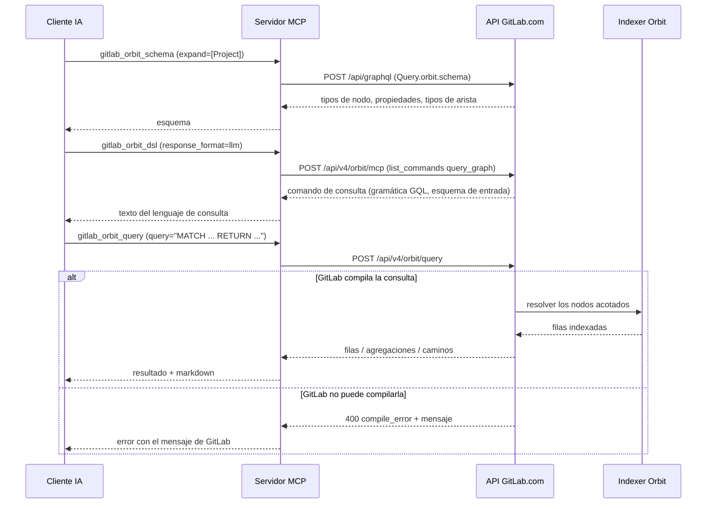

import FAQ from "../../../../components/FAQ.astro";

Orbit expone la API experimental Knowledge Graph de GitLab.com mediante **seis herramientas MCP de solo lectura**: `status`, `schema`, `tools`, `dsl`, `query` y `graph_status`. Solo está disponible cuando el servidor se conecta a `https://gitlab.com` y el nivel resuelto es Premium o Ultimate (`GITLAB_MCP_TIER=premium` o `GITLAB_MCP_TIER=ultimate`, `--tier=premium` o `--tier=ultimate` en modo HTTP, o el nivel detectado a partir de la licencia de la instancia, después de los planes de los namespaces y después de los grupos de nivel superior de los que el token es miembro). La variable de entorno `GITLAB_ENTERPRISE` se eliminó en 3.0.0 y se ignora. Orbit nunca escribe: cada herramienta inspecciona salud, esquema o datos indexados, o ejecuta una consulta de solo lectura sobre el grafo.

:::note[Referencia técnica]
Para cada acción con sus parámetros, consulta la página [Grafo de conocimiento Orbit](/gitlab-mcp-server/es/reference/tools/orbit/) de la referencia de herramientas.
:::

## ¿Cuándo está disponible Orbit?

Orbit solo se registra en conexiones a GitLab.com con nivel Premium o Ultimate. Requiere el host `https://gitlab.com` **y** un nivel resuelto de Premium o Ultimate. En la superficie dinámica predeterminada sus seis acciones son las entradas `orbit.*` del catálogo, accesibles con `gitlab_find_action` y `gitlab_execute_action`; con `GITLAB_MCP_TOOL_SURFACE=meta` es la única herramienta `gitlab_orbit` con seis acciones; con `GITLAB_MCP_TOOL_SURFACE=individual` son seis herramientas `gitlab_orbit_*`. Todas las herramientas Orbit son de solo lectura.

| Requisito                            | Valor                                               |
| ------------------------------------ | --------------------------------------------------- |
| Host de GitLab                       | `https://gitlab.com`                                |
| Nivel                                | Premium o Ultimate                                  |
| Superficie dinámica (predeterminada) | Acciones `orbit.*` mediante `gitlab_execute_action` |
| Modo meta-herramientas               | `gitlab_orbit` con seis acciones                    |
| Modo individual                      | Seis herramientas `gitlab_orbit_*`                  |
| Comportamiento de escritura          | Solo lectura                                        |

Las instancias GitLab autoalojadas no registran herramientas Orbit, incluso en un nivel Premium o Ultimate.

Lo que responde lo decide el propio GitLab.com. Desde la disponibilidad general de Orbit el 29 de octubre de 2026 el plan ya no cuenta allí: GitLab.com sirve el índice y las consultas de un grupo solo a un grupo de nivel superior con el complemento `orbit_promo` o una prueba de Orbit en curso, y responde a todo lo demás con `403` o sin nada donde estaría el índice. El servidor informa de cualquiera de los dos como un error que dice que Orbit no se sirve a ese token ahí, nunca como un resultado vacío. La única excepción explica el porqué: `graph_status` de un grupo de nivel superior, pedido con un token que tiene ahí el rol Owner, devuelve el `access` y el `trial` de Orbit del grupo, que GitLab responde junto al índice que falta, y dice que el índice falta por el acceso, no porque el grafo esté vacío.

### De dónde lee cada acción

GitLab.com retiró cinco de las seis rutas REST que usaba Orbit el 27 y el 28 de octubre de 2026. Cada acción lee ahora la fuente que GitLab ofrece en su lugar, una API documentada donde la hay, y el endpoint MCP de Orbit solo para lo que nada más sirve:

| Acción         | Fuente en GitLab.com                                                                                          |
| -------------- | ------------------------------------------------------------------------------------------------------------- |
| `status`       | GraphQL `Query.orbit.serviceStatus`                                                                           |
| `schema`       | GraphQL `Query.orbit.schema`; `llm` desde `get_graph_schema` de `POST /api/v4/orbit/mcp`                      |
| `tools`        | `tools/list` del endpoint MCP de Orbit, `POST /api/v4/orbit/mcp`                                              |
| `dsl`          | `list_commands` del endpoint MCP de Orbit                                                                     |
| `query`        | `POST /api/v4/orbit/query`                                                                                    |
| `graph_status` | GraphQL `Group.orbit` y `Project.orbit` (`indexing`, `itemCounts`, `enabled`, `enabledAt`, `access`, `trial`) |

## Acciones

| Acción         | ID canónico          | Herramienta individual      | Propósito                                                                      |
| -------------- | -------------------- | --------------------------- | ------------------------------------------------------------------------------ |
| `status`       | `orbit.status`       | `gitlab_orbit_status`       | Comprobar la salud del servicio Orbit y el estado de sus componentes           |
| `schema`       | `orbit.schema`       | `gitlab_orbit_schema`       | Inspeccionar el esquema del grafo y las propiedades de los nodos nombrados     |
| `tools`        | `orbit.tools`        | `gitlab_orbit_tools`        | Listar las herramientas que sirve el endpoint MCP de Orbit de GitLab           |
| `dsl`          | `orbit.dsl`          | `gitlab_orbit_dsl`          | Leer el lenguaje de consulta en el que GitLab.com compila las consultas, GQL   |
| `query`        | `orbit.query`        | `gitlab_orbit_query`        | Ejecutar una consulta de solo lectura sobre el Knowledge Graph escrita en GQL  |
| `graph_status` | `orbit.graph_status` | `gitlab_orbit_graph_status` | Inspeccionar el estado de indexación de un namespace, proyecto o ruta completa |

El nombre de la acción es lo que la meta-herramienta `gitlab_orbit` recibe en `action`; el ID canónico es lo que recibe `gitlab_execute_action` en la superficie dinámica predeterminada.

## ¿Cuál es el flujo típico?

El flujo típico de Orbit aprende primero el lenguaje de consulta y el grafo, y consulta después, porque el lenguaje y la ontología que sirve GitLab.com cambian durante la beta. Confirma que el servicio está activo con `status`, lee el lenguaje de consulta con `dsl` y el grafo con `schema`, y luego envía una sentencia GQL a `query`.

1. Ejecuta la acción `status` (`gitlab_execute_action` con `action: "orbit.status"` en la superficie predeterminada; `gitlab_orbit` con `action: "status"` cuando `GITLAB_MCP_TOOL_SURFACE=meta`) para confirmar que el servicio está disponible.
2. Ejecuta `dsl` para obtener el lenguaje de consulta: la gramática del comando con el que se ejecuta una consulta y el JSON Schema de su entrada (`raw`), o lo mismo como texto compacto (`llm`).
3. Ejecuta `schema` para obtener las entidades, sus propiedades y los tipos de relación entre ellas.
4. (Opcional) Ejecuta `tools` para obtener las herramientas que sirve el endpoint MCP de Orbit de GitLab, con el esquema de entrada de cada una.
5. Pasa una sentencia GQL como texto a `query`, con `response_format` en `raw`, `llm` o `gql`.

### El lenguaje de consulta

El parámetro `query` de la acción `query` es GQL, el lenguaje de solo lectura basado en openCypher 9 en el que GitLab.com compila todas las consultas desde que activó el flag `orbit_gql_queries` para todos el 2026-10-15. Una consulta es una sentencia:

```text
MATCH pattern [WHERE predicates]
RETURN projections
[ORDER BY key [ASC | DESC]]
[SKIP rows] [LIMIT rows]
```

GitLab deduce de la sentencia qué tipo de consulta es y lo indica junto al resultado como `query_type`: un recorrido, una agregación cuando `RETURN` contiene un agregado, los vecinos de un nodo o un camino más corto. Las reglas en las que más se equivoca un modelo:

- **Acota al menos un nodo.** Todo nodo lleva una etiqueta donde aparece por primera vez, y al menos uno está acotado por su id o por una propiedad literal, en línea como `{id: 278964}` o `{full_path: 'gitlab-org/gitlab'}`, o en una comparación de `WHERE`. `LIMIT` no acota nada: `MATCH (p:Project) RETURN p LIMIT 5` se rechaza con "add filters or node_ids to at least one node".
- **Un tipo de relación va tras dos puntos.** `-[:IN_PROJECT]->` nombra el tipo, y `-[IN_PROJECT]->` declara una variable llamada `IN_PROJECT` y se rechaza. Una repetición está acotada, `*1..3` como mucho, y `-[*1..3]->` sigue cualquier tipo.
- **`WHERE` admite `AND` y `NOT`, sobre las propiedades de un nodo.** `OR`, `XOR`, `RETURN DISTINCT`, `count(*)`, `OPTIONAL MATCH`, `WITH` y `UNION` se rechazan, y una lista se niega como `NOT p.visibility_level IN [...]`; `count(DISTINCT x)` cuenta valores distintos. Las comparaciones son `=`, `<>` o `!=`, `<`, `<=`, `>`, `>=`, `IN`, `STARTS WITH`, `ENDS WITH`, `CONTAINS`, `IS NULL` e `IS NOT NULL`. Los valores son literales escritos en la sentencia, porque el lenguaje no admite parámetros.
- **La flecha decide la dirección.** Entre nodos etiquetados la flecha es `->` o `<-`, y cada relación se recorre solo en su dirección definida: un merge request está `IN_PROJECT` en su proyecto. El `--` sin dirección es para los vecinos de un nodo, cuyo extremo lejano tiene una variable y nada más: `MATCH (p:Project {id: 278964})--(n) RETURN n`.
- **Un camino tiene los dos extremos acotados y nombra sus tipos de relación.** `MATCH path = ANY SHORTEST (a)-[:TYPE*1..3]->(b) RETURN path`, con `a` y `b` acotados; un comodín como `-[*1..3]->` se rechaza en un camino más corto.
- **Un agregado lleva un alias para ordenar por él.** `count`, `sum`, `avg`, `min` y `max` agregan, y cualquier otro elemento de `RETURN` es una clave de agrupación: `RETURN p, count(mr) AS mr_count ORDER BY mr_count DESC`. Una sola clave de orden, sin desempate.
- **Una página es `SKIP` y `LIMIT`.** `SKIP` admite de 0 a 10000 y `LIMIT` de 1 a 1000, como en `ORDER BY p.id SKIP 20 LIMIT 20`. `PAGE` y `AFTER` se rechazan.

### Cuando GitLab rechaza una consulta

El servidor solo comprueba que se haya dado una consulta, como texto; del resto juzga GitLab. A una consulta que no puede compilar responde con `400` y un mensaje que nombra el fallo, que llega al modelo en el texto del error junto con una sugerencia para corregir la consulta a partir de `dsl` y `schema`:

```text
orbit_query: bad request: check your input parameters ({code: compile_error}, {message: schema violation: add filters or node_ids to at least one node}). Suggestion: correct the query where GitLab's message points. orbit.dsl serves the query language and orbit.schema the entities, properties and relationship types it accepts: POST https://gitlab.com/api/v4/orbit/query: 400 ...
```

A un error de sintaxis responde con su línea y su columna y con lo que esperaba allí, y a un nombre que GitLab no conoce con todos los que sí conoce, así que la corrección suele estar en el propio mensaje.

El DSL JSON que GitLab.com leía hasta el 2026-10-15 ya no existe: GitLab.com lo retiró el 2026-10-27, y su ruta de consulta toma la consulta como texto. Por eso el parámetro `query` es una cadena, y un objeto se rechaza antes de enviar nada. Una consulta JSON escrita como texto sí llega a GitLab.com, que la analiza como GQL y la rechaza, y el error dice qué enviar en su lugar:

```text
orbit_query: bad request: check your input parameters ({code: compile_error}, {message: schema violation: Orbit query syntax at line 1, column 1: expected Statement ...}). Suggestion: GitLab.com reads a query as GQL text, not as a JSON object. Send a GQL statement, such as MATCH (p:Project {full_path: 'gitlab-org/gitlab'}) RETURN p.id, p.full_path LIMIT 1. orbit.dsl serves the language and orbit.schema the entities, properties and relationship types it accepts: POST https://gitlab.com/api/v4/orbit/query: 400 ...
```

### Flujo descubrir → consultar

El patrón recomendado es leer primero el grafo con `schema` y el lenguaje de consulta con `dsl`, y luego ejecutar una consulta mediante `query`. Un `sequenceDiagram` encaja porque los pasos involucran a cuatro actores distintos (cliente de IA, servidor MCP, GitLab.com e indexer de Orbit) y los límites de respuesta importan: el LLM no debe asumir que el lenguaje que describe `dsl` es estable, y una consulta que GitLab no puede compilar vuelve con la explicación del propio GitLab.



Los ejemplos siguientes usan la superficie dinámica predeterminada; con `GITLAB_MCP_TOOL_SURFACE=meta` llama a `gitlab_orbit` en lugar de `gitlab_execute_action` y quita el prefijo `orbit.` de `action`. GitLab.com compiló todas sus consultas el 2026-10-17.

### Ejemplo: Comprobar estado de Orbit

```json
{
  "tool": "gitlab_execute_action",
  "arguments": {
    "action": "orbit.status",
    "params": {}
  }
}
```

### Ejemplo: Obtener el esquema del grafo

```json
{
  "tool": "gitlab_execute_action",
  "arguments": {
    "action": "orbit.schema",
    "params": {
      "expand": ["Project", "User"],
      "response_format": "llm"
    }
  }
}
```

### Ejemplo: Obtener el manifiesto de herramientas Orbit

```json
{
  "tool": "gitlab_execute_action",
  "arguments": {
    "action": "orbit.tools",
    "params": {}
  }
}
```

### Ejemplo: Leer el lenguaje de consulta

```json
{
  "tool": "gitlab_execute_action",
  "arguments": {
    "action": "orbit.dsl",
    "params": {
      "response_format": "llm"
    }
  }
}
```

### Ejemplo: Ejecutar una consulta Knowledge Graph

```json
{
  "tool": "gitlab_execute_action",
  "arguments": {
    "action": "orbit.query",
    "params": {
      "query": "MATCH (p:Project) WHERE p.full_path STARTS WITH 'gitlab-org/' RETURN p.id, p.full_path LIMIT 20",
      "response_format": "llm"
    }
  }
}
```

### Ejemplo: Contar merge requests por proyecto

```json
{
  "tool": "gitlab_execute_action",
  "arguments": {
    "action": "orbit.query",
    "params": {
      "query": "MATCH (mr:MergeRequest)-[:IN_PROJECT]->(p:Project) WHERE p.full_path STARTS WITH 'gitlab-org/' RETURN p, count(mr) AS mr_count ORDER BY mr_count DESC"
    }
  }
}
```

### Ejemplo: Todo aquello con lo que se relaciona un proyecto

```json
{
  "tool": "gitlab_execute_action",
  "arguments": {
    "action": "orbit.query",
    "params": {
      "query": "MATCH (p:Project {full_path: 'gitlab-org/gitlab'})--(n) RETURN n LIMIT 50"
    }
  }
}
```

### Ejemplo: Un camino de un merge request a su proyecto

```json
{
  "tool": "gitlab_execute_action",
  "arguments": {
    "action": "orbit.query",
    "params": {
      "query": "MATCH path = ANY SHORTEST (mr:MergeRequest {source_branch: 'master'})-[:IN_PROJECT*1..2]->(p:Project {full_path: 'gitlab-org/gitlab'}) RETURN path"
    }
  }
}
```

### Ejemplo: Comprobar estado de indexación

```json
{
  "tool": "gitlab_execute_action",
  "arguments": {
    "action": "orbit.graph_status",
    "params": {
      "project_id": 278964
    }
  }
}
```

## Detalle de acciones

### `status`: Comprobar salud del servicio Orbit

Devuelve la salud del servicio Orbit: su `status` general (`HEALTHY`, `DEGRADED`, `UNHEALTHY`, `MIGRATING` o `UNKNOWN`), su `version`, y el `name` y el `status` de cada componente. GitLab lo responde por GraphQL con una sola forma, así que `response_format` se acepta y no cambia nada. Un token al que no se sirve Orbit recibe un error que lo dice en vez de un estado vacío.

**Ejemplo:** Ver arriba.

### `schema`: Inspeccionar el esquema del grafo

Devuelve los tipos de nodo y de arista que nombra una consulta: de cada nodo su `name`, `description`, `domain`, `primary_key`, `label_field` y `display` (color y tamaño), de cada arista su `name`, su `description` y los tipos de nodo de origen y destino que conecta (`variants`), y los `domains` con los tipos de nodo de cada uno. Nombra tipos de nodo en `expand` para obtener sus `properties` (nombre, tipo de dato, si puede estar vacía y los valores de un enum). Con `format` o `response_format` en `llm` devuelve en su lugar el esquema como texto compacto.

**Ejemplo:** Ver arriba.

### `tools`: Listar las herramientas MCP de Orbit

Devuelve las herramientas que sirve el endpoint MCP de Orbit de GitLab (hoy `list_commands` e `invoke_command`), cada una con su descripción, su esquema de entrada como `parameters` y su indicador `trusted`. El lenguaje de consulta en sí es lo que devuelve `dsl`.

**Ejemplo:** Ver arriba.

### `dsl`: Leer el lenguaje de consulta

Devuelve el lenguaje de consulta en el que GitLab.com compila las consultas, GQL, tal como lo publica GitLab.com: el comando `query_graph` con el que se ejecuta una consulta, su gramática y el JSON Schema de su entrada (`raw`, el valor por defecto), o lo mismo como texto compacto (`llm`). Lee `list_commands` del endpoint MCP de Orbit, que responde la lista de comandos que daba la ruta retirada `GET /api/v4/orbit/agent/commands`.

**Ejemplo:** Ver arriba.

### `query`: Ejecutar una consulta Knowledge Graph

Ejecuta una consulta de solo lectura sobre el Knowledge Graph. El parámetro `query` es una sentencia GQL enviada como texto, en el lenguaje que describe `dsl`, que nombra entidades, propiedades y tipos de relación que lista `schema`. GitLab juzga la consulta y responde a la que no puede ejecutar con un mensaje que nombra el fallo, y el servidor lo transmite. Soporta `response_format`: `raw` (JSON estructurado, el valor por defecto), `llm` (texto compacto) o `gql` (el resultado como tabla de patrones del grafo, texto como `llm`).

**Ejemplo:** Ver arriba.

### `graph_status`: Inspeccionar estado de indexación

Devuelve el índice Orbit de un grupo o proyecto, nombrado por `namespace_id`, `project_id` o `full_path`: si Orbit está activado en su grupo de nivel superior y desde cuándo (`enabled`, `enabled_at`, enviados para un grupo), los recuentos de proyectos (`indexed`, `total_known`, `gaps`, `not_indexed`, `total`), el `state` de la indexación (`READY`, `INDEXING`, `NOT_STARTED`, `FAILED` o `UNKNOWN`) con la hora de la última ejecución completada y el estado de cada área, y el número de elementos indexados de cada entidad en cada dominio. Úsalo para comprobar que un proyecto está indexado antes de consultarlo. `response_format` se acepta y no cambia nada.

Para un grupo de nivel superior, a un token con el rol Owner ahí, devuelve además el `access` y el `trial` de Orbit del grupo, que dicen si GitLab.com sirve el índice, con los nombres y valores de GitLab:

- `access`: su `state` (`LICENSED`, `TRIAL_ACTIVE`, `TRIAL_ELIGIBLE`, `TRIAL_ENDED`, `TRIAL_NOT_ELIGIBLE`, `TRIAL_STATUS_UNAVAILABLE`, `UNLICENSED` o `NOT_CONFIGURED`), la `reason` de un estado con más de una causa (de dónde viene el acceso de un grupo con licencia, `PLAN`, `PROMO_ADD_ON` o `BETA`, o por qué un grupo no lo tiene) y la `turn_on_denial_reason` que dice por qué el usuario del token no puede activar Orbit.
- `trial`: su `state` (`ELIGIBLE`, `NOT_ELIGIBLE`, `ACTIVE` o `ENDED`), su último día (`expires_on`), sus `credits` (`remaining` y `total`) y, para un usuario que puede iniciarla, la `offer` de una prueba nueva (`duration_days` e `initial_credits`).

GitLab.com sirve el índice con acceso `LICENSED` o `TRIAL_ACTIVE`. Un grupo de nivel superior al que responde con su acceso y sin índice se devuelve con ellos en lugar de como un error, y la tarjeta dice en una línea propia por qué falta el índice: el acceso con cualquier otro estado, y con esos dos, que Orbit está desactivado o una de las razones que GitLab documenta para un índice que falta. GitLab no responde ninguno de los dos para un subgrupo o un proyecto, ni a un token sin el rol Owner en el grupo, así que ahí no aparecen; pídelos con el `full_path` del grupo de nivel superior y un token de Owner. Un subgrupo o proyecto cuyo índice GitLab no sirve es un error que lo dice.

**Ejemplo:** Ver arriba.

### Qué cambió en 3.4.0

Los seis IDs de acción, nombres de herramienta y parámetros son los de versiones anteriores. Lo que GitLab ya no envía en ninguna parte salió de las salidas junto con las rutas:

- `status`: los objetos `user` y `system`, `timestamp`, `formatted_text`, y `replicas` y `metrics` de cada componente. El `status` de un componente y el general son ahora los estados en mayúsculas de GitLab.
- `schema`: `schema_version`, la `description` de cada dominio, y `incoming_edges` y `outgoing_edges` de cada nodo, que la lista de aristas lleva par a par. Los nodos tienen ahora tipo, con `primary_key`, `label_field` y `display` añadidos.
- `graph_status`: `formatted_text`, el `state` de cada elemento, y `last_started_at`, `last_duration_ms` y `last_error` de la última ejecución. Añadidos: `enabled`, `enabled_at`, `not_indexed`, `total`, las áreas de `indexing`, y el `access` y el `trial` de un grupo de nivel superior. Un grupo de nivel superior al que GitLab.com no sirve índice se responde con su acceso y su prueba en lugar de un error.
- `tools`: añadido el indicador `trusted` de cada herramienta.
- `query`: el parámetro `query` es una cadena. Tomaba también un objeto JSON, el DSL JSON que GitLab.com retiró el 27 de octubre de 2026, que GitLab.com rechaza contenga lo que contenga.

## ¿Cómo descubro los schemas de consulta?

En cualquier superficie, los schemas de parámetros por acción están disponibles como recursos MCP, así que puedes conocer la forma exacta de `params` de cada acción Orbit sin expandir todos los schemas en `tools/list`; en la superficie dinámica `gitlab_find_action` devuelve el mismo schema inline. Estos recursos siguen disponibles con `GITLAB_MCP_CAPABILITY_SURFACE=full` o `minimal` en cualquier modo de `GITLAB_MCP_META_PARAM_SCHEMA`. La tabla lista los IDs de la superficie predeterminada; con `GITLAB_MCP_TOOL_SURFACE=meta` la entrada es `gitlab://tools/gitlab_orbit.<acción>`.

| Recurso                             | Propósito                                               |
| ----------------------------------- | ------------------------------------------------------- |
| `gitlab://tools/orbit.status`       | Parámetros para comprobar salud del servicio            |
| `gitlab://tools/orbit.schema`       | Parámetros para inspeccionar la ontología               |
| `gitlab://tools/orbit.tools`        | Parámetros para descubrir el manifiesto de herramientas |
| `gitlab://tools/orbit.dsl`          | Parámetros para el lenguaje de consulta                 |
| `gitlab://tools/orbit.query`        | Parámetros para consultas Knowledge Graph               |
| `gitlab://tools/orbit.graph_status` | Parámetros para comprobar estado de indexación          |

<FAQ />
