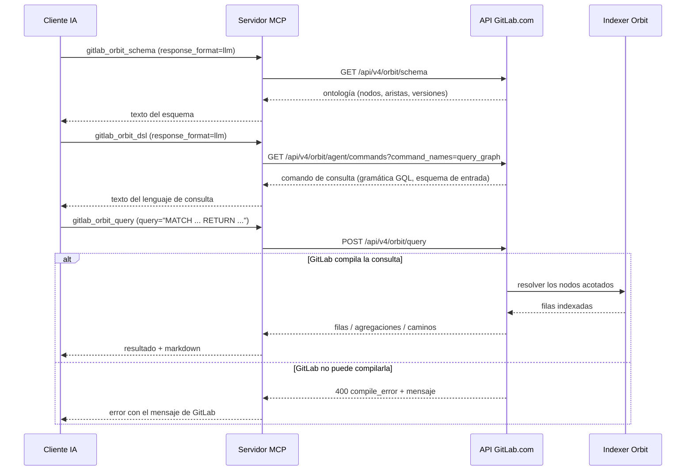

import FAQ from "../../../../components/FAQ.astro";

Orbit expone la API experimental Knowledge Graph de GitLab.com mediante **seis herramientas MCP de solo lectura**: `status`, `schema`, `tools`, `dsl`, `query` y `graph_status`. Solo está disponible cuando el servidor se conecta a `https://gitlab.com` y el nivel resuelto es Premium o Ultimate (`GITLAB_MCP_TIER=premium` o `GITLAB_MCP_TIER=ultimate`, `--tier=premium` o `--tier=ultimate` en modo HTTP, o el nivel detectado a partir de la licencia de la instancia, después de los planes de los namespaces y después de los grupos de nivel superior de los que el token es miembro). La variable de entorno `GITLAB_ENTERPRISE` se eliminó en 3.0.0 y se ignora. Orbit nunca escribe: cada herramienta inspecciona salud, esquema o datos indexados, o ejecuta una consulta de solo lectura sobre el grafo.

:::note[Referencia técnica]
Para cada acción con sus parámetros, consulta la página [Grafo de conocimiento Orbit](/gitlab-mcp-server/es/reference/tools/orbit/) de la referencia de herramientas.
:::

## ¿Cuándo está disponible Orbit?

Orbit solo se registra en conexiones a GitLab.com con nivel Premium o Ultimate. Requiere el host `https://gitlab.com` **y** un nivel resuelto de Premium o Ultimate. En la superficie dinámica predeterminada sus seis acciones son las entradas `orbit.*` del catálogo, accesibles con `gitlab_find_action` y `gitlab_execute_action`; con `GITLAB_MCP_TOOL_SURFACE=meta` es la única herramienta `gitlab_orbit` con seis acciones; con `GITLAB_MCP_TOOL_SURFACE=individual` son seis herramientas `gitlab_orbit_*`. Todas las herramientas Orbit son de solo lectura.

| Requisito                            | Valor                                               |
| ------------------------------------ | --------------------------------------------------- |
| Host de GitLab                       | `https://gitlab.com`                                |
| Nivel                                | Premium o Ultimate                                  |
| Superficie dinámica (predeterminada) | Acciones `orbit.*` mediante `gitlab_execute_action` |
| Modo meta-herramientas               | `gitlab_orbit` con seis acciones                    |
| Modo individual                      | Seis herramientas `gitlab_orbit_*`                  |
| Comportamiento de escritura          | Solo lectura                                        |

Las instancias GitLab autoalojadas no registran herramientas Orbit, incluso en un nivel Premium o Ultimate.

## Acciones

| Acción         | ID canónico          | Herramienta individual      | Propósito                                                                      |
| -------------- | -------------------- | --------------------------- | ------------------------------------------------------------------------------ |
| `status`       | `orbit.status`       | `gitlab_orbit_status`       | Comprobar la salud del servicio Orbit y el estado de sus componentes           |
| `schema`       | `orbit.schema`       | `gitlab_orbit_schema`       | Inspeccionar la ontología del grafo y ampliar definiciones de nodos            |
| `tools`        | `orbit.tools`        | `gitlab_orbit_tools`        | Listar el manifiesto de herramientas MCP que sirve Orbit                       |
| `dsl`          | `orbit.dsl`          | `gitlab_orbit_dsl`          | Leer el lenguaje de consulta en el que GitLab.com compila las consultas, GQL   |
| `query`        | `orbit.query`        | `gitlab_orbit_query`        | Ejecutar una consulta de solo lectura sobre el Knowledge Graph escrita en GQL  |
| `graph_status` | `orbit.graph_status` | `gitlab_orbit_graph_status` | Inspeccionar el estado de indexación de un namespace, proyecto o ruta completa |

El nombre de la acción es lo que la meta-herramienta `gitlab_orbit` recibe en `action`; el ID canónico es lo que recibe `gitlab_execute_action` en la superficie dinámica predeterminada.

## ¿Cuál es el flujo típico?

El flujo típico de Orbit aprende primero el lenguaje de consulta y el grafo, y consulta después, porque el lenguaje y la ontología que sirve GitLab.com cambian durante la beta. Confirma que el servicio está activo con `status`, lee el lenguaje de consulta con `dsl` y el grafo con `schema`, y luego envía una sentencia GQL a `query`.

1. Ejecuta la acción `status` (`gitlab_execute_action` con `action: "orbit.status"` en la superficie predeterminada; `gitlab_orbit` con `action: "status"` cuando `GITLAB_MCP_TOOL_SURFACE=meta`) para confirmar que el servicio está disponible.
2. Ejecuta `dsl` para obtener el lenguaje de consulta: la gramática del comando con el que se ejecuta una consulta y el JSON Schema de su entrada (`raw`), o lo mismo como texto compacto (`llm`).
3. Ejecuta `schema` para obtener las entidades, sus propiedades y los tipos de relación entre ellas.
4. (Opcional) Ejecuta `tools` para obtener el manifiesto de herramientas MCP que sirve Orbit, con el esquema de parámetros de cada una de sus herramientas.
5. Pasa una sentencia GQL como texto a `query`, con `response_format` en `raw`, `llm` o `gql`.

### El lenguaje de consulta

El parámetro `query` de la acción `query` es GQL, el lenguaje de solo lectura basado en openCypher 9 en el que GitLab.com compila todas las consultas desde que activó el flag `orbit_gql_queries` para todos el 2026-10-15. Una consulta es una sentencia:

```text
MATCH pattern [WHERE predicates]
RETURN projections
[ORDER BY key [ASC | DESC]]
[LIMIT rows | PAGE rows [AFTER 'cursor']]
```

GitLab deduce de la sentencia qué tipo de consulta es y lo indica junto al resultado como `query_type`: un recorrido, una agregación cuando `RETURN` contiene un agregado, los vecinos de un nodo o un camino más corto. Las reglas en las que más se equivoca un modelo:

- **Acota al menos un nodo.** Todo nodo lleva una etiqueta donde aparece por primera vez, y al menos uno está acotado por su id o por una propiedad literal, en línea como `{id: 278964}` o `{full_path: 'gitlab-org/gitlab'}`, o en una comparación de `WHERE`. `LIMIT` no acota nada: `MATCH (p:Project) RETURN p LIMIT 5` se rechaza con "add filters or node_ids to at least one node".
- **Un tipo de relación va tras dos puntos.** `-[:IN_PROJECT]->` nombra el tipo, y `-[IN_PROJECT]->` declara una variable llamada `IN_PROJECT` y se rechaza. Una repetición está acotada, `*1..3` como mucho, y `-[*1..3]->` sigue cualquier tipo.
- **`WHERE` admite `AND` y `NOT`.** `OR`, `XOR`, `DISTINCT`, `count(*)`, `OPTIONAL MATCH`, `WITH` y `UNION` se rechazan, y una lista se niega como `NOT p.visibility_level IN [...]`. Las comparaciones son `=`, `<>` o `!=`, `<`, `<=`, `>`, `>=`, `IN`, `STARTS WITH`, `ENDS WITH`, `CONTAINS`, `IS NULL` e `IS NOT NULL`. Los valores son literales escritos en la sentencia, porque el lenguaje no admite parámetros.
- **La flecha decide la dirección.** Entre nodos etiquetados la flecha es `->` o `<-`, y cada relación se recorre solo en su dirección definida: un merge request está `IN_PROJECT` en su proyecto. El `--` sin dirección es para los vecinos de un nodo, cuyo extremo lejano tiene una variable y nada más: `MATCH (p:Project {id: 278964})--(n) RETURN n`.
- **Un camino tiene los dos extremos acotados.** `MATCH path = ANY SHORTEST (a)-[:TYPE*1..3]->(b) RETURN path`, con `a` y `b` acotados.
- **Un agregado lleva un alias para ordenar por él.** `count`, `sum`, `avg`, `min` y `max` agregan, y cualquier otro elemento de `RETURN` es una clave de agrupación: `RETURN p, count(mr) AS mr_count ORDER BY mr_count DESC`.

### Cuando GitLab rechaza una consulta

El servidor solo comprueba que se haya dado una consulta, como texto o como objeto; del resto juzga GitLab. A una consulta que no puede compilar responde con `400` y un mensaje que nombra el fallo, que llega al modelo en el texto del error junto con una sugerencia para corregir la consulta a partir de `dsl` y `schema`:

```text
orbit_query: bad request: check your input parameters ({code: compile_error}, {message: schema violation: add filters or node_ids to at least one node}). Suggestion: correct the query where GitLab's message points. orbit.dsl serves the query language and orbit.schema the entities, properties and relationship types it accepts: POST https://gitlab.com/api/v4/orbit/query: 400 ...
```

A un error de sintaxis responde con su línea y su columna y con lo que esperaba allí, y a un nombre que GitLab no conoce con todos los que sí conoce, así que la corrección suele estar en el propio mensaje.

Una consulta escrita como objeto JSON, el DSL JSON que GitLab.com leía hasta el 2026-10-15, se sigue reenviando tal cual, para que siga funcionando si GitLab.com vuelve a desactivar GQL. Mientras GitLab.com lea GQL, analiza el objeto como GQL y lo rechaza, y el error dice qué enviar en su lugar. El mismo objeto enviado como texto JSON recibe la misma respuesta:

```text
orbit_query: bad request: check your input parameters ({code: compile_error}, {message: schema violation: Orbit query syntax at line 1, column 1: expected Statement ...}). Suggestion: GitLab.com reads a query as GQL text, not as a JSON object. Send the query as a string, such as MATCH (p:Project {full_path: 'gitlab-org/gitlab'}) RETURN p.id, p.full_path LIMIT 1. orbit.dsl serves the language and orbit.schema the entities, properties and relationship types it accepts: POST https://gitlab.com/api/v4/orbit/query: 400 ...
```

### Flujo descubrir → consultar

El patrón recomendado es leer primero el grafo con `schema` y el lenguaje de consulta con `dsl`, y luego ejecutar una consulta mediante `query`. Un `sequenceDiagram` encaja porque los pasos involucran a cuatro actores distintos (cliente de IA, servidor MCP, GitLab.com e indexer de Orbit) y los límites de respuesta importan: el LLM no debe asumir que el lenguaje que describe `dsl` es estable, y una consulta que GitLab no puede compilar vuelve con la explicación del propio GitLab.



Los ejemplos siguientes usan la superficie dinámica predeterminada; con `GITLAB_MCP_TOOL_SURFACE=meta` llama a `gitlab_orbit` en lugar de `gitlab_execute_action` y quita el prefijo `orbit.` de `action`. GitLab.com compiló todas sus consultas el 2026-10-17.

### Ejemplo: Comprobar estado de Orbit

```json
{
  "tool": "gitlab_execute_action",
  "arguments": {
    "action": "orbit.status",
    "params": {}
  }
}
```

### Ejemplo: Obtener el esquema del grafo

```json
{
  "tool": "gitlab_execute_action",
  "arguments": {
    "action": "orbit.schema",
    "params": {
      "expand": ["Project", "User"],
      "response_format": "llm"
    }
  }
}
```

### Ejemplo: Obtener el manifiesto de herramientas Orbit

```json
{
  "tool": "gitlab_execute_action",
  "arguments": {
    "action": "orbit.tools",
    "params": {}
  }
}
```

### Ejemplo: Leer el lenguaje de consulta

```json
{
  "tool": "gitlab_execute_action",
  "arguments": {
    "action": "orbit.dsl",
    "params": {
      "response_format": "llm"
    }
  }
}
```

### Ejemplo: Ejecutar una consulta Knowledge Graph

```json
{
  "tool": "gitlab_execute_action",
  "arguments": {
    "action": "orbit.query",
    "params": {
      "query": "MATCH (p:Project) WHERE p.full_path STARTS WITH 'gitlab-org/' RETURN p.id, p.full_path LIMIT 20",
      "response_format": "llm"
    }
  }
}
```

### Ejemplo: Contar merge requests por proyecto

```json
{
  "tool": "gitlab_execute_action",
  "arguments": {
    "action": "orbit.query",
    "params": {
      "query": "MATCH (mr:MergeRequest)-[:IN_PROJECT]->(p:Project) WHERE p.full_path STARTS WITH 'gitlab-org/' RETURN p, count(mr) AS mr_count ORDER BY mr_count DESC"
    }
  }
}
```

### Ejemplo: Todo aquello con lo que se relaciona un proyecto

```json
{
  "tool": "gitlab_execute_action",
  "arguments": {
    "action": "orbit.query",
    "params": {
      "query": "MATCH (p:Project {full_path: 'gitlab-org/gitlab'})--(n) RETURN n LIMIT 50"
    }
  }
}
```

### Ejemplo: Un camino de un merge request a su proyecto

```json
{
  "tool": "gitlab_execute_action",
  "arguments": {
    "action": "orbit.query",
    "params": {
      "query": "MATCH path = ANY SHORTEST (mr:MergeRequest {source_branch: 'master'})-[:IN_PROJECT*1..2]->(p:Project {full_path: 'gitlab-org/gitlab'}) RETURN path"
    }
  }
}
```

### Ejemplo: Comprobar estado de indexación

```json
{
  "tool": "gitlab_execute_action",
  "arguments": {
    "action": "orbit.graph_status",
    "params": {
      "project_id": 278964,
      "response_format": "llm"
    }
  }
}
```

## Detalle de acciones

### `status`: Comprobar salud del servicio Orbit

Devuelve la salud del clúster y el estado de los componentes backend. Útil para verificar si Orbit está disponible para tu token y proyecto.

**Ejemplo:** Ver arriba.

### `schema`: Inspeccionar la ontología del grafo

Devuelve la ontología del grafo Orbit, incluyendo versión, dominios, nodos y aristas. Usa `expand` para obtener definiciones detalladas de nodos. Soporta `response_format` (`raw` o `llm`).

**Ejemplo:** Ver arriba.

### `tools`: Descubrir el manifiesto de herramientas Orbit

Devuelve el manifiesto de herramientas MCP que sirve Orbit, con el esquema de parámetros de cada una de sus herramientas. El lenguaje de consulta en sí es lo que devuelve `dsl`.

**Ejemplo:** Ver arriba.

### `dsl`: Leer el lenguaje de consulta

Devuelve el lenguaje de consulta en el que GitLab.com compila las consultas, GQL, tal como lo publica GitLab.com: el comando `query_graph` con el que se ejecuta una consulta, su gramática y el JSON Schema de su entrada (`raw`), o lo mismo como texto compacto (`llm`). Lee `GET /api/v4/orbit/agent/commands`. La ruta que servía el DSL JSON de consulta, `GET /api/v4/orbit/schema/dsl`, responde 404 en GitLab.com desde que GQL la sustituyó, y nada en el servidor la consulta.

**Ejemplo:** Ver arriba.

### `query`: Ejecutar una consulta Knowledge Graph

Ejecuta una consulta de solo lectura sobre el Knowledge Graph. El parámetro `query` es una sentencia GQL enviada como texto, en el lenguaje que describe `dsl`, que nombra entidades, propiedades y tipos de relación que lista `schema`. Un objeto JSON se reenvía tal cual, y GitLab.com lo rechaza mientras lea GQL. GitLab juzga la consulta y responde a la que no puede ejecutar con un mensaje que nombra el fallo, y el servidor lo transmite. Soporta `response_format`: `raw` (JSON estructurado, el valor por defecto), `llm` (texto compacto) o `gql` (el resultado como tabla de patrones del grafo, texto como `llm`).

**Ejemplo:** Ver arriba.

### `graph_status`: Inspeccionar estado de indexación

Devuelve el estado de indexación del grafo para un namespace, proyecto o ruta. Útil para saber si un proyecto está indexado y listo para consultas.

**Ejemplo:** Ver arriba.

## ¿Cómo descubro los schemas de consulta?

En cualquier superficie, los schemas de parámetros por acción están disponibles como recursos MCP, así que puedes conocer la forma exacta de `params` de cada acción Orbit sin expandir todos los schemas en `tools/list`; en la superficie dinámica `gitlab_find_action` devuelve el mismo schema inline. Estos recursos siguen disponibles con `GITLAB_MCP_CAPABILITY_SURFACE=full` o `minimal` en cualquier modo de `GITLAB_MCP_META_PARAM_SCHEMA`. La tabla lista los IDs de la superficie predeterminada; con `GITLAB_MCP_TOOL_SURFACE=meta` la entrada es `gitlab://tools/gitlab_orbit.<acción>`.

| Recurso                             | Propósito                                               |
| ----------------------------------- | ------------------------------------------------------- |
| `gitlab://tools/orbit.status`       | Parámetros para comprobar salud del servicio            |
| `gitlab://tools/orbit.schema`       | Parámetros para inspeccionar la ontología               |
| `gitlab://tools/orbit.tools`        | Parámetros para descubrir el manifiesto de herramientas |
| `gitlab://tools/orbit.dsl`          | Parámetros para el lenguaje de consulta                 |
| `gitlab://tools/orbit.query`        | Parámetros para consultas Knowledge Graph               |
| `gitlab://tools/orbit.graph_status` | Parámetros para comprobar estado de indexación          |

<FAQ />
