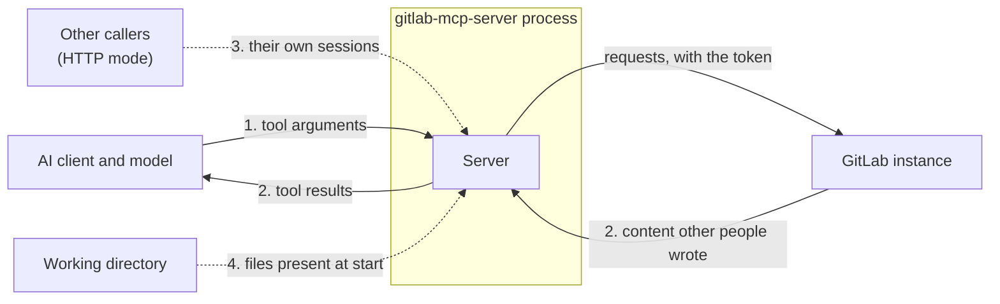

An assurance case is an argument, backed by evidence, that a system meets its security requirements. This page makes that argument for GitLab MCP Server: what it claims, against which adversaries and across which trust boundaries, how its design applies the secure design principles, and how it counters the common implementation weaknesses. Each step names its evidence: the decision record behind it, the code that enforces it, and the test or gate that fails when it stops holding. Where a claim does not hold yet, the page says so.

The requirements are those of the [security policy](https://github.com/jmrplens/gitlab-mcp-server/blob/main/SECURITY.md#threat-model). How each mechanism behaves for an operator is on the [Security](/gitlab-mcp-server/operations/security/) page, and the [October 2026 security review](https://github.com/jmrplens/gitlab-mcp-server/blob/main/docs/development/security-review-2026-10.md) takes every statement of the policy to the code and the tests that hold it, and records those it could not trace.

## Claims

The server makes nine claims, and the rest of this page argues them.

| #   | Claim                                        | What it means                                                                                                                                                                                                                                                                                                                                                                                         |
| --- | -------------------------------------------- | ----------------------------------------------------------------------------------------------------------------------------------------------------------------------------------------------------------------------------------------------------------------------------------------------------------------------------------------------------------------------------------------------------- |
| 1   | Credentials stay confidential                | A token reaches no log line, error, tool result, resource or crash output, and no redirect carries it off the instance it was sent to                                                                                                                                                                                                                                                                 |
| 2   | GitLab content stays data                    | Text other people wrote cannot change the structure of a tool result, or speak in the server's own voice                                                                                                                                                                                                                                                                                              |
| 3   | Callers of one deployment are isolated       | In HTTP mode no caller can observe another's GitLab client, identity, tier, watches or results                                                                                                                                                                                                                                                                                                        |
| 4   | The server acts within the token             | Every request runs as the token's owner; read-only and safe mode hold on every surface; an action whose effect cannot be undone asks for a confirmation unless the call carries `confirm: true` or the operator turned that off                                                                                                                                                                       |
| 5   | Local files are confined                     | A path a caller supplies resolves inside the roots the operator allows, and over HTTP no local path can be named                                                                                                                                                                                                                                                                                      |
| 6   | The server connects only where it should     | No caller value moves a request to another host, or to another endpoint of the instance than the one its action builds ([request-path guard](#path-traversal-in-a-request-path-cwe-23)); a cloud metadata address is never reached, except behind an outbound proxy, where a destination named by a host name is the proxy's to refuse; a private address only where the operator named or allowed it |
| 7   | A repository cannot configure the server     | No file in the directory the client started the server in changes its configuration                                                                                                                                                                                                                                                                                                                   |
| 8   | Consumption is bounded                       | What one caller can make the process hold or spend has a limit, decided in one register                                                                                                                                                                                                                                                                                                               |
| 9   | What users install is what the release built | Release checksums are signed, artifacts carry build provenance, every release from 3.0.0 is immutable, and every release tag from v2.7.0 on is signed                                                                                                                                                                                                                                                 |

## Threat model

GitLab MCP Server sits between an AI client and a GitLab instance. It holds a credential that usually carries the full `api` scope, it takes its instructions from a model, and it relays to that model text written by whoever can open an issue or push a branch, which on a public project is anybody. Those three facts decide what it has to withstand:

| Adversary                               | Controls                                                                 | Wants                                                                                                    |
| --------------------------------------- | ------------------------------------------------------------------------ | -------------------------------------------------------------------------------------------------------- |
| An author of GitLab content             | Issue and merge request text, notes, commit messages, files and job logs | To steer the model, or to have their text read as the server's own words                                 |
| A steered model                         | The arguments of the tool calls it makes                                 | To act beyond what the operator meant: write where it should read, reach another host, read a local file |
| Another caller of an HTTP deployment    | Its own credential and its own requests                                  | To see or use another caller's session, or to exhaust what the callers share                             |
| A client with no valid credential       | Requests to an HTTP listener, and pages in a browser that can reach one  | To guess or spray tokens, use the server as a proxy to other hosts, or ride a browser's access           |
| A repository somebody opened            | The files of the directory a stdio server starts in                      | To configure the server, and with it the token                                                           |
| Somebody between a release and its user | A download, a mirror or a registry entry                                 | To have a modified binary run in place of the release                                                    |

The claims rest on three assumptions, and on nothing more as far as the security review found: the operator is trusted and chooses the token and its scope; GitLab enforces its own authorization, and the server never tries to widen what the token allows; and the host running the server is not already compromised. What the policy leaves out of scope, such as GitLab's own vulnerabilities or a host an attacker already controls, is listed [there](https://github.com/jmrplens/gitlab-mcp-server/blob/main/SECURITY.md#out-of-scope).

## Trust boundaries

| Boundary                        | What crosses it                                              | What the server must not allow                                                                     | Claims  |
| ------------------------------- | ------------------------------------------------------------ | -------------------------------------------------------------------------------------------------- | ------- |
| 1. Model to server              | Tool arguments, from a model that may have read hostile text | An argument acting as authority beyond the token, or sending a request or a file read elsewhere    | 4, 5, 6 |
| 2. GitLab to server to model    | Content other people wrote, on its way into a tool result    | That text changing the result's structure, or forging the guidance the server writes for the model | 2       |
| 3. Tenant to tenant (HTTP mode) | Requests of different callers to one process                 | One caller reaching another's session, or exhausting what the callers share                        | 1, 3, 8 |
| 4. Working directory to server  | Files in the directory a client started the server in        | Any of them configuring the server                                                                 | 7       |

Two paths carry what the claims protect without being a boundary inside the process: the network, which carries the token from the server to GitLab and, in HTTP mode, from a client to the listener ([cleartext transmission](#cleartext-transmission-cwe-319) and [certificate validation](#improper-certificate-validation-cwe-295) below), and the way from a release to the machine that runs it (claim 9).

## Secure design principles

The eight principles of Saltzer and Schroeder, and how the server applies each.

### Least privilege

The server has no GitLab credential of its own. Every request runs as the owner of the token it carries, so what the server can do is at most what the token can, and GitLab authorizes each request. Within that, the server serves no more than the token can use. A token is admitted at `read_api`, the least any action needs; a token without `api` is served the actions GitLab accepts from `read_api`, judged per action from the requests each one sends; the five administration groups need `admin_mode`; a fine-grained token is narrowed per action by its grant; and `GITLAB_MCP_READ_ONLY` withholds every write whatever the token carries. The container image runs as an unprivileged user.

**Evidence:** [ADR-0018](https://github.com/jmrplens/gitlab-mcp-server/blob/main/docs/development/adr/adr-0018-authorization-admits-per-action-gating.md), [ADR-0024](https://github.com/jmrplens/gitlab-mcp-server/blob/main/docs/development/adr/adr-0024-fine-grained-token-authority-per-action.md) and [ADR-0026](https://github.com/jmrplens/gitlab-mcp-server/blob/main/docs/development/adr/adr-0026-read-api-token-served-what-gitlab-accepts.md); the classic scope and the fine-grained permissions each action needs, derived from the requests its handlers send into `internal/tools/actiongrants` and held there by `make check-action-grants-derivation` on every pull request and `make check-action-grants` on every push to `main` and on every pull request into `main` or at the top of a stack; `test/e2e/stdio/token_scope_test.go` and `test/e2e/http/fine_grained_test.go`, which drive the real binary.

### Fail-safe defaults

The default of each setting is the one that refuses. Certificates are verified unless `GITLAB_MCP_SKIP_TLS_VERIFY` is set. HTTP mode does not start without `--gitlab-url`, and `--allow-any-gitlab-url` is refused unless the listener is loopback or a unix socket. A local path named over HTTP is refused. A destructive call that is not confirmed fails closed, and nothing reaches GitLab. A cloud metadata address is refused on every connection, and no setting permits it, except behind an outbound proxy, where a destination named by a host name is the proxy's to refuse ([ADR-0022](https://github.com/jmrplens/gitlab-mcp-server/blob/main/docs/development/adr/adr-0022-operator-named-destinations-are-exempt.md), NEG-004). A `.env` in the working directory is never loaded.

Two defaults lean the other way. When a token's scopes cannot be read, nothing is filtered and the token counts as able to write, by design: a wrong "no" would silently remove tools, while a wrong "yes" is answered by GitLab's own `403`. And a TCP listener serves plain HTTP unless TLS is configured, also by design, since a proxy that terminates TLS in front of it is how most deployments run; `--allow-plaintext-http=false` is the hardened mode that refuses it instead, and it is listed under [residual risks](#residual-risks).

**Evidence:** [ADR-0022](https://github.com/jmrplens/gitlab-mcp-server/blob/main/docs/development/adr/adr-0022-operator-named-destinations-are-exempt.md); `test/e2e/http/gate_test.go`, `test/e2e/http/local_path_test.go` and `test/e2e/stdio/env_file_test.go`, which drive the real binary; the `TestConfirmDestructiveAction_*` cases of `internal/toolutil`; `internal/gitlab/destination_test.go`.

### Complete mediation

Every request that can act on a session carries a credential, and is bound to that credential's pool entry before anything runs ([ADR-0020](https://github.com/jmrplens/gitlab-mcp-server/blob/main/docs/development/adr/adr-0020-one-server-per-configuration-shape.md)). GitLab authenticates the token on every call the server makes with it, and OAuth mode verifies it against the selected instance before the request is served, caching a verified identity for at most `--oauth-cache-ttl` (15 minutes by default) or the token's own expiry. Each action is checked when it is called, not only when the tool list is built: the dynamic surface answers a call to a withheld action as withheld. Every outbound connection passes the destination check in the dialer, after DNS resolution and once per resolved address, so the first request and every redirect hop are judged by where they actually go. Behind an outbound proxy the dial is to the proxy, and a destination is judged only where its URL spells an address, since the proxy resolves a host name.

**Evidence:** `test/e2e/http/shared_server_test.go` and `test/e2e/http/oauth_test.go`; `internal/gitlab/destination_test.go` and `test/e2e/http/redirect_test.go`.

### Economy of mechanism

Each concern has one mechanism, applied in one place. Every action is declared once, in its domain's `ActionSpec`, and the three tool surfaces are all projected from that one catalog ([ADR-0014](https://github.com/jmrplens/gitlab-mcp-server/blob/main/docs/development/adr/adr-0014-catalog-first-runtime-architecture.md)), so read-only mode, safe mode, the scope and grant narrowing and the tier are each applied once, to the catalog, rather than once per surface. Every limit a caller can reach is decided in one register, `internal/tenancy` ([ADR-0023](https://github.com/jmrplens/gitlab-mcp-server/blob/main/docs/development/adr/adr-0023-tenant-policy-is-declared-once.md)). GitLab-authored text reaches the model through one set of escaping helpers, and every request reaches GitLab through one transport chain, where the destination check and the credential stripping on redirects live.

**Evidence:** `make audit-catalog-first` and `TestRegisterAllDoesNotUseDomainRegisterTools` (`internal/tools`); `make check-tenancy`; `make check-md-escaping`.

### Open design

Nothing depends on the design being secret. The source, the decision records, the threat model and this argument are public. What has to stay secret are keys: the token, the key each process draws at startup to name a credential in its logs by a digest, and the maintainer's tag signing key. Release checksums are signed with the release workflow's keyless identity, which anyone can check against Sigstore's public transparency log.

### Separation of privilege

An action whose effect cannot be undone needs more than the token's authority: the user's approval of a prompt, a `confirm: true` the call carries, or the operator's `GITLAB_MCP_YOLO_MODE`. The `confirm: true` is an argument, and on every surface the model writes the arguments, so a call that carries it passes without a prompt on all three. Where the client cannot prompt, and always on the dynamic surface, which never prompts, the refusal tells the model to send it only after the user approved. The confirmation is therefore a request to the model rather than a guarantee, and read-only mode and a narrow token are what hold. A release needs a `v*` tag, which only the repository's admin role can create; the maintainer has signed every one since v2.7.0, and nothing refuses an unsigned one yet. It publishes to npm, PyPI and NuGet only from the `release` environment, which deploys only from a `v*` tag. Today one person holds every role ([GOVERNANCE.md](https://github.com/jmrplens/gitlab-mcp-server/blob/main/GOVERNANCE.md#access-and-two-factor-authentication)), so no step yet needs a second person.

**Evidence:** [Destructive actions](/gitlab-mcp-server/operations/security/#destructive-actions); `test/e2e/stdio/yolo_mode_test.go`.

### Least common mechanism

What callers share is kept to what does not depend on the credential. In HTTP mode one MCP server and its catalog serve every credential of the same configuration, and each credential has a pool entry of its own: its GitLab client, its rate-limit bucket, its resource watchers and its sessions ([ADR-0020](https://github.com/jmrplens/gitlab-mcp-server/blob/main/docs/development/adr/adr-0020-one-server-per-configuration-shape.md)). Notifications are filtered by their owner on the way out. Caches are keyed by digests of the instance and the token, and nothing a caller mints, such as a fine-grained grant or the version an instance reports, is ever a cache key.

**Evidence:** `test/e2e/http/shared_server_test.go`; `make check-tenancy`.

### Psychological acceptability

The secure setting is the one that needs no configuration, so it is the one deployments end up running. An address the operator named is never checked by the outbound guard, so a GitLab on `localhost`, on a private network or behind a VPN works without a flag ([ADR-0022](https://github.com/jmrplens/gitlab-mcp-server/blob/main/docs/development/adr/adr-0022-operator-named-destinations-are-exempt.md)). A refusal names its remedy: the flag, the parameter or the scope that would change the answer. A confirmation is asked only for actions whose effect cannot be undone, not for every edit, because a prompt shown for everything is a prompt people learn to click through.

**Evidence:** [Outbound connections](/gitlab-mcp-server/operations/security/#outbound-connections) and [Error Handling](/gitlab-mcp-server/operations/error-handling/).

## Common weaknesses

Every entry of the CWE Top 25 Most Dangerous Software Weaknesses (2024) is either argued below or listed under [weaknesses that do not apply](#weaknesses-that-do-not-apply), and so are four weaknesses the list leaves out that a server holding a credential on the network has to answer: cleartext transmission (CWE-319), certificate validation (CWE-295), credentials in logs (CWE-532) and path traversal in the path of a request it sends (CWE-23). Each names the category of the OWASP Top 10 (2021), and of the OWASP Top 10 for LLM Applications (2025), it falls under, where it could arise here, what counters it, and what fails when the countermeasure stops holding.

### Server-side request forgery (CWE-918)

- **Where:** a value a caller supplies choosing the host a request goes to, or a redirect GitLab answers with. OWASP A10:2021.
- **Countered by:** requests are built against the configured instance's base URL. In HTTP mode the `GITLAB-URL` header only chooses among the instances `--gitlab-url` publishes, and `--allow-any-gitlab-url`, which lets it name any, is refused unless the listener is loopback or a unix socket. A destination the operator did not name is checked in the dialer, which refuses cloud metadata addresses on every connection and private addresses for a caller-named instance or a hop off the instance's host. Behind an outbound proxy the guard sees a destination only as its URL spells it, so a host name is the proxy's to refuse ([ADR-0022](https://github.com/jmrplens/gitlab-mcp-server/blob/main/docs/development/adr/adr-0022-operator-named-destinations-are-exempt.md), NEG-004).
- **Held by:** `test/e2e/http/gate_test.go` and `test/e2e/http/redirect_test.go`; `internal/gitlab/destination_test.go`; CodeQL's `go/request-forgery` query on every pull request and push to `main`, whose alerts on `internal/gitlab/client.go` are all dismissed as false positives today, two of them on the flow GHSA-fcj2-hj27-hj26 fixed, which the security review records as [finding 2](https://github.com/jmrplens/gitlab-mcp-server/blob/main/docs/development/security-review-2026-10.md#findings).

### Path traversal (CWE-22)

- **Where:** the eleven actions that read or write a path on the machine running the server. OWASP A01:2021.
- **Countered by:** every path resolves its symbolic links and must land inside the working directory, the temporary directory or a directory the operator named, and the working directory is dropped from those roots when it is the filesystem root or the home directory. A download is written to a new temporary file and renamed over its destination, so it never writes through a link planted there. Over HTTP no local path may be named at all.
- **Held by:** the confinement cases of `internal/toolutil` (`file_utils_test.go`, `download_output_test.go`); `test/e2e/http/local_path_test.go` and `test/e2e/stdio/local_path_test.go`.

### Path traversal in a request path (CWE-23)

- **Where:** a tool argument the server places into the path of a request to GitLab, such as an artifact path, the key of a hook's URL variable or a template name. A value carrying a separator or a `.` or `..` segment could make the path name another GitLab endpoint than the one the action builds, once a layer in front of GitLab that normalizes the path resolves the dot segments before forwarding the request (GitLab itself does not resolve them, and answers such a path with `400` or `404`): the request still runs as the token's owner and within its authority, but at an endpoint the action does not name, past the operator's exclusions, the tier, the chosen surface and the confirmation of destructive actions. OWASP A01:2021.
- **Countered by:** every request a handler builds from a tool's arguments reaches GitLab through one transport chain, and `pathTraversalGuardTransport` (`internal/gitlab/path_guard.go`) in it refuses to send, on any hop, a request whose path has a `.` or `..` segment, as it stands or once its percent-encoding is undone. It reads the path after the chain rewrites `%2E` to `.`, which it does for instances that refuse that encoding behind some reverse proxies or WAFs, so an escaped argument that is `.` or `..` as a whole is refused too; and it refuses rather than rewrites, so a request that is sent is the one the action built. The rule is stated once, in `gitlab.HasDotSegment`, and the refusal, `gitlab.ErrRequestPathRefused`, is reported to the model as a refused path argument that never left the server, not as a network or TLS failure. Before the request is built, `toolutil.RejectTraversalArg` applies the same rule to each argument a client-go route places into the path without escaping it, and names the parameter to correct. The handlers of those routes then escape the argument: `toolutil.EscapePathSegment` escapes one the route takes as a single name (a key, a trigger, a template type or name) as one segment, so a separator stays inside that name, and `toolutil.EscapePathSegments` escapes an artifact path or the ref of the artifacts archive route segment by segment, keeping its `/`. The model registry download, whose route escapes its arguments but leaves their dots, holds `model_version_id` and `filename` to `RejectTraversalArg`, and each component of its `path` that the `path.Clean` normalization keeps as a name, one marked off by a backslash or written percent-encoded; a `.` or `..` between slashes in `path` is resolved within the package rather than refused. A dot inside a segment, as in `v1.2`, is accepted.
- **Held by:** `internal/gitlab/path_guard_test.go`, where `TestAPITransport_UnescapedDotSegmentArgument_IsRefusedBeforeSending` drives client-go routes that place an argument into the path unescaped through the whole transport chain against a recording server and holds that no request reaches it, and `TestPathTraversalGuardTransport_RoundTrip_RefusesDotSegmentsAndSendsCleanPaths` holds the refusal in both forms; `internal/toolutil/path_args_test.go`, whose `TestRejectTraversalArg_AgreesWithTheTransportRule` holds the handlers' check to the transport's rule; the refused-path cases of `internal/toolutil/errors_test.go`; and in each package whose handlers place such an argument (`jobs`, `systemhooks`, `groups`, `pipelineschedules`, `licensetemplates`, `projecttemplates` and `modelregistry`), a test that refuses a dot-segment argument with no request reaching the mock and a test of the exact escaped path. The [boundary 1 path row](https://github.com/jmrplens/gitlab-mcp-server/blob/main/docs/development/security-review-2026-10.md#1-model-to-server) of the October 2026 security review names each one.
- **Did not hold until 3.4.0:** no argument placed into a request path was checked for separators or dot segments, and the `%2E` rewrite turned the escaped dots of every other argument back into dots, so on any action whose route escapes a path argument a value that is `.` or `..` as a whole reached the wire as a dot segment, and claim 6 did not hold for the endpoint a request names. [GHSA-rxjw-584q-hxjr](https://github.com/jmrplens/gitlab-mcp-server/security/advisories/GHSA-rxjw-584q-hxjr), published with 3.4.0 on 31 October 2026, lists the affected actions and releases, and the security review records it as [finding 8](https://github.com/jmrplens/gitlab-mcp-server/blob/main/docs/development/security-review-2026-10.md#findings).

### Injection into what the model reads (CWE-74, CWE-79)

- **Where:** GitLab-authored text placed in a Markdown table cell, heading, link, list value or code block of a tool result, where it could end the construct and write structure of its own, or forge the guidance the server writes for the model. OWASP A03:2021; LLM01 (prompt injection).
- **Countered by:** `EscapeMdTableCell`, `EscapeMdHeading` and `MdTitleLink` on every such value, a quote prefix on every line of a multi-line body, code fences longer than any run of backticks in what they wrap, and the server's own guidance heading defused wherever text already carries one ([Content written by other people](/gitlab-mcp-server/operations/security/#content-written-by-other-people)). The MCP listener answers JSON, or an event stream of JSON-RPC messages, sent with `X-Content-Type-Options: nosniff` and `Content-Security-Policy: default-src 'none'`, and serves no HTML page; the profiling listener, which is opt-in and on loopback only, serves Go's pprof index.
- **Held by:** `make check-md-escaping` on every pull request, which type-checks every formatter and fails when a GitLab-authored value reaches one of those constructs without its helper; `TestWriteHints_DefusesAForgedBlockAlreadyInTheBuilder` (`internal/toolutil`).

### Injection into a GraphQL document (CWE-74)

- **Where:** a caller value placed in the text of a GraphQL query or mutation. OWASP A03:2021.
- **Countered by:** the GraphQL documents the server writes are constants, and caller values travel in their variables. client-go assembles a few documents of its own; its Terraform state lookup puts the project path and the state name into the text with Go's `%q`, which escapes the quote and the backslash, so a value cannot end the string it sits in. The Orbit query action sends GitLab's Knowledge Graph a query the caller wrote, which is that action's purpose, and GitLab runs it as the token's owner.
- **Held by:** `make check-graphql-documents` on every pull request, which reads every raw document in this repository's source against GitLab's pinned schema; the R-PATH dimension of `make audit-1to1-paths`, also on every pull request, which puts the documents client-go builds to the same schema and reports a refusal rather than failing on it, since its fix is upstream; the test transport, which validates every GraphQL request a unit test sends.

### Exposure of credentials (CWE-200, CWE-532)

- **Where:** logs, tool results, crash output, telemetry, and the redirects GitLab answers with. OWASP A01:2021 and A09:2021; LLM02 (sensitive information disclosure).
- **Countered by:** a log line names a credential by a keyed per-process digest and never by its characters. A panic in a request handler is answered with a generic internal error, and its stack goes to the log only. The credential headers are dropped when a redirect leaves the instance or goes from `https` to `http`, and stay dropped for the rest of the chain. The copy of the logs exported to an OpenTelemetry collector carries no credential handle.
- **Held by:** CodeQL's `go/clear-text-logging` query on every pull request and push to `main`; `test/e2e/http/collector_privacy_test.go` and `test/e2e/http/redirect_test.go`; `TestRecoverPanics_KeepsTheProcessAndHidesTheStack` (`cmd/server`).
- **Not traced yet:** that an error wrapping GitLab's answer carries none of the request's headers, which the security review found no test for.

### Cleartext transmission (CWE-319)

- **Where:** the token on its way to GitLab, and in HTTP mode from a client to the listener. OWASP A02:2021.
- **Countered by:** the default instance is `https://gitlab.com`, and an `http` instance is the operator's own choice. OAuth mode refuses an instance that is not `https`, loopback aside. No credential header is sent on a redirect hop that goes from `https` to `http`. The listener terminates TLS itself with `--tls-cert` and `--tls-key`, at TLS 1.2 or later, or binds a unix socket that no remote peer can reach. A TCP listener that serves plain HTTP on an address other machines can reach says so at startup, at `WARN`, unless `--allow-plaintext-http` declares that something in front of it encrypts the hop, and `--allow-plaintext-http=false` refuses to start one.
- **Held by:** `test/e2e/http/listener_test.go`, which holds the warning to the real binary on a wildcard bind, its absence on loopback, a unix socket and TLS, and the hardened mode's refusal of a wildcard bind, and `test/e2e/http/redirect_test.go`.
- **Does not hold yet:** a TCP listener serves plain HTTP when neither TLS nor a socket is configured, warned about, and refused only in the hardened mode an operator chooses, which is how a deployment behind a TLS-terminating proxy runs and also how the container image starts ([residual risks](#residual-risks)).

### Improper certificate validation (CWE-295)

- **Where:** every TLS connection the server opens, to GitLab or for its own health probe. OWASP A07:2021.
- **Countered by:** the GitLab client verifies certificates unless `GITLAB_MCP_SKIP_TLS_VERIFY` is set, and OAuth mode refuses that setting for an instance off loopback, since every caller's bearer token would follow. The GitLab client, the listener and the health probe all set TLS 1.2 as their minimum.
- **Held by:** `TestTLSConfigFor_StatesTheFloorAndReloads`, `TestProbeTLSConfig_HoldsTheServersFloor` and `TestValidateHTTPAuthConfig_OAuthRefusesSkipTLSVerify` (`cmd/server`); `TestListener_TLS_RefusesObsoleteVersions` and `TestOAuth_SkipTLSVerifyScope` (`test/e2e/http`).

### Missing or incorrect authorization, and privilege management (CWE-862, CWE-863, CWE-269)

- **Where:** an action the deployment or the token should not run, reached through any of the three surfaces, a read that can reach a GraphQL mutation included, or a privilege the server could hold beyond the token's. OWASP A01:2021 (CWE-862, CWE-863) and A04:2021 (CWE-269); LLM06 (excessive agency).
- **Countered by:** GitLab authorizes every request as the token's owner, and the server holds no credential of its own, so no path gives it a privilege the token lacks ([least privilege](#least-privilege)). Read-only mode, safe mode, the scope and grant narrowing and the tier are applied to the one catalog every surface is built from, and the dynamic surface answers a call to a withheld action as withheld before anything reaches GitLab. An action whose effect cannot be undone needs a confirmation, which a model can give itself with `confirm: true` ([separation of privilege](#separation-of-privilege)).
- **Held by:** the `TestCreateServer_ReadOnly_*` and `TestCreateServer_SafeMode_*` cases (`cmd/server`) on the three surfaces; `make check-readonly-graphql`, which fails when a read-only action can reach a GraphQL mutation; `make check-action-grants-derivation`, which fails when an action's read or write classification departs from what `read_api` reaches without a declaration saying why.

### Authentication (CWE-287, CWE-306)

- **Where:** the HTTP listener, which anyone who can reach it can call. OWASP A07:2021.
- **Countered by:** every request that can act on a session carries a credential, and a token GitLab refuses is answered `401`. OAuth mode verifies every token against the instance before the request reaches the MCP handler. Failed authentications are budgeted per address, both in failures and in distinct credentials refused, and per IPv6 `/48`, and a blocked caller costs nothing. The routes served without a credential are the health check and the public discovery documents, and the profiling listener is refused unless it is on loopback.
- **Held by:** `test/e2e/http/gate_test.go` and `test/e2e/http/oauth_test.go`; [Authentication budgets](/gitlab-mcp-server/operations/security/#authentication-budgets).

### Cross-site request forgery and DNS rebinding (CWE-352)

- **Where:** a page in a browser that can reach an HTTP deployment. OWASP A01:2021.
- **Countered by:** the Go standard library's cross-origin protection on every route, which refuses a browser's cross-origin `POST` or `DELETE`; an `Origin` guard on the MCP endpoint, which refuses an untrusted origin on every method but a preflight; and a `Host` guard, which refuses a host the deployment did not declare, against DNS rebinding.
- **Held by:** `test/e2e/http/cross_origin_test.go` and `test/e2e/http/proxy_test.go`.

### Uncontrolled resource consumption (CWE-400, CWE-770)

- **Where:** what a caller can make the process hold or spend: calls held open, sessions, listen streams, request bodies, searches, uploads, pooled credentials and requests to GitLab. LLM10 (unbounded consumption).
- **Countered by:** each limit is decided once in the tenant policy register, `internal/tenancy` ([ADR-0023](https://github.com/jmrplens/gitlab-mcp-server/blob/main/docs/development/adr/adr-0023-tenant-policy-is-declared-once.md)), and enforced where the resource is counted: held calls and sessions bounded by the descriptor limit, a request body of 4 MiB and 100 levels of nesting by default, a rate limit per credential that is on by default in HTTP mode, a search query of at most 256 characters, the bound on pooled credentials, and authentication budgets that refuse before a credential is read. A legitimate but expensive query a caller asks GitLab to run is out of scope, and limiting it is the operator's responsibility, as the [policy](https://github.com/jmrplens/gitlab-mcp-server/blob/main/SECURITY.md#out-of-scope) says.
- **Held by:** `make check-tenancy` on every pull request, which fails on a limit written outside a site the register declares; `test/e2e/http/held_test.go`, `test/e2e/http/sessions_test.go` and `test/e2e/http/limits_test.go`.

### Improper input validation (CWE-20)

- **Where:** tool arguments, on each of the three surfaces. OWASP A03:2021; LLM05 (improper output handling), since the arguments are what the model wrote.
- **Countered by:** on the dynamic and meta surfaces `params` is decoded strictly into the action's typed input, refusing an unknown field or a value of the wrong type, and dynamic execute refuses unknown and missing parameters before dispatch. Every individual tool's input schema sets `additionalProperties: false`, and on the individual surface the MCP SDK validates each call against that schema before the handler runs, so a value of the wrong type or an argument the schema does not name is refused and nothing is sent to GitLab; in safe mode a write tool is answered by a preview instead, without that check, and the preview sends nothing either. Arguments nested past 64 levels are refused before decoding.
- **Held by:** `TestUnmarshalParams_RejectsUnknownField` and `TestAttachArgumentLimits_RefusesOverNestedArguments` (`internal/toolutil`); `TestExecute_ReportsUnknownAndMissingParamsBeforeDispatch` (`internal/tools/dynamic`); `TestIndividualSurface_ArgumentsTheSchemaRefuses_NeverReachGitLab` (`test/e2e/stdio`), which drives the real binary on the individual surface and holds that a call with a value of the wrong type and a call with an argument the schema does not name are each answered with the SDK's validation error naming the argument, while the GitLab stand-in receives no request for either; the fuzz targets, each run for ten minutes every week.

### Deserialization of untrusted data (CWE-502)

- **Where:** everything the server decodes from a client or from GitLab. OWASP A08:2021.
- **Countered by:** untrusted input is decoded into fixed Go types: requests and GitLab's answers as JSON into typed structs, and the list cursor a client sends back to the MCP SDK as gob into a struct of one string. Go's decoders fill the type they are given, so no input chooses what code runs.

### Hard-coded credentials (CWE-798)

- **Where:** the source, the release artifacts and the repository's history. OWASP A07:2021.
- **Countered by:** the server carries no credential; a token comes from the environment, the operator's env file or each request. The repository runs secret scanning with push protection, and gosec's rule G101 runs on every pull request outside the test files and the files of action IDs, with a reason on each suppression.

### Memory safety (CWE-787, CWE-125, CWE-416, CWE-119, CWE-476)

- **Where:** any code that handles memory directly.
- **Countered by:** Go is memory safe, and the release binaries and the image are built with `CGO_ENABLED=0`, so no C code is linked. The server's own code uses the `unsafe` package in two places, `internal/toolutil/meta_tool.go` and `internal/toolutil/schema_share.go`, only to read an address as an identity, never to write through a pointer or compute one; some dependencies use it too, `golang.org/x/sys` and the protobuf runtime among them. A nil dereference is a panic rather than memory corruption, and a panic in a request handler is answered with an internal error for that request instead of ending the process.
- **Held by:** the race detector, weekly and at every release, over the unit suite and the transport modules; the fuzz targets, weekly.

### Integer overflow (CWE-190)

- **Where:** a count, a size or an identifier converted between integer types, from a caller's argument or from GitLab's answer.
- **Countered by:** gosec's rule G115 reports every integer conversion that can overflow, and each suppression states why the value fits. Go checks every slice and array index when it runs, so an index that wrapped panics rather than reaching memory outside the bounds.
- **Held by:** golangci-lint, gosec among its linters, on every pull request.

### Vulnerable components and integrity failures

- **Where:** the dependencies the binaries link, the packages every lockfile of the repository holds, the image's packages, and the way from a release to the user. OWASP A06:2021 and A08:2021; LLM03 (supply chain).
- **Countered by:** govulncheck over the source and `make check-binary-vulns` over every binary the release builds, on every pull request and push to `main` and again on the tagged tree before a release publishes anything; OSV-Scanner over every lockfile, the Go modules, the site's packages and the PyPI upload's tools, with the OpenSSF malicious-packages feed, on every pull request and push to `main` (`make check-dependency-vulns`), where a malicious package blocks whatever an allow list names; Trivy over the image's Alpine packages before the image is pushed, and weekly over `latest`; Dependabot security updates. Release checksums are signed with the release workflow's keyless identity, every artifact carries build provenance, every release from 3.0.0 is immutable, every release tag from v2.7.0 on is signed by the maintainer and no tag can be moved or deleted, and npm, PyPI and NuGet are published to through trusted publishing, with no stored token.
- **Held by:** the govulncheck and dependency advisories jobs of CI; `cmd/audit_image_vulns` in `release.yml` and `image-vulns.yml` (`make check-image-vulns` asks the same locally); the `verify-published` job of `release.yml`; `make check-supply-chain`; OpenSSF Scorecard. How a user checks a release is [Verifying release integrity](/gitlab-mcp-server/operations/security/#verifying-release-integrity).
- **Not traced yet:** the tag signatures, which the security review read by hand and no check holds: nothing refuses an unsigned `v*` tag.

## Weaknesses that do not apply

| Weakness                              | Why it does not apply                                                                                                                                                                                                                                                                                                                                                                                                            |
| ------------------------------------- | -------------------------------------------------------------------------------------------------------------------------------------------------------------------------------------------------------------------------------------------------------------------------------------------------------------------------------------------------------------------------------------------------------------------------------- |
| SQL injection (CWE-89)                | The server keeps no database, and no SQL driver is linked into the binary                                                                                                                                                                                                                                                                                                                                                        |
| OS command injection (CWE-78, CWE-77) | The server's own code starts no process and runs no shell. `os/exec` is linked only through dependencies: the MCP SDK's command transport, which a client uses to start a server; godotenv's command helper, which the server does not call; and gopsutil, which `--shutdown` and the health probe use to find the server's other processes and which on macOS runs `ps` with a process ID. No tool argument reaches any of them |
| Code injection (CWE-94)               | Nothing evaluates input as code, and the server's own code uses no template engine or interpreter                                                                                                                                                                                                                                                                                                                                |
| Unrestricted file upload (CWE-434)    | The server keeps no uploaded file. It reads a confined local file, or takes the content inline, and sends it to GitLab, whose own rules decide what an upload may be                                                                                                                                                                                                                                                             |

## Residual risks

What the claims do not cover, accepted or still open:

- **Instructions in plain prose.** The server contains the structure of GitLab content, not its meaning: a model can still follow an instruction an issue writes in ordinary sentences. Read-only mode and a narrow token are what limit the damage. The confirmation on actions that cannot be undone helps only while the model does not send `confirm: true` itself, and a model steered into the action can send that too.
- **Plain HTTP on a TCP listener.** Unless `--tls-cert` and `--tls-key` are given or the listener is a unix socket, HTTP mode serves plain HTTP, and the container image listens on every interface. Behind a TLS-terminating proxy that is the intended shape; anywhere else the token crosses the network in the clear. Startup warns about such a listener off loopback, and `--allow-plaintext-http` turns the warning into a line at `INFO` where a proxy encrypts the hop; by default nothing refuses it, and the hardened mode, `--allow-plaintext-http=false`, is the operator's to choose. The security review records it as a design choice in [finding 6](https://github.com/jmrplens/gitlab-mcp-server/blob/main/docs/development/security-review-2026-10.md#findings).
- **No audience binding.** GitLab issues no token bound to this server, so the server accepts a GitLab token and passes it on to GitLab. The deviation from the MCP authorization specification is accepted in [ADR-0019](https://github.com/jmrplens/gitlab-mcp-server/blob/main/docs/development/adr/adr-0019-audience-binding-unavailable-at-the-authorization-server.md), and `--oauth-client-uid` is the alternative it offers ([Audience binding](/gitlab-mcp-server/operations/security/#audience-binding-a-documented-deviation)).
- **Unknown scopes count as able to write.** When a token's scopes cannot be read the server filters nothing, and GitLab's `403` answers a call the token cannot make.
- **One maintainer.** No change is reviewed by a second person before a release, and the project's bus factor is 1 ([GOVERNANCE.md](https://github.com/jmrplens/gitlab-mcp-server/blob/main/GOVERNANCE.md#continuity)).

## How the case is checked

| When                                  | What runs                                                                                                                                                                                                                                                                                                                                                                                                                                                                                      |
| ------------------------------------- | ---------------------------------------------------------------------------------------------------------------------------------------------------------------------------------------------------------------------------------------------------------------------------------------------------------------------------------------------------------------------------------------------------------------------------------------------------------------------------------------------- |
| Every pull request and push to `main` | golangci-lint with gosec; govulncheck, `make check-binary-vulns` and `make check-dependency-vulns`; `check-md-escaping`, `check-readonly-graphql`, `check-graphql-documents`, `check-sdk-context`, `check-tenancy`, `check-action-grants-derivation`, `check-gateway-chars` and `check-supply-chain`; the unit suite on Linux, macOS and Windows; the HTTP and stdio transport modules, which drive the real binary; CodeQL over the Go code, the workflows and the site's scripts; SonarCloud |
| Weekly, and at every release          | The race detector over the unit suite and the transport modules; the end-to-end suite against GitLab CE in Docker, on all three surfaces; Trivy over the image's packages, before the push at a release and over `latest` every week                                                                                                                                                                                                                                                           |
| Weekly                                | Every fuzz target for ten minutes; OpenSSF Scorecard, which also runs on every push to `main`                                                                                                                                                                                                                                                                                                                                                                                                  |
| On the repository, continuously       | Dependabot security updates, secret scanning with push protection, and private vulnerability reporting                                                                                                                                                                                                                                                                                                                                                                                         |
| At each security review               | The [October 2026 record](https://github.com/jmrplens/gitlab-mcp-server/blob/main/docs/development/security-review-2026-10.md) takes every statement of the policy to the code and the tests that hold it, and records those it could not trace; its status line says whether the maintainer has signed it off                                                                                                                                                                                 |
