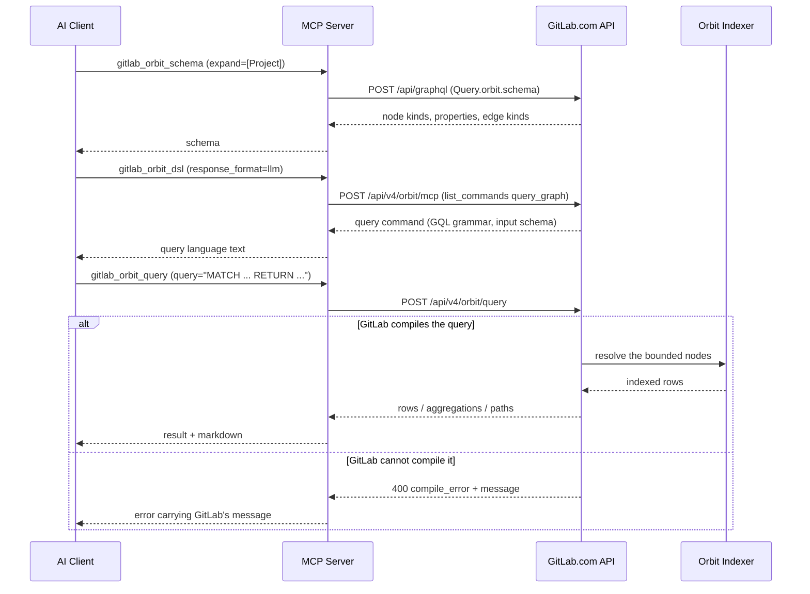

import FAQ from "../../../components/FAQ.astro";

Orbit exposes GitLab.com's experimental Knowledge Graph API through **six read-only MCP tools**: `status`, `schema`, `tools`, `dsl`, `query`, and `graph_status`. It is available **only** when the server connects to `https://gitlab.com` and the resolved tier is Premium or Ultimate (`GITLAB_MCP_TIER=premium` or `GITLAB_MCP_TIER=ultimate`, `--tier=premium` or `--tier=ultimate` in HTTP mode, or the tier detected from the instance license, then the namespace plans, then the top-level groups the token is a member of). The `GITLAB_ENTERPRISE` environment variable was removed in 3.0.0 and is ignored. Orbit never writes: every tool inspects health, schema, or indexed data, or runs a read-only graph query.

:::note[Technical reference]
For every action with its parameters, see the [Orbit knowledge graph](/gitlab-mcp-server/reference/tools/orbit/) page of the tool reference.
:::

## When is Orbit available?

Orbit registers only on GitLab.com connections with a Premium or Ultimate tier. It requires the `https://gitlab.com` host **and** a resolved tier of Premium or Ultimate. On the default dynamic surface its six actions are the `orbit.*` catalog entries reached through `gitlab_find_action` and `gitlab_execute_action`; with `GITLAB_MCP_TOOL_SURFACE=meta` it is the single `gitlab_orbit` tool with six actions; with `GITLAB_MCP_TOOL_SURFACE=individual` it is six `gitlab_orbit_*` tools. Every Orbit tool is read-only.

| Requirement               | Value                                         |
| ------------------------- | --------------------------------------------- |
| GitLab host               | `https://gitlab.com`                          |
| Tier                      | Premium or Ultimate                           |
| Dynamic surface (default) | `orbit.*` actions via `gitlab_execute_action` |
| Meta-tool mode            | `gitlab_orbit` with six actions               |
| Individual mode           | Six `gitlab_orbit_*` tools                    |
| Write behavior            | Read-only                                     |

Self-managed GitLab instances do not register Orbit tools, even on a Premium or Ultimate tier.

GitLab.com itself decides what it answers. Since Orbit's general availability on 29 October 2026, the plan no longer counts there: GitLab.com serves a group's index and queries only for a top-level group with the `orbit_promo` add-on or a running Orbit trial, and answers anything else with `403` or with nothing where the index would be. The server reports either as an error saying Orbit is not served to the token there, never as an empty result. The one exception says why: `graph_status` of a top-level group, asked with a token that has the Owner role there, returns the group's Orbit `access` and `trial`, which GitLab answers beside the missing index, and says that the index is missing because of the access, not because the graph is empty.

### Where each action reads from

GitLab.com removed five of the six REST routes Orbit used on 27 and 28 October 2026. Each action now reads the source GitLab offers in their place, a documented API where there is one, and the Orbit MCP endpoint only for what nothing else serves:

| Action         | Source on GitLab.com                                                                                            |
| -------------- | --------------------------------------------------------------------------------------------------------------- |
| `status`       | GraphQL `Query.orbit.serviceStatus`                                                                             |
| `schema`       | GraphQL `Query.orbit.schema`; `llm` from `get_graph_schema` of `POST /api/v4/orbit/mcp`                         |
| `tools`        | `tools/list` of the Orbit MCP endpoint, `POST /api/v4/orbit/mcp`                                                |
| `dsl`          | `list_commands` of the Orbit MCP endpoint                                                                       |
| `query`        | `POST /api/v4/orbit/query`                                                                                      |
| `graph_status` | GraphQL `Group.orbit` and `Project.orbit` (`indexing`, `itemCounts`, `enabled`, `enabledAt`, `access`, `trial`) |

## Actions

| Action         | Canonical ID         | Individual tool             | Purpose                                                        |
| -------------- | -------------------- | --------------------------- | -------------------------------------------------------------- |
| `status`       | `orbit.status`       | `gitlab_orbit_status`       | Check Orbit service health and component status                |
| `schema`       | `orbit.schema`       | `gitlab_orbit_schema`       | Inspect the graph schema and the properties of the nodes named |
| `tools`        | `orbit.tools`        | `gitlab_orbit_tools`        | List the tools GitLab's Orbit MCP endpoint serves              |
| `dsl`          | `orbit.dsl`          | `gitlab_orbit_dsl`          | Read the query language GitLab.com compiles queries in, GQL    |
| `query`        | `orbit.query`        | `gitlab_orbit_query`        | Execute a read-only Knowledge Graph query written in GQL       |
| `graph_status` | `orbit.graph_status` | `gitlab_orbit_graph_status` | Inspect indexing status for a namespace, project, or full path |

The action name is what the `gitlab_orbit` meta-tool takes in `action`; the canonical ID is what `gitlab_execute_action` takes on the default dynamic surface.

## What is the typical flow?

The typical Orbit flow learns the query language and the graph first and queries second, because the language and the ontology GitLab.com serves change during the beta. Confirm the service is up with `status`, read the query language with `dsl` and the graph with `schema`, then send a GQL statement to `query`.

1. Run the `status` action (`gitlab_execute_action` with `action: "orbit.status"` on the default surface; `gitlab_orbit` with `action: "status"` when `GITLAB_MCP_TOOL_SURFACE=meta`) to confirm the service is available.
2. Run `dsl` for the query language: the grammar of the command a query runs as and the JSON Schema of its input (`raw`), or the same as compact text (`llm`).
3. Run `schema` for the entities, their properties and the relationship types between them.
4. (Optional) Run `tools` for the tools GitLab's Orbit MCP endpoint serves, with the input schema of each.
5. Pass a GQL statement as text to `query`, with `response_format` set to `raw`, `llm` or `gql`.

### The query language

The `query` parameter of the `query` action is GQL, the read-only language based on openCypher 9 that GitLab.com compiles every query in since it turned the `orbit_gql_queries` flag on for everyone on 2026-10-15. A query is one statement:

```text
MATCH pattern [WHERE predicates]
RETURN projections
[ORDER BY key [ASC | DESC]]
[SKIP rows] [LIMIT rows]
```

GitLab infers what kind of query it is from the statement and says so beside the result as `query_type`: a traversal, an aggregation when `RETURN` holds an aggregate, the neighbors of one node, or a shortest path. The rules a model most often gets wrong:

- **Bound at least one node.** Every node carries a label where it first appears, and at least one is bounded by its id or a literal property, inline as `{id: 278964}` or `{full_path: 'gitlab-org/gitlab'}`, or in a `WHERE` comparison. `LIMIT` bounds nothing: `MATCH (p:Project) RETURN p LIMIT 5` is refused with "add filters or node_ids to at least one node".
- **A relationship type follows a colon.** `-[:IN_PROJECT]->` names the type, and `-[IN_PROJECT]->` declares a variable called `IN_PROJECT` and is refused. A repeat is bounded, `*1..3` at most, and `-[*1..3]->` follows any type.
- **`WHERE` takes `AND` and `NOT`, on one node's properties.** `OR`, `XOR`, `RETURN DISTINCT`, `count(*)`, `OPTIONAL MATCH`, `WITH` and `UNION` are refused, and a list is negated as `NOT p.visibility_level IN [...]`; `count(DISTINCT x)` counts distinct values. The comparisons are `=`, `<>` or `!=`, `<`, `<=`, `>`, `>=`, `IN`, `STARTS WITH`, `ENDS WITH`, `CONTAINS`, `IS NULL` and `IS NOT NULL`. Values are literals written into the statement, since the language takes no parameters.
- **The arrow decides the direction.** Between labeled nodes the arrow is `->` or `<-`, and each relationship is followed only in its defined direction: a merge request is `IN_PROJECT` its project. The undirected `--` is for the neighbors of one node, whose far end has a variable and nothing else: `MATCH (p:Project {id: 278964})--(n) RETURN n`.
- **A path has both ends bounded and names its relationship types.** `MATCH path = ANY SHORTEST (a)-[:TYPE*1..3]->(b) RETURN path`, with `a` and `b` each bounded; a wildcard such as `-[*1..3]->` is refused for a shortest path.
- **An aggregate is aliased to be sorted by.** `count`, `sum`, `avg`, `min` and `max` aggregate, and every other item of `RETURN` is a group key: `RETURN p, count(mr) AS mr_count ORDER BY mr_count DESC`. One sort key, with no tie-breaker.
- **A page is `SKIP` and `LIMIT`.** `SKIP` takes 0 to 10000 and `LIMIT` 1 to 1000, as in `ORDER BY p.id SKIP 20 LIMIT 20`. `PAGE` and `AFTER` are refused.

### When GitLab refuses a query

The server checks only that a query was given, as text; GitLab judges the rest. A query it cannot compile is answered with `400` and a message naming the fault, which reaches the model in the error text with a suggestion to correct the query from `dsl` and `schema`:

```text
orbit_query: bad request: check your input parameters ({code: compile_error}, {message: schema violation: add filters or node_ids to at least one node}). Suggestion: correct the query where GitLab's message points. orbit.dsl serves the query language and orbit.schema the entities, properties and relationship types it accepts: POST https://gitlab.com/api/v4/orbit/query: 400 ...
```

A syntax error is answered with its line and column and what GitLab expected there, and a name GitLab does not know with every name it does know, so the correction is usually in the message itself.

The JSON DSL GitLab.com read until 2026-10-15 is gone: GitLab.com removed it on 2026-10-27, and its query route takes the query as text. The `query` parameter is therefore a string, and an object is refused before anything is sent. A JSON query written as text still reaches GitLab.com, which parses it as GQL and refuses it, and the error says what to send instead:

```text
orbit_query: bad request: check your input parameters ({code: compile_error}, {message: schema violation: Orbit query syntax at line 1, column 1: expected Statement ...}). Suggestion: GitLab.com reads a query as GQL text, not as a JSON object. Send a GQL statement, such as MATCH (p:Project {full_path: 'gitlab-org/gitlab'}) RETURN p.id, p.full_path LIMIT 1. orbit.dsl serves the language and orbit.schema the entities, properties and relationship types it accepts: POST https://gitlab.com/api/v4/orbit/query: 400 ...
```

### Discover → query workflow

The recommended pattern is to read the graph with `schema` and the query language with `dsl` first, then execute a query through `query`. A `sequenceDiagram` fits because the steps involve four distinct actors (AI client, MCP server, GitLab.com, the Orbit indexer) and the response boundaries matter: the LLM should not assume the language `dsl` describes is stable, and a query GitLab cannot compile comes back with GitLab's own account of why.



The examples below use the default dynamic surface; with `GITLAB_MCP_TOOL_SURFACE=meta` call `gitlab_orbit` instead of `gitlab_execute_action` and drop the `orbit.` prefix from `action`. GitLab.com compiled every query among them on 2026-10-17.

### Example: Check Orbit status

```json
{
  "tool": "gitlab_execute_action",
  "arguments": {
    "action": "orbit.status",
    "params": {}
  }
}
```

### Example: Get graph schema

```json
{
  "tool": "gitlab_execute_action",
  "arguments": {
    "action": "orbit.schema",
    "params": {
      "expand": ["Project", "User"],
      "response_format": "llm"
    }
  }
}
```

### Example: Get Orbit tool manifest

```json
{
  "tool": "gitlab_execute_action",
  "arguments": {
    "action": "orbit.tools",
    "params": {}
  }
}
```

### Example: Read the query language

```json
{
  "tool": "gitlab_execute_action",
  "arguments": {
    "action": "orbit.dsl",
    "params": {
      "response_format": "llm"
    }
  }
}
```

### Example: Run a Knowledge Graph query

```json
{
  "tool": "gitlab_execute_action",
  "arguments": {
    "action": "orbit.query",
    "params": {
      "query": "MATCH (p:Project) WHERE p.full_path STARTS WITH 'gitlab-org/' RETURN p.id, p.full_path LIMIT 20",
      "response_format": "llm"
    }
  }
}
```

### Example: Count merge requests per project

```json
{
  "tool": "gitlab_execute_action",
  "arguments": {
    "action": "orbit.query",
    "params": {
      "query": "MATCH (mr:MergeRequest)-[:IN_PROJECT]->(p:Project) WHERE p.full_path STARTS WITH 'gitlab-org/' RETURN p, count(mr) AS mr_count ORDER BY mr_count DESC"
    }
  }
}
```

### Example: Everything a project is related to

```json
{
  "tool": "gitlab_execute_action",
  "arguments": {
    "action": "orbit.query",
    "params": {
      "query": "MATCH (p:Project {full_path: 'gitlab-org/gitlab'})--(n) RETURN n LIMIT 50"
    }
  }
}
```

### Example: A path from a merge request to its project

```json
{
  "tool": "gitlab_execute_action",
  "arguments": {
    "action": "orbit.query",
    "params": {
      "query": "MATCH path = ANY SHORTEST (mr:MergeRequest {source_branch: 'master'})-[:IN_PROJECT*1..2]->(p:Project {full_path: 'gitlab-org/gitlab'}) RETURN path"
    }
  }
}
```

### Example: Check indexing status

```json
{
  "tool": "gitlab_execute_action",
  "arguments": {
    "action": "orbit.graph_status",
    "params": {
      "project_id": 278964
    }
  }
}
```

## Action details

### `status`: Check Orbit service health

Returns the health of the Orbit service: its overall `status` (`HEALTHY`, `DEGRADED`, `UNHEALTHY`, `MIGRATING` or `UNKNOWN`), its `version`, and the `name` and `status` of each component. GitLab answers it through GraphQL in one shape, so `response_format` is accepted and changes nothing. A token Orbit is not served to gets an error saying so rather than an empty status.

**Example:** See above.

### `schema`: Inspect the graph schema

Returns the node kinds and edge kinds a query names: each node's `name`, `description`, `domain`, `primary_key`, `label_field` and `display` (color and size), each edge's `name`, `description` and the source and target node kinds it connects (`variants`), and the `domains` with the node kinds in each. Name node kinds in `expand` to get their `properties` (name, data type, whether it can be empty, and the values of an enum). With `format` or `response_format` set to `llm` it returns the schema as compact text instead.

**Example:** See above.

### `tools`: List the Orbit MCP tools

Returns the tools GitLab's Orbit MCP endpoint serves (`list_commands` and `invoke_command` today), each with its description, its input schema as `parameters` and its `trusted` flag. The query language itself is what `dsl` returns.

**Example:** See above.

### `dsl`: Read the query language

Returns the query language GitLab.com compiles queries in, GQL, as GitLab.com publishes it: the `query_graph` command a query runs as, its grammar and the JSON Schema of its input (`raw`, the default), or the same as compact text (`llm`). It reads `list_commands` of the Orbit MCP endpoint, which answers the command list the removed `GET /api/v4/orbit/agent/commands` did.

**Example:** See above.

### `query`: Execute a Knowledge Graph query

Runs a read-only Knowledge Graph query. The `query` parameter is a GQL statement sent as text, in the language `dsl` describes, naming entities, properties and relationship types `schema` lists. GitLab judges the query and answers one it cannot run with a message naming the fault, which the server passes on. Supports `response_format`: `raw` (structured JSON, the default), `llm` (compact text) or `gql` (the result as a graph pattern table, text like `llm`).

**Example:** See above.

### `graph_status`: Inspect indexing status

Returns the Orbit index of one group or project, named by `namespace_id`, `project_id` or `full_path`: whether Orbit is turned on for its top-level group and since when (`enabled`, `enabled_at`, sent for a group), the project counts (`indexed`, `total_known`, `gaps`, `not_indexed`, `total`), the indexing `state` (`READY`, `INDEXING`, `NOT_STARTED`, `FAILED` or `UNKNOWN`) with the time of the last completed run and the state of each area, and the number of indexed items of each entity in each domain. Use it to check that a project is indexed before querying it. `response_format` is accepted and changes nothing.

For a top-level group, to a token with the Owner role there, it also returns the group's Orbit `access` and `trial`, which say whether GitLab.com serves the index at all, with GitLab's names and values:

- `access`: its `state` (`LICENSED`, `TRIAL_ACTIVE`, `TRIAL_ELIGIBLE`, `TRIAL_ENDED`, `TRIAL_NOT_ELIGIBLE`, `TRIAL_STATUS_UNAVAILABLE`, `UNLICENSED` or `NOT_CONFIGURED`), the `reason` of a state with more than one cause (where a licensed group's access comes from, `PLAN`, `PROMO_ADD_ON` or `BETA`, or why a group has none), and the `turn_on_denial_reason` that says why the token's user cannot turn Orbit on.
- `trial`: its `state` (`ELIGIBLE`, `NOT_ELIGIBLE`, `ACTIVE` or `ENDED`), its last day (`expires_on`), its `credits` (`remaining` and `total`) and, for a user who can start one, the `offer` of a new trial (`duration_days` and `initial_credits`).

GitLab.com serves the index under `LICENSED` or `TRIAL_ACTIVE` access. A top-level group it answers with its access and no index is returned with them rather than as an error, and the card says in a line of its own why the index is missing: the access under any other state, and Orbit turned off, or one of the reasons GitLab documents for a missing index, under those two. GitLab answers neither for a subgroup or a project, nor to a token without the Owner role in the group, so they are absent there; ask the top-level group's `full_path` for them with an Owner's token. A subgroup or project whose index GitLab does not serve is an error that says so.

**Example:** See above.

### What changed in 3.4.0

The six action IDs, tool names and parameters are the ones of earlier releases. What GitLab no longer sends anywhere left the outputs with the routes:

- `status`: the `user` and `system` objects, `timestamp`, `formatted_text`, and each component's `replicas` and `metrics`. A component's `status` and the overall `status` are now GitLab's upper-case states.
- `schema`: `schema_version`, each domain's `description`, and each node's `incoming_edges` and `outgoing_edges`, which the edges list carries pair by pair. Nodes are typed now, with `primary_key`, `label_field` and `display` added.
- `graph_status`: `formatted_text`, each item's `state`, and the last run's `last_started_at`, `last_duration_ms` and `last_error`. Added: `enabled`, `enabled_at`, `not_indexed`, `total`, the areas of `indexing`, and a top-level group's `access` and `trial`. A top-level group GitLab.com serves no index is answered with its access and trial instead of an error.
- `tools`: each tool's `trusted` flag added.
- `query`: the `query` parameter is a string. It took a JSON object as well, the JSON DSL GitLab.com removed on 27 October 2026, which GitLab.com refuses whatever it holds.

## How do I discover query schemas?

On every surface, action parameter schemas are available through MCP resources, so you can learn the exact `params` shape of each Orbit action without expanding every schema in `tools/list`; on the dynamic surface `gitlab_find_action` returns the same schema inline. These resources remain available with `GITLAB_MCP_CAPABILITY_SURFACE=full` or `minimal`, regardless of `GITLAB_MCP_META_PARAM_SCHEMA` mode. The table lists the default-surface IDs; with `GITLAB_MCP_TOOL_SURFACE=meta` the entry is `gitlab://tools/gitlab_orbit.<action>`.

| Resource                            | Purpose                                |
| ----------------------------------- | -------------------------------------- |
| `gitlab://tools/orbit.status`       | Parameters for service health checks   |
| `gitlab://tools/orbit.schema`       | Parameters for ontology inspection     |
| `gitlab://tools/orbit.tools`        | Parameters for tool manifest discovery |
| `gitlab://tools/orbit.dsl`          | Parameters for the query language      |
| `gitlab://tools/orbit.query`        | Parameters for Knowledge Graph queries |
| `gitlab://tools/orbit.graph_status` | Parameters for indexing status checks  |

<FAQ />
